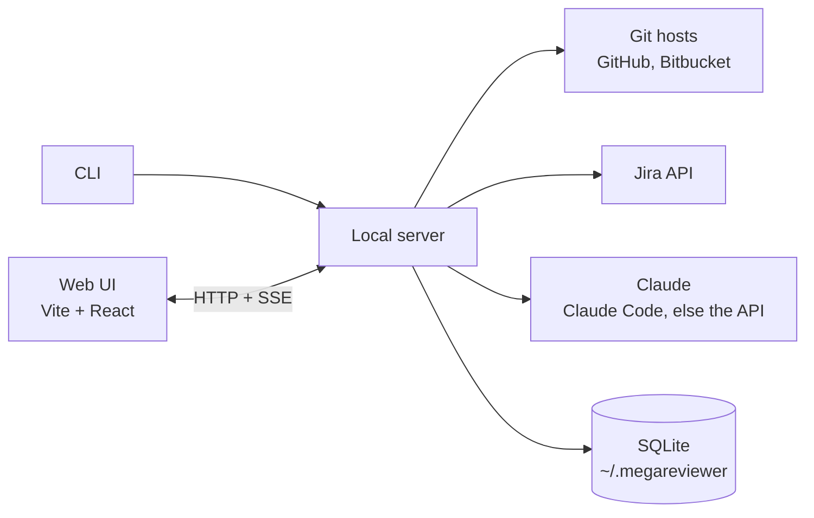

# Architecture

How megareviewer is built. [DESIGN.md](DESIGN.md) covers what it does and why.

## Shape: local-first, no server of ours

megareviewer is a CLI that serves a web UI on the user's machine:

```
npx megareviewer
```

It starts a local server on `127.0.0.1`, opens the browser, and does everything from there. Code, credentials and results never touch infrastructure we run.

Why:

- **Nothing to host or pay for.** Users bring their own Anthropic credentials.
- **Privacy is simple to explain.** "Your code never leaves your machine, except to the model provider" makes security reviews easy.
- **A local process can do what a browser page can't.** It can call Jira and Bitbucket (which block cross-origin browser requests), reuse the `gh` token, read the local git checkout, and later read agent transcripts on disk. The checkout is read when there is one (see [Local checkout](#local-checkout)) and never changed.

Costs we accept:

- **No shared state between reviewers.** The git host is the shared store: the review is published back to the PR.
- **Each reviewer pays for their own analysis.** A CI step that precomputes it is the later fix.
- **No webhooks,** so analysis starts when the PR is opened in the UI. Results stream so the intent summary shows up first.

## Git hosts

Supported: **GitHub** and **Bitbucket Cloud**.

The pipeline and UI never talk to a host directly. Each host is a connector behind one interface:

| Operation | GitHub | Bitbucket Cloud |
|---|---|---|
| Get PR (title, description, branch, head SHA) | `GET /repos/{o}/{r}/pulls/{n}` | `GET /2.0/repositories/{ws}/{repo}/pullrequests/{id}` |
| Get commits | `.../pulls/{n}/commits` | `.../pullrequests/{id}/commits` |
| Get diff (unified) | `.../compare/{base}...{head}` at the PR's SHAs, with diff media type, so a push while loading can't mismatch diff and head SHA | `.../diff/{head}..{dest}?topic=true` at the PR's commits: the same three-dot diff the PR's diff endpoint redirects to, pinned the same way |
| Get files at commits | One GraphQL query per 3 files, 6 at a time (`object(expression: "sha:path")`); `.../contents/{path}?ref={sha}` for a file GraphQL truncates or won't give as text | `.../src/{sha}/{path}`, one request per file, 18 at a time |
| List PRs to review | Search API (`review-requested:@me`, `author:@me`) | PRs to review: per repo, the 50 most recently updated of the configured workspace. Own PRs: one workspace-wide call |
| Which PRs opened before are still open | One GraphQL query, a `repository.pullRequest(number)` alias per PR | `.../pullrequests/{id}`, one request per PR, 5 at a time |
| Publish review | One PR review with inline comments and a verdict | Approve or request changes, plus one call per inline comment |
| Review threads | GraphQL `pullRequest.reviewThreads`, 100 a page, with each thread's comments | `.../pullrequests/{id}/comments`: an inline comment without a parent starts a thread, `parent.id` chains replies, deleted ones are left out |
| Reply | GraphQL `addPullRequestReviewThreadReply` on the thread's ID | `POST .../comments` with `parent: {id}` |
| Comment now | `POST .../pulls/{n}/comments` with `commit_id` the analysis's head, `line`, `side` and, for a range, `start_line` | `POST .../comments` with `inline` on the last line, the range named in the body |
| Resolve, reopen | GraphQL `resolveReviewThread`, `unresolveReviewThread` | `POST .../comments/{id}/resolve`, `DELETE` the same |
| PR status (state, reviewers, checks) | One GraphQL query: the PR's `state`, `isDraft`, `reviewDecision`, `reviewRequests`, `latestReviews` and `latestOpinionatedReviews`, and the `statusCheckRollup` of the analysis's head commit | `.../pullrequests/{id}` for `state`, `draft` and `participants`, and `.../commit/{head}/statuses`, in parallel |

Both hosts return a unified diff, so hunk splitting and everything after it is shared.

Bitbucket specifics:

- **No cross-repo "waiting for my review" search.** The picker scans the 50 most recently updated repos of the configured workspace. A pasted PR URL always works.
- **Publishing isn't atomic.** Comments are posted one by one, so the server records each posted comment and skips it on retry, avoiding duplicates after a partial failure.
- **Inline comments anchor on the PR's current diff,** not on a commit. Publishing refuses when the PR has new commits since the analysis, so comments can't land on the wrong lines.

Flaky networks: on a lossy link, one dropped request used to fail the whole analysis, and a stalled one could hang for minutes. So:

- **Every read times out after 60 seconds** and fails as a network error.
- **Reads that fail on the network are retried** three times, after 1, 2 and 4 seconds. One wrapper around every host does this, so both hosts share the policy. Other failures, such as a rate limit or a missing PR, are answers and aren't retried.
- **Files come in small batches over several connections.** On a slow link each connection is slow on its own: one 250 KB GraphQL answer took 13 to 18 seconds while GitHub had started answering within 2, and the same files as ten parallel requests took 4 to 8. Through a proxy capping each connection at 20 KB/s, megareviewer #1's 49 files took 21 seconds in batches of 10, two at a time, which was the first version, and 11 in batches of 3, six at a time. On a fast link the smaller batches were no slower (1.2 to 1.9 seconds against 1.8 to 3.6). Batches of 2, eight at a time, gained nothing more.
- **Publishing is never retried and has no timeout.** A post that failed on the network may still have been posted, and retrying it would post it twice. The reviewer retries it, and the posted-comment records skip what's already there.
- **Threads and the PR's status follow the same rules.** Reading them is retried like any read; replying, resolving and commenting now are writes, never retried and without a timeout. A reply that failed keeps its text in the field, so sending it again is the reviewer's call.

## Local checkout

The checkout is the directory given with `--checkout`, or else the one megareviewer runs in. It's read when it has the PR's head commit, whatever its remotes say: the commit pins every file's content, so a fork's checkout, or one cloned before its owner was renamed, reads the same. Requiring a remote that names the PR's repository was the plan, and refused delphi-code's own checkout, whose remote still names its owner's old account. The remotes only decide what the page says when the commit is missing: with one that names the repository, that a `git fetch` would bring it; without, that no checkout was found. `doctor` names the checkout and the repositories its remotes name.

Reading runs `git` without a shell and without a new dependency: `cat-file -e` for the commit, `ls-tree` for the files at it, and `cat-file --batch` for many files in one process, after `--batch-check` skips those over 1 MB. Nothing it runs fetches, checks out or writes, so the reviewer's working tree stays as it is. A failure to read is a warning on the analysis, never a failed analysis.

It's used for one thing so far: the unchanged callers of what the PR changes (see prep).

## Components



| Component | Role | Tech |
|---|---|---|
| CLI | Checks credentials, starts the server, opens the browser | Node 22.13+, TypeScript |
| Local server | Serves the UI and the API, runs the analysis pipeline, holds all credentials | Hono |
| Web UI | PR picker, review page, publishing | Vite, React, Tailwind CSS, shadcn/ui on Base UI, Shiki |
| Connectors | Git hosts, tickets, model calls, the local checkout | Octokit, Bitbucket REST, Jira REST, the `claude` and `codex` commands, `opencode serve` over HTTP, `@anthropic-ai/sdk`, the `git` command |
| Code analysis | Parse changed files for mechanical proofs and call-graph hints | `web-tree-sitter` |
| Store | Cached analyses and review state | SQLite via built-in `node:sqlite`, plain SQL migrations |

It ships as one npm package. The server is bundled into a single file with no runtime dependencies, and the UI is prebuilt and served as static files. A tiny launcher runs first and checks the Node version, so Node older than 22.13, the first with `node:sqlite` unflagged, gets a clear message instead of a failed import of `node:sqlite`.

## Why TypeScript everywhere

- **The UI is TypeScript anyway.** Using it for the server too means one language, one toolchain, and one set of Zod schemas shared by the model calls, the server and the UI.
- **The libraries we need are first-class in TypeScript.** Octokit, the Anthropic SDK with Zod helpers, and tree-sitter's WASM build.
- **Easy install.** `npx` works on almost every developer machine with nothing extra to install.

Trade-offs we accept, and how we limit them:

| Trade-off | Mitigation |
|---|---|
| npm supply-chain risk in a tool that holds credentials | The server is bundled at publish time, so users install one package with no dependencies and no third-party install scripts. No native modules (hence `node:sqlite`). Few dependencies (see [ENGINEERING.md](ENGINEERING.md)). |
| Users need Node | Bun can compile the same code into a single binary if that becomes a blocker. |
| Weaker for heavy analysis later | The HTTP API between UI and server is the seam: the server can be rewritten in Go without touching the UI. |

Alternatives considered:

- **Go server + TypeScript UI:** a single binary and a smaller attack surface, but two toolchains and a schema generated for both. We'd switch if security-sensitive buyers or install friction become the blocker.
- **Rust:** no official Claude SDK, and slower iteration that doesn't pay off for mostly-network work.
- **Python:** the hardest to install on users' machines.

## Releases

Versions are published to npm from CI: pushing a `v*` tag runs every check, builds the package, and publishes it with npm provenance. Users can verify that a version was built from this repository at a given commit, which matters for a tool that holds their credentials. Publishing from a laptop was the alternative; it's simpler, but nothing ties the published files to the source. megareviewer is MIT-licensed.

## Credentials

| Service | Source | Required |
|---|---|---|
| GitHub | `GITHUB_TOKEN`, else `GH_TOKEN`, else `gh auth token` | For GitHub PRs |
| Bitbucket Cloud | `BITBUCKET_EMAIL` + `BITBUCKET_API_TOKEN` (scoped Atlassian API token), else `BITBUCKET_USERNAME` + `BITBUCKET_APP_PASSWORD`; `BITBUCKET_WORKSPACE` for the picker | For Bitbucket PRs |
| Claude | Claude Code's own sign-in, through the `claude` on the PATH; else the SDK's resolution: `ANTHROPIC_API_KEY`, else an `ant auth login` profile | For Request AI review, which says why it can't run without either |
| OpenAI | Codex's own sign-in, through the `codex` on the PATH | No. Without it, OpenAI's models are listed, disabled, in Request AI review's menu |
| opencode | The providers the reviewer connected in their opencode, through the `opencode` on the PATH | No. Without it, its row in Request AI review's menu is disabled with the fix |
| Jira | `JIRA_BASE_URL`, `JIRA_EMAIL`, `JIRA_API_TOKEN` | No. Without it, ticket keys are shown but not fetched |

Bitbucket app passwords are accepted because existing setups for other tools often have them, and both kinds are the same Basic auth to the adapter. Atlassian removed app passwords in July 2026, so `doctor` points to an API token when one is rejected; rejecting them outright at startup was the alternative.

megareviewer never reads Claude Code's credentials: it runs the unmodified `claude`, which signs its own requests, and removes `ANTHROPIC_*` and `CLAUDE*` variables (but `CLAUDE_CONFIG_DIR`) from its environment, since an API key there would make Claude Code bill the API while the startup line says the plan. Claude Code can run the passes when it's installed, signed in and no older than the version megareviewer was checked with, and the API when the SDK finds credentials. Each is a provider of the model options the reviewer chooses from (see Model passes); both are asked at once whenever the status is, 5 seconds each, so a hung `claude` can't hold the page. One that can run is kept for the process; one that can't is asked again on the next status request, so signing in to Claude Code needs no restart. Without a choice, a run uses Sonnet 5.5 on Claude Code when it can, else on the API, else GPT-6 Sol on Codex, else opencode's own default model. Claude Code only was the alternative: it would break the model for everyone set up with a key. A flag to force one, `--ai-via`, went with `--ai`.

Codex is to a ChatGPT plan what Claude Code is to a Claude plan, and is the third provider, after both of Claude's. megareviewer never reads its credentials (`~/.codex/auth.json`): it runs the unmodified `codex`, and removes `OPENAI_*` and `CODEX_*` variables (but `CODEX_HOME`) from its environment, since `CODEX_API_KEY` wins over the ChatGPT sign-in. `codex --version`, `codex login status` and `codex debug models` say whether it can run, whether it's on a plan ("Logged in using ChatGPT") or an API key, and which models the account has. The OpenAI API with a key was the alternative; it's the one way to run OpenAI's models with no tools at all, but it can't spend a ChatGPT plan, and it's left for when someone asks.

opencode is the fourth provider: one command in front of whichever model providers the reviewer connected, local ones among them, so every model it can reach is an option without megareviewer learning each vendor's API or holding a key. megareviewer starts one `opencode serve` of its own on the first status request, on 127.0.0.1 at a port it picks, with a random password, in a new empty directory, and stops it on close; one that dies is started again on the next use. It never reads opencode's stored credentials: `opencode --version` says it's installed, and the server's `GET /api/model` lists the models its providers offer. The reviewer's opencode config is read, since that's where providers are defined, but not the project's or Claude Code's, and opencode's own free models are left out (`OPENCODE_DISABLE_FREE_MODELS`): they run on opencode's inference service, which the reviewer never connected. Pointing opencode at an empty config directory was the alternative; it would hide every provider configured in a file, which is how local models are added. Attaching to an opencode server the reviewer already runs was the other: megareviewer starts its own, so it knows the config it runs under. 2.3.0 is the first version whose server megareviewer speaks; an older one isn't started.

At least one git host must be configured. Credentials stay in the server process and are never sent to the browser.

## Analysis pipeline

Input is a PR URL from either host. Output is one analysis, cached by `(host, repo, PR, head SHA, pipeline version)`, so reopening a PR is instant and a new push triggers a fresh analysis. The pipeline version says whether a local checkout was read, so reopening a PR once the checkout has its head commit analyzes again. The model isn't in it: its passes add to the analysis.

An analysis is complete after prep, with the four model stages not run (`skipped`). The model passes run when the reviewer asks for them on the page, with Request AI review (`POST /api/analyses/:id/model`, with the chosen option's ID or none for the default; an unknown option is a bad request, and one that can't run is refused with its reason), on that analysis in place, so the reviewer's drafts, verdicts and place stay. The run collects and preps again from the stored PR, its files from `file_contents` and prep being deterministic, then runs the passes. Its failure is the analysis's `modelError`, shown beside the button with Try again; the analysis stays complete, so the reviewer keeps reviewing while the passes run. An analysis is in progress while its code's stages or the model's run, and its events stream until neither does. Starting the same PR's analysis with the model on, under another ID, was the alternative: drafts are kept per analysis and wouldn't follow. A model run a stop interrupts is failed at the next start, as an analysis is.

Remove AI review, beside the usage line under the code, takes a run off again (`DELETE /api/analyses/:id/model`) after asking, so the passes can be tried again on the same PR: the code's stages run again in place under the same ID, and the states of Claude's points go with it, so a new run's `f1` doesn't take an old one's dismissal. The reviewer's drafts and a publication's record stay. Resetting only the model's fields was the alternative; the model's risk is merged into the rules', so only running the code again gives back exactly what the code made. Every model call is kept with the analysis, a failed one too: its pass, attempt, start, duration, and what came of it, an answer, the problems the checks found in it, which a retry is told, or the error, with why. Run details, beside the usage line, lists them in the order they started, timed from the run's first call, and the server logs each with the same fields. Both name the run's option, "Sonnet 5.5 through Claude Code", which the analysis records when the run starts; analyses stored before the choice have none, and were all Haiku 5.5. On delphi-code #2 the findings pass ran twice and took 4 of the run's 5 minutes, and nothing said why: usage kept only the calls that answered, without their problems, and the log line said how many problems there were, not what they were, in a terminal that was gone by the time anyone asked. Keeping it in the log alone was the alternative; a run is looked at on its page, often long after the server that ran it.

### 1. Collect

- PR title, description, branch name, commits, and the diff, from the host connector.
- Base and head contents of each changed file, for parsing and context.
- Jira tickets: keys matching `[A-Z][A-Z0-9]+-\d+` in the description, commit messages and branch name, fetched from Jira.
- Whether the local checkout has the PR's head commit, decided before the analysis starts, since its pipeline version says so.

### 2. Deterministic prep (no model)

- Split the diff into hunks with stable IDs. Every later stage refers to hunks by ID.
- Mark hunks as **mechanical with proof** when a check proves it:
  - generated or vendored files (lockfiles, `linguist-generated` in `.gitattributes`, known build output);
  - whitespace-only changes;
  - pure renames (rename headers in the diff with no content change);
  - moved code (removed and added blocks match after normalization);
  - formatting-only changes (tree-sitter syntax trees are identical before and after).
- Split each hunk without a proof into **parts**, one per definition it changes. A hunk is whatever git put between two unchanged stretches, so one can hold three routes, and the tour could place it only once: on delphi-code #2, three routes added in one hunk made one flow of 32 of the 48 hunks. The cut is at the outermost definitions that start or end inside the hunk, so a class around a block of methods cuts at its methods. Deleted lines go with the definition around them in the base file, and an unchanged line shared by a base and a head definition makes them one, so a renamed method stays one part. Lines outside any changed definition (imports, decorators, comments, unchanged stretches) join the next part. Tests split too. A proved hunk is never split, since its proof is about the whole hunk. Proofs, decisions, comments and risk stay per hunk; hints and the tour are per part.
- Build call-graph hints with tree-sitter: which changed symbols are defined, and which changed code calls or uses them. A use links to a definition only in its own file or in a file its imports reach, never across languages or from code into tests, and a type annotation isn't a use. Matching names across the whole PR was the first version: on a real PR it linked Python and TypeScript files that shared a class name, pointed production code at test fakes, and joined most of the PR into one tour step. A missing link hides no code, so the hints err toward fewer.
- Find the **call sites**: every use, on a part's lines, of a definition the PR changes, by the hints' rules, with its line and column, for the page to show the code a call runs. A hint keeps the first line a name is used on, at most 10 per hunk, and the first part that changes a definition, which is what the tour needs; a site is every use, uncapped, reaching every part that changes the definition. On delphi-code #2 that's 128 sites beside 105 hints. The parser gives each reference the column of every use on its line, in UTF-16 units, as the page's strings count.
- Link changed files by their imports, by the same rules, for the overview: an import that reaches another changed file is a link, even where no hint does, such as an app importing the module that registers its routes.
- Link requests to routes, across languages: a call that names an HTTP method and a literal path (a typed or generated client, `fetch` and the like, a test client in a test) links to the part that adds the route serving it. Methods match exactly and paths segment by segment, a placeholder in any syntax matching one segment. A base prefix the client adds isn't in the code, so a request also matches after dropping its leading segments, but only when that leaves one route. Hints stop at a language, so a full-stack PR was two islands: on delphi-code #2, nothing linked the page to the three routes it calls.

- With a checkout, find the **unchanged callers** of what the PR changes: code outside the PR that calls a definition the PR changes, or names it as a type, which is where a regression shows. A changed definition is one the base file has and whose own lines the PR adds or deletes, not counting nested definitions or blank lines, so a class that only gains methods isn't one. Callers are found by the hints' rules: through imports (or the package, in Go and Java), within a language family, never from code into tests, and not type uses of generated files. Only files in the PR's languages whose text names a changed definition are parsed, and languages whose imports aren't read are left out. At most 50 uses per definition are kept, code first, with the rest counted. Matching names across the repository was measured first: on delphi-code #2 it found 357 uses in 83 files, almost all other things named `state`, `to_json` or `main`. Following imports leaves 6: `create_app`'s three callers, the one of `clone_credentials`, whose order of credentials the PR changes, and the page that renders `CredentialsGuide`. One level only; callers of callers would need the same reading again.
- Classify every remaining hunk as *contract* or *logic* with rules on its file's path: dependency manifests, schemas and migrations (an `openapi*` or `swagger*` file among them), CI and infrastructure, repository config, app config, and auth or security paths. A rule can only raise a hunk to *contract*; one no rule matches is *logic*. The rules read what a file is, never the names or text in it. A security path skips test code (tests, and helpers named fake, mock, stub or fixture), and doesn't make a hunk contract when every line it changes is inert: blank, a comment, an import, a string, an UPPER_CASE constant set to a literal, a closing bracket, or, in markup, a tag with literal attributes or plain text. The rules' contract is internal: it orders the tour and keeps a hunk contract after the model's pass, and the page never shows it. What the reviewer sees is the model's contract, as a risk. Line rules were the version before: credential storage and authorization read from the shape of a name (`save_secret`, `require_permission`), credential endpoints from a changing route with a `token`-like segment, risky calls from regexes on added lines (`eval(`, `subprocess`, `shell=True`), and removed or skipped tests from counts of declarations and skip markers. Probed with counterexamples, each failed both ways: a lexer's `clear_tokens()`, `Notification.requestPermission()`, `POST /llm/tokens`, "subprocess" in a log message and two tests merged into one were contract, while `localStorage.setItem("token", …)`, a removed owner check, a removed `@login_required`, `POST /login`, `spawn("sh", ["-c", cmd])`, `pickle.loads`, a deleted assertion and `@unittest.skip` were logic. Risk is about behavior, what a check guards, what a response exposes, what an assertion still proves, and a name doesn't say it; longer word lists only move the edges. Behavior-level risk is the model's, with Request AI review. On delphi-code #2 the line rules made 10 hunks contract and path rules alone make 3: keychain.py, on a security path, and openapi.json's two.
- Build the tour from the call-graph hints, as flows. The page doesn't show it as steps (see Map); its flows order and label the overview. A flow starts at an entry point a user or caller reaches (an HTTP route, a page, a command), found by framework markers on added lines, and reads the changed code it runs, callers before callees. Code that more than one flow runs is read once, in a shared section before them, and each of those flows passes through it: one section per connected piece of shared code, with the tests of that code, titled `Shared:` and where the flows enter it, and saying which steps use it. A section is a flow step without entries. Reading shared code in the first flow that reached it was the first version: on delphi-code #2 the GET flow read 37 of 73 parts, most of them the connection and keychain code that PUT and DELETE run too. With shared sections the largest step has 23 parts and GET 21, and every part is still placed once. Code an earlier flow read is linked from the next flow instead of shown again. Types, imports, tests and docs join the flow they belong with; what no flow runs goes into supporting steps: API schema, docs, tests, and other changes by area. Shared sections come first, then flows that reach contract hunks. The tour has no step cap: merging unrelated code to meet one would hide the story. Grouping the files the call graph connects was the first version: its steps were whatever happened to connect, titled by a chain of symbols, and on a real PR one step held 33 of 48 hunks. Code that registers an entry, like a router the routes are declared on or an app adding that router, is read first in the first flow it registers. A request never extends a flow: the flow passes through the route in an earlier step, says what it sends, and comes after the route's flow. A page flow that walked into the backend would read the whole PR. A test that requests a route joins that route's flow.
- Join back the parts the tour read together: consecutive parts of one hunk in the same step become one part again, and a hunk read in one step is whole again. Splitting without joining gave 115 parts on delphi-code #2, one file in 29 pieces, too fine to read; with joining, 8 of its 48 hunks stay split, into 32 parts, and each of its three routes is a flow of its own. The model's passes see whole hunks: its input maps hints back to hunks.

The model can't override a mechanical proof. It only classifies the hunks that remain, and a hunk a rule marks *contract* stays *contract* whatever the model says. The tour is the code's alone.

### 3. Model passes

Only when the reviewer asks, on the **model option** they choose: a model on a provider, which is what runs the passes and decides who pays. The same model on two providers is two options, since the bill differs. A provider answers its own status and its options, and the list is their answers together: Haiku 5.5, Sonnet 5.5 and Opus 5.5 on Claude Code, then the same three on the Anthropic API, then GPT-6 Luna and GPT-6 Sol on Codex, those of them the reviewer's `codex debug models` lists, then every chat model the reviewer's opencode offers, grouped by the provider behind it. One list of models, with the provider picked for them, was the alternative; it hides who pays, which is what a reviewer chooses by. A model is listed once the evals have run on it, with its scores in a report under `evals/reports/`, because the prompts were tuned on Haiku and a wrong finding costs the reviewer more than a missed one; listing every model a provider serves was the alternative. opencode's are the exception: they're whatever the reviewer connected, and the evals can't run on all of them, so every one is listed, marked unmeasured; listing only models measured elsewhere would leave out local models, the reason to use opencode. The analysis records the option its run used, and the page names it (see UI); Remove AI review and a new run is how another model is tried on the same PR. One option runs all four passes, with the same prompts: a model per pass, or prompts per model, would each be a model the evals haven't measured.

The default, when the reviewer hasn't chosen, is **Sonnet 5.5** (`claude-sonnet-5-5`) on the first provider that can run it. On the 14 eval cases through Claude Code it met 9 of the 12 targets against Haiku's 7: no wrong findings where Haiku had 21% (6 of 28), 7% of its decisions noise against 36%, and every contract hunk marked where Haiku missed 4 of 25 (`evals/reports/2026-11-14/`). It was faster too, about 3.5 minutes for the run against 6, because it writes a quarter of Haiku's output tokens. It costs about 4× Haiku at API prices, $0.17 a case against $0.04, and on a plan more of its usage limits. Haiku stays the default was the alternative; the cost is still cents a PR, and the menu offers Haiku to a reviewer who wants it. Opus 5.5 met 8 targets at more than twice Sonnet's cost.

Each Claude model's ID, name, price, input budget, output limit under each transport and the efforts it accepts are in one table in the adapter, `src/adapters/model/claude/models.ts`, and each OpenAI model's slug, name and price in `src/adapters/model/codex/models.ts`, its context window and efforts coming from Codex's catalog; a pass whose effort a model doesn't accept runs at the nearest one it does. The prompts, input rendering, output schema and pass model every provider shares are in `src/adapters/model/shared/`, apart from Claude's transports, so a provider imports only those, never another provider; the dependency rules check it.

Every pass answers with JSON checked by the same Zod schema, through one of four transports that share the prompts and the input rendering. Three enforce the schema as structured output:

- **Claude Code,** the default: one `claude -p` process per pass, on the reviewer's own Claude plan, so a review isn't billed per token on top of a plan they already pay for. The Messages API can't spend a plan; Claude Code can. Each runs without a shell in a new empty directory, with no tools but the schema's `StructuredOutput`, no MCP servers, settings, skills, commands or saved session, and the answer comes back as the stream's `structured_output`. Claude Code has no token count, so the size check estimates tokens from the prompt's bytes, high on purpose: 1.9 bytes a token and 2,000 tokens for its own, where the eval cases measured 2.06 and about 1,550.
- **The Anthropic API,** the fallback: one streaming request per pass with the SDK.
- **Codex,** for OpenAI's models: one `codex exec` per pass, on the reviewer's ChatGPT plan. Each runs without a shell in a new empty directory, with our instructions in place of Codex's (`model_instructions_file`, which also saves about 4,300 tokens a call), the answer's schema as `--output-schema`, the read-only sandbox, `--ephemeral` so the review isn't in the reviewer's Codex history, and none of their config, rules or `AGENTS.md`. The answer is the last message's text, parsed as JSON and then with the same Zod schema. Its size check estimates 3 bytes a token after 6,000 of Codex's own, where the eval cases measured 3.36 to 5.19 bytes and about 5,300 tokens, against the model's context window less 32,000 for the answer. Codex reports tokens and no cost, so the cost is computed at OpenAI's API prices, or absent for a model without one.
- **opencode,** for the models of the reviewer's own providers: a session per pass on the one server, run as an agent megareviewer defines in the server's config, whose system prompt is the shared one. opencode 2.3.0 has no structured output a prompt can ask for, so the pass's task ends with the JSON schema of its own answer, its variant of the union, and asks for one JSON object and nothing else; the answer's text is parsed, a code fence or a sentence around it tolerated, and checked by the same Zod schema, and the pipeline retries an invalid one once as for any transport. Provider-native structured output through a provider's request body was the alternative: each provider package names the field differently, the config is fixed for the server's life, so one schema for every pass, and Anthropic refuses the union as too large a grammar. On delphi-code #2 through Haiku 5.5 every pass answered valid JSON first time. The session is deleted once the pass is read, since opencode keeps it in the reviewer's own history, and it's given a title, so opencode doesn't spend a call naming it. The size check estimates 1.9 bytes a token, Claude's rate, after 2,000 of opencode's own, against the model's context size from the server's list less 32,000 for the answer. The cost is what opencode reports from its model catalog, absent for a model the catalog has no price for.

On Claude's two transports, the passes share one cached prefix holding the PR context, so a pass that starts after it's written reads the PR from cache. Effort is set per pass. Changing the output format between requests would invalidate that cache, so every pass sends the same output schema (a union of the four outputs, tagged by pass). Where the PR data sits differs:

- **On the API,** it's a user message, after the system prompt, and each pass sets its effort in a system message after it, since a different top-level effort would invalidate the cache.
- **On Claude Code,** it's in the system prompt, after the instructions, which end by saying what follows is data. That's the only placement Claude Code caches across processes: measured with 30.5k tokens of PR data, the second process read 29,887 tokens from cache with the data in the system prompt, and none with it in the user message, as one text or as a block of its own. Effort is the `--effort` flag, which doesn't miss the cache; another schema does, since it's a tool before the system prompt. On delphi-code #2 the later passes read the PR from cache, as the stage 41 doc records. Forking one saved session per pass was the alternative: it keeps the data in a user message, and writes the PR's code into `~/.claude/projects` as sessions the reviewer then sees in Claude Code.
- **On opencode,** it's in session instruction entries, which opencode puts in the system prompt before its last cache breakpoint; the task is the prompt. On delphi-code #2 through Haiku 5.5 each later pass read 127,219 tokens from cache. A synthetic message before the task read nothing from cache, and the PR in the task's own message can't be shared. An entry can hold 262,144 bytes as opencode counts them, JSON-encoded, so a larger PR is cut between lines into entries keyed in the order opencode joins them; delphi-code #2 with its unchanged callers is 363 KB. The route is experimental, which the version check guards.
- **On Codex,** it's in the instructions file, after the instructions, as on Claude Code, and the pass's task is on stdin. OpenAI looks a cache up at message ends, so that's the only placement a later pass can read: on stdin the PR and the task are one message. But the cache rarely holds across processes: Codex sends a new thread's ID as the cache key on every `codex exec`, and a cache lives on one machine, so on delphi-code #2 one later call in 11 read the PR from cache. A run pays for the PR five times, about 160k input tokens of the plan's limits there. Resuming one thread for every pass was the way to share the key, and was left: it carries each answer into the next pass and writes the session to the reviewer's Codex history.

Risk and decisions don't read another pass's answer; findings read the intent's, to name the mismatch a finding shows. The intent pass starts first and writes the PR to the prompt cache. Risk and decisions start as soon as its answer begins, when the PR is in the cache, and read it from there; Claude Code says so with the model's first message, the API with the stream's first event, and Codex and opencode say nothing until the answer is done, so there they wait for the intent to end. Findings start when the intent ends. On Claude Code the model's first message comes as its thinking ends, a moment before the answer, so all three start about when the intent ends. When the intent ran first and the tour last, each waiting for the passes before it, a 62-second run on delphi-code #2 spent the intent's 7 seconds before the findings started and the tour's 8 after they ended. All four starting at once was tried: each pass wrote the whole PR to the cache, and on the evals the passes cost 2.5 times as much at API prices, $2.27 against $0.78 on delphi-code #2.

| Pass | Output | Effort |
|---|---|---|
| Intent | Stated intent (description, tickets), intent inferred from the code, and mismatches between them | medium |
| Findings | What looks wrong, as a draft comment: a title of at most 80 characters, an explanation of at most 300, the hunk and lines it rests on, a severity, a suggested change for those lines or none, and the intent mismatch it shows or none | high |
| Risk | Each remaining hunk marked *logic* or *contract*, with a one-line reason saying what could break outside the PR and, for contract, the lines where that's decided | low |
| Decisions | Why the code makes the choices a reader would wonder about, each titled as the question it answers, with a category, the answer, the hunk IDs it rests on and the line that makes the choice | high |

Intent is kept short, because the reviewer reads it before any code: each summary is one sentence, with at most 5 behavior changes. The findings pass is the model's job: triage. It lists at most 10, most important first, and only what the code in the data shows, because a wrong finding costs the reviewer more than a missed one. The server checks that each one's hunk exists and that the hunk shows its lines; one still wrong after the retry is dropped and logged. A title or explanation longer than the prompt asks is kept as written, with no retry: on delphi-code #2 one explanation over 300 characters cost a second findings pass, 2 of the run's 5 minutes, and one still too long after the retry was dropped, a real finding lost for its length. A suggestion on base-side lines, which a comment can't replace, or a mismatch the intent doesn't have costs the finding only that, after the retry. The findings pass reads the intent's mismatches by ID, so one finding carries a mismatch it shows instead of the reviewer reading it twice. Matching them on the server by the hunk they rest on, so findings could start beside the intent, was tried: a hunk often holds two mismatches, and on the evals it gave description-contradicts' constant delay the mismatch about retrying 4xx errors. A decision's line outside its hunks falls back to its first hunk's changed lines, without a retry: a footnote on the wrong line isn't worth one. A risk's lines do the same, outside its own hunk or on a logic hunk.

The model's results reach the page as **points**: findings first (the intent's mismatches no finding names among them, which is why the header has no mismatch chip), then the risks the model raised itself, then the decisions, each in the model's own order. `pointsOf` builds them in the domain as a pure function of the analysis. Every hunk the model marks contract is a risk, on a path the rules mark or not, with the model's reason alone; a hunk only the rules mark is none, since the rule read the path, not the code.

Every risk asks the reviewer to stop, so the risk pass marks contract only a hunk where a mistake would break or expose something outside the PR, and its reason says what and for whom. A hunk that only follows from another (a new endpoint's request and response models, a generated client or API schema, the router's registration, the form that calls it) is logic, and so is an interface whose every end is in the PR. The decisions pass leaves out a choice that only carries out what the description or a ticket already explains, and keeps one whose consequence the reviewer has to accept even when it was asked for, such as a breaking change, a default or a lifetime. The first prompts listed kinds of contract and chose contract when unsure, and on delphi-code #2 the model marked 25 of 48 hunks contract, with reasons saying what the code is ("defines the JSON shape", "generated TypeScript client types"), while 6 of its 8 decisions began "The description says". With these rules it marks 8 contract, the keychain, the credential order, clone credentials, the token routes, the token check and the response shape, and no decision says the description again. Leaving out risks on generated files in `pointsOf` was the alternative for part of it; the generated mark comes from a file's header, which the PR's author writes, so a header would silence a risk.

The model doesn't title the tour. A tour pass did, last, since it read the risk and decisions: a title of at most 80 characters naming behavior ("Save a host's token", not `PUT /api/account-connections/{domain}/token`) and an explanation per step, and merges of supporting steps into the steps they belong with. It added 8 seconds to the end of every run for titles only the overview shows, so it went while the run is brought toward 20 seconds; the overview labels flows by the code's titles. Before it, the model wrote its own tour, at most 7 steps, which on delphi-code #2 grouped by layer, with the three routes in one step: a tour the reader can check against the call graph is worth more than the model's grouping. Analyses titled by the tour pass keep its titles.

The server validates every response: every referenced hunk ID must exist. On failure it retries the pass once with what was wrong, then shows the error. Hunk IDs that still don't exist after the retry are dropped from the intent's mismatches and the decisions, and the server logs it. The page doesn't warn about it: the first version did, but a reviewer can't act on the model's mistake.

PR content is untrusted. A description or code comment can contain text aimed at the model, so:

- The model has no tools; with Claude Code, that's checked on every call. The stream's first event lists the session's tools and MCP servers, and anything but `StructuredOutput` alone and no servers kills the process and fails the pass, as does an API key in use when the startup line says the plan, so a Claude Code update that changes a flag's meaning fails loudly instead of handing PR text a shell. The worst a prompt injection can do is distort the analysis.
- Codex's tools can't all be turned off, so its lockdown is different: no tool runs unseen. Every feature that adds one is disabled, and what's left (`exec`, `wait`, the agent tools, MCP resources) is watched on the stream, read as it arrives: any item but the model's reasoning, its message or Codex's own errors, an item type Codex doesn't have yet among them, kills the process and fails the pass with "the session used a tool", and its answer is never read. Under it, the read-only sandbox blocks the network and writes, as measured on macOS (stage 52's doc), so a command that did start could only read files and pass them to the model, whose answer is then thrown away. Code mode's `exec` runs without putting an item on the stream, so it's turned off (`code_mode_host`), and fails closed. Accepting the sandbox alone was the alternative; a command's output could then reach a finding the reviewer publishes. The bound is the same: the worst an injection can do is distort the analysis, or fail the pass.
- opencode's agent is denied every tool by its permissions, a final rule denying everything, the last match winning; that leaves the model one tool, `skill`, which can't be removed and has nothing to load. Its answer is read only once the session is idle, and a session holding anything but the prompt, one answer of text and reasoning, and the turn's end (a tool call, a shell, a skill loaded, a second step, or a message of a kind opencode adds later) fails the pass with "the session used a tool", its answer discarded. A PR description asking for a shell and an SSH key, on small-feature's input, ran nothing: the model had no tool to run it with, and reported the request as a finding.
- Model output is rendered as text, never as HTML.
- Mechanical proofs come from deterministic code, not the model.

**Size limits.** Mechanical hunks are sent as path plus stats, not content. If the PR still doesn't fit in the context window, the analysis fails with a clear message. It never silently truncates.

**Model and cost.** Per million tokens, Haiku 5.5 is $0.10 in and $0.50 out for prompts up to 100K tokens, five times that above; Sonnet 5.5 is $2 and $10, and Opus 5.5 $4 and $20. On the eval cases a PR cost $0.04 on Haiku, $0.17 on Sonnet and $0.40 on Opus at API prices. Each reviewer pays for their own analysis, so cost per review decides whether people run it at all; the menu shows who pays for each option, not its price, which the usage line says after the run. Through Claude Code nothing is charged per review: the passes come out of the plan's usage limits, and the usage footer shows Claude Code's cost at API prices as an estimate, "≈ $0.02 at API prices, on your Claude plan". Opus 5.5 was the first choice: stronger analysis, but on the order of $1 per medium PR. Haiku 5.5 came next, the cheapest, and Sonnet replaced it as the default once the evals measured both. A refused pass fails with the model's reason instead of being answered by another model: the API's server-side fallbacks aren't used on Sonnet or Opus, since a pass answered by a model the reviewer didn't choose would be named after the one they did. Whether a plan serves a model isn't known before the call, so a plan that refuses one fails the run with Claude Code's reason. Through Codex, GPT-6 Luna is $0.10 in and $0.50 out, Sol $2 and $10, from OpenAI's price list; the usage line says "on your ChatGPT plan", and for a model OpenAI doesn't price it shows tokens and says the cost is unknown, rather than borrowing Claude's: one vendor's prices say nothing about another's. Through opencode the cost is opencode's own figure from its model catalog, billed by the provider behind it: $0.24 for delphi-code #2 on Haiku 5.5. A local model has no price, so its cost is unknown rather than zero.

## UI

**PR picker.** The main page: a field for a pasted PR link, the PRs waiting for the user's review and their own open PRs from every configured host, and their review activity. A link without `https://` is read as one, and the field says what's wrong only when it's submitted, so Analyze is never disabled without saying why. PRs opened here before join the ones waiting for review: the 50 most recently analyzed, asked about on their hosts so only open ones show, and listed once, with the host's role, when the host lists them too. The host's list alone left out a PR opened from a pasted URL, one on GitHub once the reviewer had submitted a review, and one on Bitbucket in a repository past the 50 scanned. Keeping every PR opened, whatever its state, saved the requests, and would list merged PRs as waiting. When the lookup fails, the host's error banner says so and its own list still shows. Each list is one Tab stop, with the arrows, Home and End inside it. The lists are read when the page opens, on Retry, on Check again, and when the tab comes back more than 2 minutes after the last read; a Refresh button was the version before, and reading on every focus was the alternative, since Bitbucket's list is a request per repository on a limit shared with reviews. A start, from the field or a row, can be cancelled: only the waiting stops, since the server can't be, and an analysis it started anyway is cached for next time.

**Connections** is a button in the header of every page, with a popover of GitHub, Bitbucket, Claude and Jira: whether each works, the error when it doesn't, and the variables that would connect it. It replaced the header's status dot and a setup strip on the picker, which showed four lines on every visit to a reviewer whose setup works. megareviewer holds no credentials of its own, so the popover has no Connect or Manage, only Check again, which reads the status and the lists again; entering credentials in the page would need a store for secrets. Claude unavailable is optional, not an issue, since the review works without the model. `connectionsOf` in `web/src/app/connections.ts` is the pure function from the status to the rows and the button, and the status is read once for every page, in `ConnectionsProvider`.

**Review activity** is a calendar under the lists of what the reviewer posted from megareviewer on this machine: a square per day for 26 weeks, or as many as the card fits down to 8, shaded by pull requests reviewed, with the comments in each square's tooltip and name, and totals beside it. `GET /api/review-activity` returns the last 27 weeks' timestamps, one week of margin for the time zone, and the page sorts them into the browser's local days, since a day's edges depend on its time zone. It's derived from what publishing already records, not written twice: a review is a row of `publications`, its comments the rows of `published_comments` but the summary, and both are already the idempotent record a retry relies on, so a retried publish can't count twice. Replies and Comment now were recorded nowhere, so `thread_posts` keeps one row each, written once the host accepts them; a post whose answer was lost isn't counted, since nothing says it landed. A table of activity events beside the others was the alternative: two writes to keep in step on a publish that isn't atomic on Bitbucket.

**Review page.** It opens on the code. The header names the PR once: its repository and number, a link to it on the host, with where it stands at the row's other end: its threads ("7 threads · 2 unresolved"), CI and its reviewers; its title, with the PR's state and its review status after it; one muted line of who wants to merge which branch into which, when it was updated, and how many files and lines it changes, counted once the diff is read; and its intent in one line: the model's summary once Claude has run, or the description's first sentence before, with its Markdown markers dropped as plain text. An info button, Details, ends that line and opens the full intent in a dialog, which says why nothing outside the PR is shown when no checkout was read. The header scrolls away with the code.

**Where the PR stands** is read live from the host, as threads are: when the page opens, when the window is back in focus, after a publish, and every minute while a check is running and the tab is visible. It changes without a push, so it isn't part of the analysis, and polling is kept to that minute since a host's rate limit is shared with the rest of the tool. A port of its own, `PullRequestStatusSource`, reads it, apart from `GitHost` and `ReviewThreads` for the reason threads have theirs.

- **The state badge always shows:** Open, Draft, Merged or Closed (Declined and superseded on Bitbucket), with an icon. Showing it only when a PR isn't open was the alternative, since nearly every PR reviewed is, as nearly every file is modified and the tree shows no status for those; but the header names one PR, not a list of rows, so one badge costs little, and one that's always there is learned, so its change to Merged is noticed.
- **The review status shows only when it says something:** Approved or Changes requested. GitHub's own `reviewDecision` is used, since it counts what branch protection counts, and where it has none (a repository that requires no review) and on Bitbucket it's derived: changes requested if anyone requested them, else approved if anyone approved. "Review required" is every PR waiting for this reviewer, so it isn't shown.
- **CI is the analysis's head commit's,** not the PR's latest: the reviewer reads the code at that commit, and a pass on a newer push would vouch for code they aren't looking at. One line, "✓ CI 12/12 passed", "✕ CI 2 of 12 failed", "◌ CI 3 of 12 running", opens the checks, failed first, each with a Details link. Skipped checks don't count toward the total. A check's link is a URL a CI integration set, not a PR author, so it's a link, but only http(s), and with `noreferrer`. A change of the line after the first read is announced politely. Checks the token can't read say so, with the scope to add; a commit without checks shows nothing.
- **Reviewers are initials,** as in threads, each with a mark of its verdict (✓, ✕, a speech mark for a comment, none while only asked), changes requested first. Three at most, or two and `+N`. They open a list with each verdict in words. The PR's author isn't one.
- **The bar gets none of it.** The design's compact header repeated Changes requested; the bar's one row is the stepper's, and the PR's state doesn't change while it's read.
- **A read that fails is quiet:** "Status unavailable" where CI and reviewers would be, opening why and Try again, never a failed page.

Under it is the **bar**, one row that stays at the top of the window: Claude's slot, Show files at 1024px or less, and Publish, or "✓ Published" with its link. Once it's stuck it names the PR first, by its title. Claude's slot is in one of three states: Request AI review before it runs, a filled split button with a sparkles icon, its tooltip naming the model and who pays ("Runs Sonnet 5.5 through Claude Code, on your Pro plan"), and beside it a 24 px arrow, filled with it, that opens the options grouped by provider, each group headed by what runs it and who pays or, when it can't, by why and the fix. An option that can't run is in the list, disabled, focusable and described by its group's reason; hiding it was the alternative, and a reviewer would never learn that signing in to the API adds options. A model the evals haven't measured, as every one of opencode's is, carries an "unmeasured" chip. Each group is one provider's options, or one provider's behind opencode, so its heading says what runs them and who pays. A group of more than six shows the chosen option and the default, else its first, and a field that filters the rest by every word typed, from which an arrow key goes to the option beside it rather than the menu's first; an Anthropic key alone gives opencode 20 models, which would outgrow the window. Showing them all, scrolled, was the alternative. The choice is kept per browser, as the Display menu's are, and sent with the run; one that can no longer run falls back to the default. A settings page for the choice was the alternative, a page for one field, away from where the choice matters. While it runs, a hairline along the bar's bottom edge, "Claude is reading this PR" and the time since; the wording names the run's model family, read from the analysis, and the current choice's before a run, so it stays right when another provider's models are listed; once it's done, a chip per kind with its count ("⚠ 2 findings", "▲ 1 risk", "◇ 2 decisions"), then the stepper, `‹ 2 of 5 › ⚠ Delay overflows after 31 attempts`. Previous and Next go round the points, every one a step, dismissed ones struck through, so the position doesn't jump when one is dismissed. The position opens the whole list and the title goes back to the point's card; before the first step the position is the count, "5 points". A chip is a toggle that narrows the stepper to its kind ("1 of 2"), going to the kind's first point unless the reviewer is on one. The current point is the one last gone to, by the stepper, the list, a mention or Raise, not the one in view. What a run didn't finish is named in the slot with why, and Try again. Before the run the button is the bar's strongest call to action, beside a Publish the reviewer has no reason to press yet; a run that failed with nothing to show offers Try again in outline, its sparkles in the primary color, so it doesn't outweigh Publish. When no option can run, the button shows a lock, is disabled but stays focusable, and its tooltip, on hover or focus, and its description for screen readers give each provider's reason once ("Claude Code isn't signed in: run `claude` and sign in; or No Anthropic API credentials: …"); the arrow still opens the list. An enabled button whose click failed with that reason was the version before: the reviewer learned why only by trying. Analyze with Claude was its name first; Request AI review is the design's, and says what the reviewer gets rather than what runs it, which the tooltip says. Next at the end of the intent line was the version before: the header scrolled away with it, so after one step the reviewer was on a card with no way to the next but scrolling back up, and it said neither where it was nor went back. The design drew a full header and a compact one that sticks; one bar that is the header's last row keeps the stepper's buttons in one place, where the reviewer's focus doesn't scroll away under them. The bar never wraps: below 1280px the stuck title goes and the chips keep their glyph and count, leaving the stepper's title room, and below 640px the stepper's title goes. Its height is `--review-bar-h`, which the file cards' sticky headers, the tree rail and the page's `scroll-padding-top` read, so nothing sticks or takes the focus under it. Whether it's stuck comes from an `IntersectionObserver` on the bar with the window's top edge moved down a pixel. While the code's analysis runs, a progress strip of its stages sits under the bar; Claude's run has the hairline instead, since the reviewer waits on one thing, not six. Map and Overview were a pair of buttons in the bar first; a choice the reviewer makes once and keeps took room the stepper's title needs, on a row that never wraps. The reviewer picks one of the two layouts in the header's Display menu, beside the theme, which the review page adds its choice and the Decisions switch to while it's open, or with `v`, kept per browser:

- **Map**, the default: every changed file once, in one scroll, then the proved-mechanical changes, beside a rail of the files, as a tree. The files are in path order, as a directory tree lists them: at each level directories before files, then by name. A file is one card with all its parts in the file's order, mechanical ones collapsed in place with their proof. The card's header names the file, its directory muted before its name, a new or deleted file marked as in the tree and a renamed one by its old path and a chip, and the lines added and removed. A part shows no risk of its own. A bar beside each part's lines, colored by its risk, was the first version; a count of contract parts in the header, with the path rules' reasons, came next, and went when contract became internal (see Deterministic prep). A part has a divider only to say that it changes a definition used outside the PR, "Used unchanged in 2 places and 1 test", opening each use with its file, line and the lines around it. A rule's reason on the divider was the first version; it quoted the lines under it, the name a part defines and the route it declares, and said which rule fired rather than anything about the code. Keeping only reasons the screen doesn't show came next, such as the file a credential call lands in; that was still a guess from a name, readable in the code. The unchanged lines between two parts, above the first and below the last are a subtle fold, an unfold icon and "17 lines unchanged", and a click on it opens all of them, shown as the parts' unchanged lines are. Buttons for 20 lines from either end and for all of them were the first version; they put three controls on a row that one click does the job of. Below the last part the count is known only once the file is: a hunk with fewer than git's 3 lines of context after its last change, or no newline at its end, reaches the end of the file and has no fold. The first fold opened fetches the file at the PR's head commit from `GET /api/analyses/:id/files/:side/:path`, which serves only the PR's own files and reads them from `file_contents`, where Collect left them, before the host. Fetching every card's file as it came into view was the alternative; it would show the count below the last part at once, at a request per file the reviewer may never open. Only a file in both commits has folds: an added or deleted one is whole in its diff. A card's lines scroll sideways as one, its parts and opened folds together, with its dividers, fold rows and comment boxes held at the visible width; a scroll per part was the first version, and a part with a long line scrolled away from the lines around it. `n` and `p` go to the next and previous file, from the card holding the focus, or else from where the window is scrolled to.

  The tree beside the code says where the code being read sits in the codebase: directories are the one part of its structure known without a checkout. Directories are headings, and a chain of directories with no files and one directory in it is one heading (`web/src/`). A file is one row: its name, its added and removed lines, and a `renamed` chip for a rename. A new file's icon is a file with a plus and its name is in the added lines' color; a deleted file's is a file with a minus, its name in the removed lines' color and struck through; the word is there for screen readers. A rename keeps its chip, since nothing else on its row says so. A modified file, nearly every one, shows no status; letters for all four were the first version, and an M on almost every row said nothing. Word chips for new and deleted were the version before; the mark says the same in the place of the icon the row already has, and the headers, which had no icon, gain one. The mark costs a new or deleted file its role and language icon. A directory has a folder icon and its name in medium weight, with a guide line down its files; a file has an icon whose shape says its role (code, test, data, docs, styles) and whose color, one of the syntax colors, says its language family (Python, JavaScript and TypeScript, data, markup), the others grey. Before that every row was text in one color, directories only muted and in mono, and on delphi-code #2 a folder, a Python file and a test read alike. A filter at the top, `/` to focus it, narrows the rows by path. The cards are in the tree's order, so scrolling the code moves down the tree. The file in view, the last card whose top has passed a quarter of the window, is highlighted, and when it changes the tree opens the directories down to it, leaving the others as the reviewer set them, so a directory the reviewer closes stays closed until another file in it comes into view; a click on a row scrolls to its card. At 1024px or less the tree is behind a button. The rail before it showed a bar per part, with its lines and risk, and only each file's last path segment: two `hosting_services.py` on delphi-code #2 read as one, and a row per part said what the cards say again.

  Two ways to show how the file in view connects to the others were tried beside the tree and removed, because links between files didn't help while reviewing: arrows on the rows of the files that call it and that it calls, with the other rows muted, and a `Tree · Overview` switch at the top of the rail whose second form was a miniature of the overview, its boxes scaled to the rail with the current directory's files and neighbors listed under it. `v` opens the full overview.

  The page was cut back to these primitives, to be rebuilt only from what proves useful. Each removed element added text without helping the reviewer:

  - the rail beside the code, with a bar per part, its totals and its Show Map button, since rebuilt as the tree;
  - the grouping switch (call order or folders) and call order itself, which the overview still shows;
  - the contract index above the code, and the "Contract changes only" filter;
  - the jump palette (`⌘K`, `t`) and its field above the code;
  - calls opening in place, call chips and peeks, and the divider's links to callers in other files; a call's code is back as a card on hover, without chips (below);
  - reviewed marks (`x`, `[`, `]`), with the dimmed bars and ticked files that showed them;
  - `j` and `k` between parts.

  A call into code the PR changes shows that code where the call is. Its name has a dotted underline, solid under the mouse, and resting on it for 300 ms opens a card under it: each part that changes the called definition, as the map shows it but numbered by the new side only, since the base's column is empty beside every added line, opened at the line that defines the name, under its file, lines, counts and "Go to file", which scrolls to the part. The card stays open while the pointer is on the name or on the card, and closes 150 ms after it leaves both, or on Esc, as WCAG 1.4.13 asks of content shown on hover. `o` opens it on the focused line's first call, and again on its next. The dots say which names open code before the mouse finds them, as a mark on the name rather than a chip under the line: chips under calls were the version before, and on delphi-code #2 29 of 54 repeated a call shown earlier, which is why they went with the page's other elements. A mark only under the mouse was the first version of the card, and two quieter marks were drawn: the dots only on the line under the mouse, which leaves the names hidden until the mouse reaches the line, and every name lit while ⌥ is held, behind a key nobody guesses. The dots are in the text's own color, which passes on every line and word tint; muted grey was 2.85:1 on a changed word in dark. Three other forms were drawn and rejected: jumping to the definition's card, which loses the reader's place for code they mostly want a glance at; the code opened in the lines under the call, which pushes the code being read down; and a column beside the code, which costs the width the code needs. A click on the name still opens the comment box, as a click anywhere on the line does. One card serves the page: Base UI's preview card takes a handle, and each call is a trigger carrying its parts. Calls into code the PR doesn't change aren't marked; that needs the checkout, read when a name is pointed at.
- **Overview:** the changed directories as a layered diagram. A box is a directory: its path, its file count and its entries (routes, a page, a command), colored as mechanical when every change in it is. Directories nothing in the PR calls are on top, each one row below its lowest caller. Edges are the imports, calls, type uses and requests between the directories' files, merged into one per pair of boxes; one carrying a request is drawn apart, because it crosses into another process. Two directories that call each other keep the edge joining more pairs of files pointing down, and the other runs up the side; on a tie, or in a longer cycle, the edges into the directory a flow reads first run up, as for files. Tests and test helpers are badges on the directories they reach, generated files are faded, and directories no edge touches sit in a strip under the diagram. The directory of the file last in view in the code is outlined. A click on a box opens its first file in the map, and Esc there comes back; a button on it opens it in place to its files, laid out by the same rules. Files outside the PR that use what it changes are faded nodes one row below the code they use, with a dashed edge up into it, grouped by directory above 10; a click opens the code they use. Rows by depth, ordered by their neighbors' positions, are enough at that size without a layout library.

  A node per file was the version before, with directories only above 40 files. On delphi-code #2 its 21 files made 13 nodes over seven rows and 4 in the strip, and the two `hosting_services.py` were told apart only by their labels; by directory it's 9 boxes in the diagram and 3 in the strip, and the PR reads as the setup page, the routes, the services, the infrastructure and the domain.

The overview replaced a call tree: the changed hunks as a tree of symbols from the entry points. On delphi-code #2 it had 42 rows for 29 hunks, 13 of them "above" references to a hunk placed higher, three test files among its seven roots, and 19 hunks under "Not on a call path". Its rows were symbols, so it never showed that the PR runs from the routes through the services to the host classes and the keychain. Reviewers didn't use it. A tree of the tour's flows instead of symbols is the alternative kept for later.

At 1024px wide or less the header's lines wrap, the bar gives up its words as above, and only code blocks and the overview's canvas scroll sideways, never the page. A minimum page width of 1000px was the first version: in a narrow browser it put the header's controls, Publish among them, offscreen.

In the map, each point is on the part its lines are in, or else on the first part of the hunks it rests on, and the kind says where on it. A finding is a card under the last line it rests on, as a thread is, with a bug in that line's number cell: its kind, severity and Draft chips, "Only you see this", its text, the mismatch it shows and its suggested change as a diff, then Dismiss, Edit and Add to review. Added to the review, the draft takes its text and suggestion but not its severity, which was Claude's, and the card folds to a line above the draft that holds it, and comes back if that draft is discarded. A risk is a note under the last of the lines the model names, after a finding that ends on the same line: a card of the finding's shell, lighter, with "Risk", its lines, its reason and Comment and Dismiss as quiet buttons. The risk pass named only a hunk at first, so the risk sat over the hunk's first changed line: on delphi-code #2 the risk on the token routes sat over the imports sixteen lines above them, wherever git had cut the hunk. A band over the first of its lines, edge to edge in the contract tint, was the version before: it was louder than a finding's card, a third shape beside the cards of findings, threads and drafts, and it sat between a function's first line and its body. A decision is a chip at the end of its line, a question ("Why cache rendered receipts"), which opens a footnote under the line with the answer, Comment and Hide; decisions are behind a Decisions switch in the Display menu, off until the reviewer turns it on and kept per browser, and while it's off no decision is a point: no chip, no step, no footnote. An eye beside the decisions chip in the bar, on by default, was the version before; with decisions on, a PR whose description explains its choices read them twice, six of eight times on delphi-code #2, so they became something a reviewer opts into. The lines a finding or a risk rests on are marked on their number beside the code: its kind's tint, the number in its color and medium weight, and a 3 px rail on the code's side, a finding's winning where they overlap; a decision takes none. A bar at the row's edge was the version before: about 115 px left of the code, it merged with the card's border and the focus bar, and on a range of one to three lines read as a tick. The edge bar is left to the focus and the open comment box. Two other forms were drawn and rejected: a caption line with a rail and no card, a fourth shape and quieter than something the reviewer is asked to check, and the lines themselves tinted with the note as their header, which replaces the diff's green or red on them. A point whose lines its part doesn't show sits under the part's header, and the other hunks a point rests on link to it, but not the other parts of the hunk its lines are in, which are around it. Dismiss folds a finding or a risk to one line, with Undo. Every point a card of one shape, with Raise and Dismiss, was the version before, first over its part and then under the last of its lines: on the fixture PR five cards sat on the receipt route, and the two findings read no louder than the three that could be left alone. A quiet list for risks and decisions under the findings' cards was tried and dropped: it kept all three kinds in one box. The designer's version had a teal band for logic code, a margin rail for decisions, Mark reviewed on risks and keys of their own; they were left out, for the reasons the page's elements record above. A tint under the code was the alternative to the mark: it would need a contrast pair for every syntax color on three more surfaces, for what a mark on the number beside a card that names the kind already says. Mechanical hunks are collapsed with their proof ("moved, verified identical"), and the user can expand them.

**Claude's run, the wait and the landing.** While Claude reads, a segment a third of the bar's width travels along a faint track on its bottom edge, and the description's sentence stays in the intent line. When the intent pass finishes, the description fades out and Claude's sentence fades in where it was, the description's room kept until the run ends. Nothing else changes until the run has ended: the page shows the analysis as it was before the run, so findings that arrive first don't land alone and move the code under the reviewer twice. Then, about a second in all, once: the hairline runs out to the full width and fades; the receipt's chips come in one by one, 120 ms apart, each rising as its count rolls up from zero, then the stepper and what's missing; from 300 ms the tree's marks drop in row by row, the step shortened so 40 rows still start within 250 ms; from 600 ms each point whose lines are in the window, top to bottom, draws its mark down its lines' numbers, a wash of its kind's color passes over them and fades away completely, and its card unfolds in height from under them. Cards out of the window are in place at once, in the same layout step that puts the line at the top of the window back where it was, so the code being read doesn't move and only cards in view unfold. The order is the reviewer's: what Claude found, where it is, then the code. It plays only when the page saw the run go from running to ended; opening an analyzed PR again shows everything at rest, and a card that's dismissed and undone, or scrolled to later, doesn't animate.

`useLanding` is the timeline's one owner. It sets `data-landing` on the page, `measure`, `landing`, then `done`, and gives each chip, tree row and card in view its place as `--landing-i`; CSS keyframes in `globals.css` play the rest, timed by motion tokens (`--landing-*`, `--hairline-*`) that are 0 ms under `prefers-reduced-motion`, which makes every step an instant change and sends the phase straight to `done`. `measure` is one render that's never painted: the page as it was, the new cards taking no room, to find which cards are in the window and note the top line (`holdTopLine`) before anything opens. The top line is a line of code found under the window's edge, below the sticky file header; holding the first file card in view was the version before, and missed when the reviewer was in the middle of a long file. When the run ends while the tab is hidden, its title says so until the reviewer comes back.

The wash passes and is gone, so the reason for a mark on the number rather than a tint under the code stands: nothing rests on a contrast pair the check doesn't cover. Cards growing in with a 4 px slide on every mount, and the tree's marks and chips appearing at once, was the first version: a card replayed its entrance when it was undone or reopened, and nothing said where to look first. A landing library was the alternative to CSS; the timeline is a few keyframes and custom properties, and a dependency for it would be the only one in the page that animates. A card above its lines was the version before; it pushed the lines it rests on down as it opened, so the reader watched lines light up and then move.

The page opens on the code because the intro in front of it, an intent panel and two sidebars, was what reviewers skipped. Two alternatives were rejected:

- A path of questions, one per concern, which put the intent and a question before every piece of code.
- One tour step at a time beside sidebars for the tour and the decisions. It split the reader's attention across three panels. It was the first version.

**Publish.** Sends the review to the PR's host. The comments the reviewer wrote on hunk lines, those a raised point opened among them, go on those lines; nothing is written on their behalf. The reviewer picks the verdict in the dialog — comment (the default), approve or request changes — except on their own PR, which hosts don't let the author approve. It followed from counts of verdicts on decisions before; with points, saying nothing means fine, so there was nothing left to count. The user confirms before anything is posted, in a dialog of only what posts: the comments as they'll read, with their file and lines, the verdict, then a field for an optional summary, and a button that says it, "Publish 2 comments". The summary posts as written. Nothing else is added. The dialog before showed the verdict and why, a warning about decisions not reviewed, a preview of the summary repeating the reviewer's text, and a summary that added "2 comments on the code." and "_Reviewed with megareviewer_". Publish is offered on any complete analysis, since an approval with nothing to say is a review in itself. Once it's published, the points are read-only, but line comments stay open: a new one can only post now, with Comment now (⌘↵), and one left unposted says "Draft · not posted". The drafts the review posted are cleared from the browser, since they're threads on the host now and are read again. Locking the line comments with the decisions was the first version; a review published early left nowhere to say what came up after. Its button ends the bar, "Publish review…" with a count of what it will post (the comments on lines), so it's in reach however far the reviewer has scrolled. It shows no key hint: ⇧R still opens it and is in the `?` dialog, and the hint's two key caps took room the bar's one row needs for the stepper. It was in the header first, out of reach once the code scrolled past it, then floated at the bottom right of the window, with room left under the page's end for it. A bar that stays on top was rejected then, because it costs a row of code on every screen for one button; it holds the stepper now, which has to be in reach from every point's card, so the row pays for itself and Publish moved into it. A box at the foot of the file tree was the other alternative; the tree is behind a button at 1024px or less.

Comments on hunk lines are drafts in the browser's local storage until they're sent with the publish request, which checks that each is on a line the diff shows. A `hunk_comments` table with its own routes was the plan; the drafts belong to one reviewer in one browser, and the posted-comment records already make publishing safe to retry. A click anywhere on a line opens its comment box, unless it ends a selection of code; the line number is the keyboard's way to the same. Under the mouse a line is tinted and its number's cell fills edge to edge with a plus before the number, one band with the tint, as the number does with the keyboard's focus; the plus is on the number rather than in the marker column, where it would read as an added line's. A rounded chip with the plus at its far edge was the first version, and read as apart from the line. Only the number opened it at first. A draft can cover a range, chosen with ⇧-click on a second line. The box had a severity picker and a Suggest a change toggle, with a field for the suggested lines and a diff of them under the comment's own field, and has neither now: the toggle stacked three boxes in one draft. A suggestion is still a ` ```suggestion ` block typed in the comment, previewed when the draft is saved, and a draft saved before with a suggestion keeps it, shows it and posts it in its body. A draft has two states. Editing, its text is saved as it's typed, so a reload loses nothing; Add to review (⌘↵) or a click on its own line closes it, and Cancel (Esc) puts back the draft as it was when the box opened, which for a new one is none, and for one a point's Comment or Edit opened is the draft and the point as they were before it. The box starts where the code does, past the line numbers, and the lines it's on have a bar at their edge while it's open. Its header names the file and lines, `orders.ts` and `R14–15` (L for the base's side); Write and Preview tabs show the text or the comment as it will read; and the keys are a line of words under it, "⌘↵ add to review · Esc cancel", rather than hints on its buttons. Add comment was the button's name before; it didn't say the comment waits for the review. A Discard button beside Cancel, with Cancel keeping what was typed, was the version before; two ways out that did nearly the same thing. Saved, it reads as the comment it will be, with a chip saying it posts with the review, its body and its suggestion as a diff, and Edit and Discard. Closing an empty draft removes it. The box stays open when the focus leaves it, so the reviewer can select code while writing. A box that closed when the focus left it, with one editing state, was the first version; selecting code to quote closed it, and a click on its line with the box open closed it as the focus left, then opened it again. GitHub anchors a range with `start_line`; Bitbucket can't, so its comment goes on the last line and names the range, and the comment box says so.

Replies and resolving post at once: a reply answers someone now. A new comment belongs to the review being written and goes with its verdict, unless the reviewer posts it with Comment now, beside Add to review in the comment box: it goes to the PR at once as a thread of its own, the draft goes, and the thread shows on the line when the threads are read again. Like publishing, it goes on the analysis's head or nowhere, since its lines are anchored on it: when the PR has new commits since, it's refused and the text stays in the box. Only with the analysis complete, as publishing. GitHub and Bitbucket work the same way. Without it, the way to say something now was a review of one comment, which posts a summary too.

**Review threads.** The PR's existing threads are on the code they're about: under their line in the file's card, or, when the code has changed since or no part shows the line, under "Earlier comments" at the bottom of the card, with the line they were on. A thread on a file without a card goes in a list after the cards. None is dropped. A thread sits in the same card as a draft, with a bar apart from its edge in its state's color, draft, open, resolved or outdated, and says the state in words too; a 3 px border on a thread and a flush row for a draft were the first version. Consecutive comments by one person share one header, their initials and name, an Author chip for the PR's author and how long ago, with a rule only between people. The text lines up with the name, every time sits at the right, and a line under the initials runs down a run of several: three replies in a row by one person read as three paragraphs of one comment without it. A time and a hairline at the start of each later comment was the first version, and looked like a heading cutting the run. A full header on every comment was rejected, three identical headers for three short replies, as were a tinted block per comment, boxes inside the thread's box around a suggestion's box, the times alone in the gutter, and a dot on the line at each comment. A thread opens with a line naming its lines and counting its comments, "Line `R16` · 2 comments", with its Outdated and Resolved marks. It ends, lined up with the comments' text, with what looks like a field, "Reply…", and Resolve with a check beside it, so writing a reply and resolving don't read as two buttons of a kind. A row of outline buttons, Reply, Add to batch and Resolve, was the version before; the three looked alike. A click on the field opens the real one in its place, under a rule, with "⌘↵ reply · Esc cancel" under it, and the field stays while it has text, is posting or has failed. A Reply and resolve button was in the design and was left out: one more button for two clicks that already exist. A field always open was the first version, and made every thread a reply box taller. A resolved thread folds to one line saying who resolved it. The tree's rows and the cards' headers count each file's open threads. A thread has no keys of its own: its field and button are the way to reply and resolve, and only the comment box keeps its keys, `c` to open it, ⌘↵ and Esc. `r`, `e` and `b` with the focus in a thread were the first version; the thread took the focus as a tab stop for them, and their hints on every button were noise beside the button's word.

A suggested change shows as a small diff: the lines the thread covers, as the map shows them, and the suggestion's lines. It's read here and applied on the host. Applying them was the version before: Add to batch on each, then "Apply N suggestions" in the header made one commit on the PR's branch through the host's API, on the analysis's head or nowhere. It took a button on every suggestion, a dialog, a route, a commit write per host and a read of the reviewer's push permission, for what the host's own page already does.

How threads work, and what was rejected:

- **Read live, not cached.** Threads change without a push, so caching them by head SHA, as analyses are, would show stale ones. They load when the page opens and again after each write. A failed read is a warning above the code, never a failed page.
- **A port of their own.** `ReviewThreads` (`getThreads`, `reply`, `comment`, `setResolved`, `getAttachment`), not four more methods on `GitHost`: publishing a review and taking part in a conversation are different use cases, and both adapters pass one contract suite.
- **No severity on comments.** Hosts have none, and megareviewer adds none: a comment's words say how much it matters. Only a finding of Claude's not yet added to the review shows one, as Claude's. A severity of our own on comments was the version before, written into the body as `**minor:**`, `**major:**` or `**blocking:**` and read back from it as a chip; a body that still starts with one shows it as the text it is.
- **Suggestions in the host's format,** a ` ```suggestion ` block, which GitHub renders natively, so a suggestion reads the same on either side. One that doesn't close, holds a fence of its own length or is one of two in a comment is shown as text or code. An empty one deletes the lines.
- **Bodies are untrusted.** A parser of our own reads paragraphs, code spans, fenced code (colored like the diff) and suggestions, and the page renders them as text: no `dangerouslySetInnerHTML` and no links.
- **Attachments through the local server.** An image pasted into a comment (an `` tag or ``), or a video (GitHub's attachment URL alone on a line), shows in the thread when it's in the host's own attachment store: `github.com/user-attachments/assets/…`, GitHub's user-images hosts, a Bitbucket repository's `/images/`, or a file in a Bitbucket repository by its `/raw/{ref}/{path}` URL, which the server reads from the API's `src` at that ref, since the site answers a token with its sign-in page. The page loads it from `GET /api/analyses/:id/attachment?url=…`, which takes the token in the query as the events route does, since `` and `<video>` can't send headers. The server fetches it with the reviewer's credentials, sending them to the host's own origin only and following its redirect to signed storage without them, and passes on only PNG, JPEG, GIF, WebP, AVIF, MP4, WebM and QuickTime up to 25 MB. It answers byte ranges, which a video player asks for to seek; without them a video only played from the start. A click on an image opens it over the whole window, and Esc, its close button or a click beside it closes it; a video has its player's own full-screen button. An `` tag's `width` and `height` go to the page, so the image keeps its place while it loads and the code under it doesn't jump. The last 100 MB of attachments stay in memory, newest kept, since a player asks for one in many ranges and an attachment's URL names its content; an SVG could carry scripts into this origin. Any other URL is a PR author's choice and is never fetched, so it can't tell them who's reviewing: it's named by its alt text. Loading images straight from their URLs was the alternative; the CSP's `img-src https:` would allow it, but a private repository's attachments need the reviewer's credentials, videos need `media-src`, and a tracking pixel would load too. Showing an image's raw tag was the first version, then naming every image without loading it; on delphi-code #2 the reviewer wanted to see the screenshot. A Markdown library with a sanitizer was the alternative; it's a dependency and HTML to get right, for features a review comment doesn't need.
- **Initials, not avatars.** Avatars would load from the host's CDN for every comment, a request per face that tells the host who's looking, for a picture the name already gives.

**Design system.** The UI is Indigo Calm: Tailwind CSS v4 utilities over its tokens, in `web/src/styles/globals.css`, kept as the design handed it over except for the dark surfaces, with Geist and Geist Mono served from the package. It has a light and a dark theme, the dark one on a neutral grey ladder from `#1F1F1F`, with the diff, verdict and risk tints lifted to match. Cards, gutters and threads are `#1F1F1F` too, flush with the page and set apart by their borders; a step lighter, `#262626`, was tried first. The design's near-black, blue-tinted ladder from `#0B0B0F` was the first version. Where the lighter surfaces failed the contrast check, the foreground was lightened, never the surface darkened, so comments in dark code are now only a little dimmer than the text. and a diff palette safe for color blindness, blue and orange for green and red, chosen apart from the theme; both are kept per browser, and `web/public/theme.js` sets them before the first paint. That's a file rather than an inline script because the server's CSP allows scripts from `'self'` only. Of the three risk classes only contract has a hue, amber, so a finding, a risk and a decision read as red, amber and grey; logic and mechanical are greys. Magenta was the version before, the one hue no diff, verdict or focus color used, and read as another category rather than a level; violet was rejected as too close to the primary's indigo, the focus and selection color. Three hues were the first version: a teal logic bar on nearly every part said little and drew the eye from the contract ones. Its primitives are shadcn/ui's Base UI components, copied into `web/src/ui` and owned here: the shadcn CLI generated them in a scratch project rather than in this repository, where it would rewrite the stylesheet and install unpinned versions, and a `hunk:` comment marks every change from upstream. Those changes map them onto the type scale, the radius steps and the base layer's 2 px focus outline, and tell a selected tab or pressed toggle by a 3:1 border as well as its fill. Base UI, cva, lucide icons, Sonner and react-resizable-panels come with them. Tailwind, its native compiler and these libraries are build tools or bundled into the UI, so the package still installs with no dependencies.

The review components are in `web/src/review`, on the domain's own `FileChange` and `Hunk`, and the pages are built from them: the hunk card a part shows in, with its unchanged callers and line comments; the file tree, which is also the rail beside the code; the mechanical changes; key hints and the `?` dialog; banners, empty states and skeletons. A diff viewer, the PR header, a comment composer and a publish panel are there for what the pages don't use yet. The review thread, with its suggestion diff, is in `web/src/review/thread`. The PR's state, review status, CI and reviewers are in `web/src/review/pr`. A command palette waits for a feature that needs it. The UI's own CSS before it, a token file and a stylesheet per page, is gone: everything is the design system's utilities.

- **The diff is an ARIA grid.** The grid takes the focus and points `aria-activedescendant` at the focused line, so ↑ and ↓ move it and ⇧ extends a selection, even past the rows drawn: a file over 300 rows draws only those in view, with TanStack Virtual. Every changed line says "added line 20" to a screen reader as well as having its marker. Biome's rules that want native elements and focusable rows are off for `web/src/review/diff`, since a grid's rows are neither.
- **Syntax colors are tokens.** Shiki's CSS-variables theme names each token's scope, and the scope picks one of the five `--syntax-*` colors, so code follows the theme and the contrast check; the GitHub themes used before brought their own hex values. Word changes come from the review module's own word diff rather than jsdiff.
- **One keymap.** `web/src/lib/keymap.ts` lists every shortcut once, with its keys, action and scope; handlers, key hints and the `?` dialog read it. The review page's keys are in it too, with the overview's arrows and Enter. A key without a modifier never fires while typing. The `?` dialog has a switch for letter keys, which speech input types by accident (WCAG 2.1.4); arrow keys, ⌘↵ and Esc stay on.
- **A color that fails moves the element, not the token.** The tree's status letters were 4.43:1 on `accent` (M in amber), so the active row went to `surface-subtle` with a primary bar. When dark cards went flush with the page, `surface-subtle` went with them and the active row lost its fill, leaving only its bar; the tree's rows have their own `surface-row` now, `#262626` in dark, and the check fails a row fill that matches the page or a card. The contrast check covers each pair the components use. A changed word can't move: it's any token on the added or removed tint. So the check covers every syntax color on every line and word tint, and in dark three were lifted (keyword, string and function, to 4.6:1 on an added word's `#286142`); they were 3.95–4.15:1 when only three sample pairs were checked.
- **A line number is an inline target.** The number that opens a line's comment box is a 48×20 px button, as tall as its line of code, so two consecutive lines put their buttons closer than 24 px. WCAG 2.5.8 exempts a target whose size the line height of its text sets, as it does a link in a sentence, and a click anywhere on the line does the same. The button says so with `data-inline-target`, and the target check exempts it only while it's no taller than its row's line height. Rows of 24 px were the alternative: 17% less code on a screen to fit a target the whole line already is.

The design system has a page of its own, `/design-system.html`, served by `pnpm dev:web` and left out of builds. It replaces the dev-only playgrounds the old styles had, and shows the tokens live (swatches, type, spacing, radius, elevation, motion), every primitive and component in its states, and three screens put together from them, all on made-up data and switchable between light, dark and the color-blind diff. Playwright checks it in all four combinations of theme and diff palette (`e2e/design-system.spec.ts`): Chrome's accessibility tree for names, then in the page ARIA references, ids, text contrast as rendered and 24 px targets; a Tab walk that wants a 2 px outline on each stop and no trap; the keyboard map on the mock screens; reduced motion; and screenshots, compared on macOS only, since fonts render differently on each platform. axe was the plan and isn't used: it's MPL-2.0, outside the licenses this repo takes, so the checks are our own and narrower. A test plants one of each problem to prove they're caught. Mapping Indigo Calm's values onto the plain CSS tokens was the alternative, smaller and with no new dependencies; Tailwind was chosen to take the design system whole, with its components and contrast check, instead of keeping a translation of it.

## Storage

SQLite at `~/.megareviewer/db.sqlite`:

| Table | Holds |
|---|---|
| `analyses` | host, repo, PR number, head SHA, pipeline version, status, result JSON |
| `decision_reviews` | analysis, decision ID, status (pending / approved / rejected), comment |
| `published_comments` | analysis, comment key (a decision or the summary), host comment ID, published time |
| `publications` | analysis, review URL, published time |
| `file_contents` | host, repo, commit SHA, path, content (or none, when the file isn't at that commit), fetched time |
| `thread_posts` | analysis, kind (a reply or a comment posted now), posted time |

The pipeline version changes whenever prompts or schemas change, which invalidates cached analyses.

`file_contents` keeps every file fetched from a host. A file at a commit never changes, so an analysis that failed partway, or another analysis of the same commits, doesn't fetch it again. Rows older than 30 days are dropped when megareviewer starts. A file over 1 MB isn't kept, because the analysis doesn't use it.

## Local server security

- Binds to `127.0.0.1` only.
- The CLI creates a random session token and opens the UI with it. Every API request must carry the token, and the server checks the `Host` header. This stops other web pages and DNS rebinding from reaching the API.

## First slice

In scope: the CLI, GitHub and Bitbucket Cloud connectors, PR picker, all four model passes, the review page, decision approvals stored locally, and publishing to the host.

Later, in rough order:

1. Read more of the local git checkout. It's read for unchanged callers already; left are the PR's own files instead of the host's API (no rate limits, other git hosts), unchanged functions on a call path between two changed hunks, and callers of callers.
2. Carry decision statuses over when a PR gets new commits.
3. Agent transcripts (e.g. Claude Code sessions) as an intent source.
4. Ask the code (principle 7).
5. A CI step (GitHub Action, Bitbucket Pipelines) that precomputes the analysis and attaches it to the PR.
6. Desktop app via Tauri.
