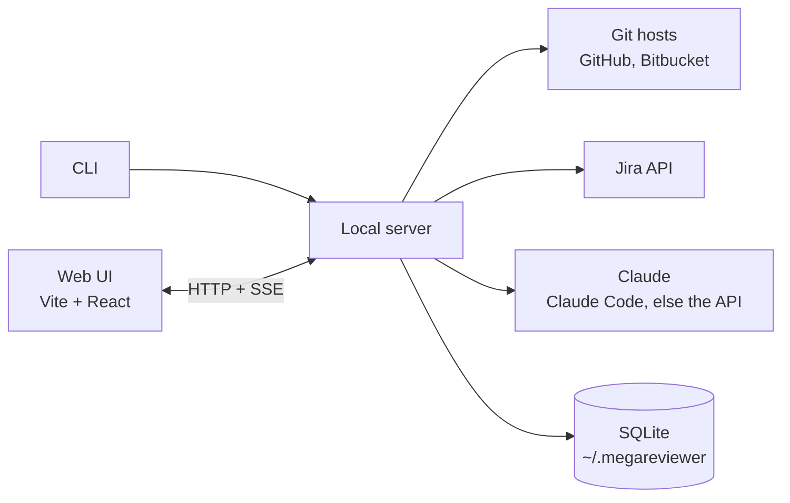

# Architecture

How megareviewer is built. [DESIGN.md](DESIGN.md) covers what it does and why.

## Shape: local-first, no server of ours

megareviewer is a CLI that serves a web UI on the user's machine:

```
npx megareviewer
```

It starts a local server on `127.0.0.1`, opens the browser, and does everything from there. Code, credentials and results never touch infrastructure we run.

Why:

- **Nothing to host or pay for.** Users bring their own Anthropic credentials.
- **Privacy is simple to explain.** "Your code never leaves your machine, except to the model provider" makes security reviews easy.
- **A local process can do what a browser page can't.** It can call Jira and Bitbucket (which block cross-origin browser requests), reuse the `gh` token, read the local git checkout, and later read agent transcripts on disk. The checkout is read when there is one, and never changed; without one, megareviewer reads a copy of its own (see [Local checkout](docs/architecture/local-checkout.md)).

Costs we accept:

- **No shared state between reviewers.** The git host is the shared store: the review is published back to the PR.
- **Each reviewer pays for their own analysis.** A CI step that precomputes it is the later fix.
- **No webhooks,** so analysis starts when the PR is opened in the UI. Results stream so the intent summary shows up first.

## Components



| Component | Role | Tech |
|---|---|---|
| CLI | Checks credentials, starts the server, opens the browser | Node 22.13+, TypeScript |
| Local server | Serves the UI and the API, runs the analysis pipeline, holds all credentials | Hono |
| Web UI | PR picker, review page, publishing | Vite, React, Tailwind CSS, shadcn/ui on Base UI, Shiki |
| Connectors | Git hosts, tickets, model calls, the local checkout | Octokit, Bitbucket REST, Jira REST, the `claude` and `codex` commands, `opencode serve` over HTTP, `@anthropic-ai/sdk`, the `git` command |
| Code analysis | Parse changed files for mechanical proofs and call-graph hints | `web-tree-sitter` |
| Store | Cached analyses, review state and the reviewer's preferences | SQLite via built-in `node:sqlite`, plain SQL migrations |

It ships as one npm package. The server is bundled into a single file with no runtime dependencies, and the UI is prebuilt and served as static files. A tiny launcher runs first and checks the Node version, so Node older than 22.13, the first with `node:sqlite` unflagged, gets a clear message instead of a failed import of `node:sqlite`.

## Why TypeScript everywhere

- **The UI is TypeScript anyway.** Using it for the server too means one language, one toolchain, and one set of Zod schemas shared by the model calls, the server and the UI.
- **The libraries we need are first-class in TypeScript.** Octokit, the Anthropic SDK with Zod helpers, and tree-sitter's WASM build.
- **Easy install.** `npx` works on almost every developer machine with nothing extra to install.

Trade-offs we accept, and how we limit them:

| Trade-off | Mitigation |
|---|---|
| npm supply-chain risk in a tool that holds credentials | The server is bundled at publish time, so users install one package with no dependencies and no third-party install scripts. No native modules (hence `node:sqlite`). Few dependencies (see [ENGINEERING.md](ENGINEERING.md)). |
| Users need Node | Bun can compile the same code into a single binary if that becomes a blocker. |
| Weaker for heavy analysis later | The HTTP API between UI and server is the seam: the server can be rewritten in Go without touching the UI. |

Alternatives considered:

- **Go server + TypeScript UI:** a single binary and a smaller attack surface, but two toolchains and a schema generated for both. We'd switch if security-sensitive buyers or install friction become the blocker.
- **Rust:** no official Claude SDK, and slower iteration that doesn't pay off for mostly-network work.
- **Python:** the hardest to install on users' machines.

## Where each part is

Each part of the system is described in a file of its own under `docs/architecture/`. Read the one for what you're changing.

| File | Covers |
|---|---|
| [git-hosts.md](docs/architecture/git-hosts.md) | The host connectors, each operation on GitHub and Bitbucket Cloud, and how reads survive a flaky network |
| [local-checkout.md](docs/architecture/local-checkout.md) | Finding a clone with the PR's head commit, and megareviewer's own downloaded copy |
| [credentials.md](docs/architecture/credentials.md) | Where each service's credentials come from, the model providers, and the local server's token |
| [pipeline.md](docs/architecture/pipeline.md) | The analysis: the cache key, callers added in place, collect, and the deterministic prep |
| [model-passes.md](docs/architecture/model-passes.md) | Model options and providers, the four transports, the passes, their checks, the lockdown, size and cost |
| [preferences.md](docs/architecture/preferences.md) | Preferences in a run's guidance, marks, review signals, proposals and their routes |
| [harness.md](docs/architecture/harness.md) | Guideline files and what they link, how the harness is walked, stored and read by the passes |
| [guardrails.md](docs/architecture/guardrails.md) | The guardrail call, check configs, the server's checks and how marks land |
| [storage.md](docs/architecture/storage.md) | The SQLite tables |
| [releases.md](docs/architecture/releases.md) | Publishing to npm and GitHub releases, and `install.sh` |
| [ui-main-pages.md](docs/architecture/ui-main-pages.md) | The PR picker, history between pages, Connections, review activity and the preferences page |
| [ui-review-page.md](docs/architecture/ui-review-page.md) | The review page's header, the PR's status on its host, and the bar |
| [ui-layouts.md](docs/architecture/ui-layouts.md) | The map and its file tree, calls opening their code, the tour, the overview and its forms |
| [ui-points.md](docs/architecture/ui-points.md) | Findings on the code, guidance marks, and Claude's run landing on the page |
| [ui-publishing.md](docs/architecture/ui-publishing.md) | Approve, Revoke approval, Publish, line comments and Comment now |
| [ui-threads.md](docs/architecture/ui-threads.md) | The PR's review threads, going round them, and how comment bodies are read |
| [ui-design-system.md](docs/architecture/ui-design-system.md) | Indigo Calm, the review components, syntax colors, fonts, the keymap and accessibility checks |

## First slice

In scope: the CLI, GitHub and Bitbucket Cloud connectors, PR picker, the model passes, the review page, point states stored locally, and publishing to the host.

Later, in rough order:

1. Read more of the local git checkout. It's read for unchanged callers already, and the PR's head commit is always at hand, from a clone or from megareviewer's own copy. Left are the PR's own files instead of the host's API (no rate limits, other git hosts), which also needs the base commit in the copy, unchanged functions on a call path between two changed hunks, and callers of callers.
2. Carry point states over when a PR gets new commits.
3. Agent transcripts (e.g. Claude Code sessions) as an intent source.
4. Ask the code (principle 7).
5. A CI step (GitHub Action, Bitbucket Pipelines) that precomputes the analysis and attaches it to the PR.
6. Desktop app via Tauri.
