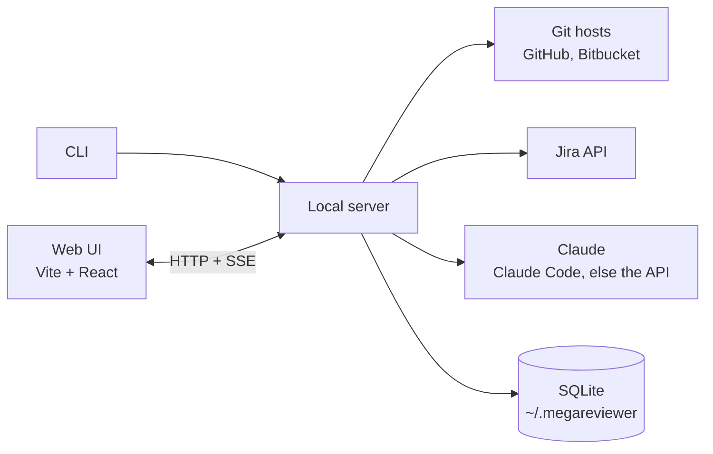

# Architecture

How megareviewer is built. [DESIGN.md](DESIGN.md) covers what it does and why.

## Shape: local-first, no server of ours

megareviewer is a CLI that serves a web UI on the user's machine:

```
npx megareviewer
```

It starts a local server on `127.0.0.1`, opens the browser, and does everything from there. Code, credentials and results never touch infrastructure we run.

Why:

- **Nothing to host or pay for.** Users bring their own Anthropic credentials.
- **Privacy is simple to explain.** "Your code never leaves your machine, except to the model provider" makes security reviews easy.
- **A local process can do what a browser page can't.** It can call Jira and Bitbucket (which block cross-origin browser requests), reuse the `gh` token, read the local git checkout, and later read agent transcripts on disk. The checkout is read when there is one, and never changed; without one, megareviewer reads a copy of its own (see [Local checkout](#local-checkout)).

Costs we accept:

- **No shared state between reviewers.** The git host is the shared store: the review is published back to the PR.
- **Each reviewer pays for their own analysis.** A CI step that precomputes it is the later fix.
- **No webhooks,** so analysis starts when the PR is opened in the UI. Results stream so the intent summary shows up first.

## Git hosts

Supported: **GitHub** and **Bitbucket Cloud**.

The pipeline and UI never talk to a host directly. Each host is a connector behind one interface:

| Operation | GitHub | Bitbucket Cloud |
|---|---|---|
| Get PR (title, description, branch, head SHA) | `GET /repos/{o}/{r}/pulls/{n}` | `GET /2.0/repositories/{ws}/{repo}/pullrequests/{id}` |
| Get commits | `.../pulls/{n}/commits` | `.../pullrequests/{id}/commits` |
| Get diff (unified) | `.../compare/{base}...{head}` at the PR's SHAs, with diff media type, so a push while loading can't mismatch diff and head SHA | `.../diff/{head}..{dest}?topic=true` at the PR's commits: the same three-dot diff the PR's diff endpoint redirects to, pinned the same way |
| Get files at commits | One GraphQL query per 3 files, 6 at a time (`object(expression: "sha:path")`); `.../contents/{path}?ref={sha}` for a file GraphQL truncates or won't give as text | `.../src/{sha}/{path}`, one request per file, 18 at a time |
| List PRs to review | Search API (`review-requested:@me`, `author:@me`) | PRs to review: per repo, the 50 most recently updated of the configured workspace. Own PRs: one workspace-wide call |
| Which PRs opened before are still open | One GraphQL query, a `repository.pullRequest(number)` alias per PR | `.../pullrequests/{id}`, one request per PR, 5 at a time |
| Publish review | One PR review with inline comments and a verdict | Approve or request changes, plus one call per inline comment |
| Revoke approval | Dismiss the user's latest review that approves or requests changes, when it approves (`PUT .../pulls/{n}/reviews/{id}/dismissals`, with "Approval revoked.", which GitHub requires) | `DELETE .../pullrequests/{id}/approve`, when the user's participant entry approves, or their ID is unknown and anyone's does |
| Review threads | GraphQL `pullRequest.reviewThreads`, 100 a page, with each thread's comments | `.../pullrequests/{id}/comments`: an inline comment without a parent starts a thread, `parent.id` chains replies, deleted ones are left out; `fields` asks for who resolved each thread, which the list otherwise leaves out, so a resolution reads `{}` |
| Reply | GraphQL `addPullRequestReviewThreadReply` on the thread's ID | `POST .../comments` with `parent: {id}` |
| Comment now | `POST .../pulls/{n}/comments` with `commit_id` the analysis's head, `line`, `side` and, for a range, `start_line` | `POST .../comments` with `inline` on the last line, the range named in the body |
| Resolve, reopen | GraphQL `resolveReviewThread`, `unresolveReviewThread` | `POST .../comments/{id}/resolve`, `DELETE` the same |
| PR status (state, reviewers, checks) | One GraphQL query: the PR's `state`, `isDraft`, `reviewDecision`, `reviewRequests`, `latestReviews` and `latestOpinionatedReviews`, and the `statusCheckRollup` of the analysis's head commit | `.../pullrequests/{id}` for `state`, `draft` and `participants`, and `.../commit/{head}/statuses`, in parallel |
| The reviewer's past comments | Search API (`repo:{o}/{r} is:pr reviewed-by:@me -author:@me`, by updated), then `.../pulls/{n}/comments` per PR, 6 at a time, the ones by the current user | `.../pullrequests` the user didn't write, by updated, with each one's `participants` through `fields`, 50 a page; the ones the user acted on, then `.../pullrequests/{id}/comments` per PR, 5 at a time, read as threads are |

Both hosts return a unified diff, so hunk splitting and everything after it is shared.

Bitbucket specifics:

- **No cross-repo "waiting for my review" search.** The picker scans the 50 most recently updated repos of the configured workspace. A pasted PR URL always works.
- **Who the user is comes from a workspace.** Listing PRs, the reviewer's own verdict, whether a PR is theirs and their past comments all need their ID. `GET /user` says it, but needs `read:user:bitbucket`, account data megareviewer uses for nothing else, so a token shouldn't have to carry it. `GET /user/workspaces/{ws}/permissions/repositories` names the caller with `read:repository:bitbucket`, which is needed anyway. It's asked in `BITBUCKET_WORKSPACE`, then in the workspace of the PR at hand, and `GET /user` only when neither answers: a workspace the user isn't in refuses, and one where they were given no repository lists none. Dropping `GET /user` was rejected, since a token or app password that has the account scope works without a workspace. So was a variable for the account ID: one more thing to set up, and a wrong one would list someone else's PRs without saying so. When nothing says who the user is, a pasted PR still reviews and publishes, and revoking an approval is left to Bitbucket.
- **Publishing isn't atomic.** Comments are posted one by one, so the server records each posted comment and skips it on retry, avoiding duplicates after a partial failure. The records are per review, so a second review can post on a line the first did.
- **Inline comments anchor on the PR's current diff,** not on a commit. Publishing refuses line comments when the PR has new commits since the analysis, so they can't land on the wrong lines; a verdict or a summary alone goes through.
- **Pull requests can't be filtered by who took part.** `participants.uuid` isn't a field `q` takes, and `reviewers.uuid` is who was asked, not who reviewed: on atlassian/aws-s3-deploy one reviewer was asked on 24 pull requests, acted on 11 of them, and on 1 nobody asked them to. So reading the reviewer's past comments lists the pull requests they didn't write, most recently updated first, and keeps the ones where their `participated_on` is set, which Bitbucket sets on an approval, a request for changes or a comment. It reads no further than the 500 most recently updated.

Flaky networks: on a lossy link, one dropped request used to fail the whole analysis, and a stalled one could hang for minutes. So:

- **Every read times out after 60 seconds** and fails as a network error.
- **Reads that fail on the network are retried** three times, after 1, 2 and 4 seconds. One wrapper around every host does this, so both hosts share the policy. Other failures, such as a rate limit or a missing PR, are answers and aren't retried.
- **Files come in small batches over several connections.** On a slow link each connection is slow on its own: one 250 KB GraphQL answer took 13 to 18 seconds while GitHub had started answering within 2, and the same files as ten parallel requests took 4 to 8. Through a proxy capping each connection at 20 KB/s, megareviewer #1's 49 files took 21 seconds in batches of 10, two at a time, which was the first version, and 11 in batches of 3, six at a time. On a fast link the smaller batches were no slower (1.2 to 1.9 seconds against 1.8 to 3.6). Batches of 2, eight at a time, gained nothing more.
- **Publishing is never retried and has no timeout.** A post that failed on the network may still have been posted, and retrying it would post it twice. The reviewer retries it, and the posted-comment records skip what's already there.
- **Threads and the PR's status follow the same rules.** Reading them is retried like any read; replying, resolving and commenting now are writes, never retried and without a timeout. A reply that failed keeps its text in the field, so sending it again is the reviewer's call.
- **A failed read of the reviewer's past comments keeps what it got.** It's a request per pull request after the list, and the wrapper retries the whole read, so each adapter keeps the comments of the pull requests it had already read, and a retry asks for the list and the rest. On GitHub, 52 comments on 8 pull requests took 10 requests and 2.7 seconds.

## Local checkout

For a PR megareviewer tries these, in this order, and reads the first that has the PR's head commit:

1. **The folder it was started in,** or the one given with `--checkout`.
2. **A folder it read the repository from before,** the most recent first, remembered in the store (`known_checkouts`). One that's gone is forgotten.
3. **A clone found by searching the home folder.** The search runs only when the first two don't have the commit.
4. **megareviewer's own copy of the repository,** when an earlier download put the commit in it. With no copy that has it either, the commit is downloaded (see [megareviewer's own copy](#megareviewers-own-copy)).

What decides is the head commit, whatever a folder's remotes say: the commit pins every file's content, so a fork's checkout, or one cloned before its owner was renamed, reads the same. Requiring a remote that names the PR's repository was the plan, and refused delphi-code's own checkout, whose remote still names its owner's old account. When none has the commit, the review opens without it. While it downloads, the page says so; with downloads off it says what was found: the first folder that names the repository, by a remote or because it was read from it before, where a `git fetch` would bring the commit; or that no clone was found, and whether the home folder was searched. The analysis keeps the folder (`checkoutDir`), and opening a PR that has no callers yet brings it up to date. Reading only the folder megareviewer was started in was the first version: a reviewer who started it anywhere else got no callers, and a note telling them to restart.

**The search** walks the home folder at startup, up to 6 folders deep, for folders with a `.git` folder in them. It never opens `Library`, `node_modules` or a folder whose name starts with a dot, nor the home folder's own `Documents`, `Desktop`, `Downloads`, `Pictures`, `Music` and `Movies`, which macOS asks the reviewer about. It doesn't look inside a clone or a worktree, and follows no symlink. It stops after 2 seconds or 2,000 clones, and the startup summary, `doctor` and the log say so. On the author's machine it finds 20 clones in 0.05 s. A clone could be the repository's when one of its remotes names it, or its folder has its name. The remotes come from `.git/config` read as text: `git remote -v` in each of the 20 took 0.37 s and would run git in folders that have nothing to do with the PR, so git runs only in a folder that could be the PR's. A lookup that finds nothing walks again, at most once a minute, so a repository cloned meanwhile is found. On a Mac it then asks Spotlight for folders of the repository's name in the home folder, which finds `~/Documents/GitHub/<repo>`, where GitHub Desktop clones. A name with anything but letters, digits, dots, dashes and underscores is never put in a query.

The search runs without asking, and the startup summary says so, with how many clones it found and `--no-search`, which turns it off. Nothing it reads leaves the machine. Asking first was the alternative: a question before the first review, for a walk that reads folder names. A `--repos` flag for folders the reviewer names waits until someone keeps code outside the home folder. The folders beside the checkout would be a second rule for what the walk finds anyway. Claude Code, Cursor and JetBrains each keep a list of projects, but those are other programs' files, and the walk finds the same folders. Fetching the missing commit into a found clone would write into the reviewer's repository.

Reading runs `git` without a shell and without a new dependency: `cat-file -e` for the commit, `grep` for the files at it whose text holds a name, with the names on stdin and no path list, and `cat-file --batch` for many files in one process, after `--batch-check` skips those over 1 MB. Only files that mention a changed definition are read: on oracle/graal, 383 of 16,579 Java files, in 0.3 s instead of 3.3. Listing every file and reading all in the PR's languages was the first version. `grep` is told to search what git takes for binary too, and to ignore the repository's own grep settings, so it never leaves out a file. Nothing megareviewer runs in a clone it finds fetches, checks out or writes, so the reviewer's clones stay as they are. A partial clone would fetch a file it lacks when asked for it, so git runs with lazy fetching off and every protocol refused; what it lacks is a warning. A failure to read is a warning on the analysis, never a failed analysis.

It's used for one thing so far: the unchanged callers of what the PR changes (see prep).

### megareviewer's own copy

When nothing on the machine has the PR's head commit, megareviewer downloads that one commit into a bare repository of its own, `~/.megareviewer/repos/<host>/<owner>/<repo>.git`. `RepositoryCopies` is the port, apart from `LocalCheckouts`: one reads what the reviewer has, the other is the only code that talks to a git remote. A copy is read as any checkout is, by `createGitCheckout`, and it's the last place looked, so a clone of the reviewer's wins. It's not among the folders read before: those are the reviewer's.

**The download** is `git fetch --depth=1 --no-tags <HTTPS URL> +<sha>:refs/megareviewer/<sha>`, into a repository made with `git init --bare` and no template. Bare, so git runs no filter, hook or submodule, and checks nothing out. The ref is made by the fetch itself, once everything the commit needs is there, and a commit counts as in a copy only when its ref is: objects without it are a download that was cut off. The ref also tells the host what the copy has: on oracle/graal a second commit without one downloaded everything again, 14.6 s, and with one took 1.5 to 2.2 s. Only the head commit is asked for, since nothing reads the base from a checkout. One thing happens to a copy at a time; a second request for a commit joins its download, and one for another commit waits. Past five packs, `git gc` packs them together after the download has answered: a copy grown to 173 MB went back to 58 in 3.1 s. A download stops with megareviewer, and after 10 minutes, and takes its half-made pack with it, since git killed leaves one as large as what had arrived. A copy nothing read for 30 days is removed at startup; when it was read is a file in it, `megareviewer-last-read`, so the two go together.

**The lockdown.** The download has a runner of its own (`run-download.ts`), so `runGit`, which reads the reviewer's clones, still refuses every protocol. It runs git without a shell and with an environment made from scratch: the path, the temporary folder, proxies and certificate settings from the server's, and nothing else. `GIT_CONFIG_NOSYSTEM` and `GIT_CONFIG_GLOBAL` leave out the system's and the reviewer's config, and `HOME` is the copies' folder, so there's no `.netrc` for git to read credentials from; HTTPS is the one protocol, no redirect is followed, and there's no credential helper, prompt or hook. The credentials are the ones megareviewer already holds for the host's API, passed as git config in the environment (`GIT_CONFIG_COUNT`), as an `Authorization` header for the host's own origin (`http.https://github.com/.extraHeader`), on the fetch alone. They're in no argument, URL or file, and are taken out of what git prints before it's shown or logged. GitHub's token signs in as `x-access-token`. Bitbucket's git refuses the email its API takes with an API token, and takes `x-bitbucket-api-token-auth`, so a username that's an email signs in by that name; an app password's username is used as it is. git older than 2.32 doesn't read its whole config from the environment and isn't used to download. Measured through this, with real accounts (stage 66's doc): a private repository of each host, and every pull request from a fork that megareviewer can open, from the base repository, so a fork's name is never needed.

**What's in the way** is said in the page's note, with what would fix it: no git or one too old, a host that refuses the credentials, with the host's own words, a commit it no longer has, a repository that moved, 10 minutes. The review is complete either way, and opening the PR again tries again.

The download happens without asking, and the startup summary says so, with where to and `--no-download`, which turns it off; a copy already there is still read. Alternatives rejected:

- **The whole history,** 532 MB for graal against 58 for the commit, to read nothing of it.
- **The host's tarball.** No git needed, but every commit downloads whole, and a second way to read files beside git's.
- **A partial clone, or leaving out files over 1 MB.** It saved 1 of 11.9 s and 6 of 58 MB, and a file left out is downloaded when something asks for its size.
- **`git fetch` into the clone found.** It would write into the reviewer's repository. Borrowing its objects (`objects/info/alternates`), so only the difference is downloaded, wasn't tried.
- **A worktree or a checkout on disk.** Nothing reads files but by commit, and checking out runs filters the PR's author writes.

## Components



| Component | Role | Tech |
|---|---|---|
| CLI | Checks credentials, starts the server, opens the browser | Node 22.13+, TypeScript |
| Local server | Serves the UI and the API, runs the analysis pipeline, holds all credentials | Hono |
| Web UI | PR picker, review page, publishing | Vite, React, Tailwind CSS, shadcn/ui on Base UI, Shiki |
| Connectors | Git hosts, tickets, model calls, the local checkout | Octokit, Bitbucket REST, Jira REST, the `claude` and `codex` commands, `opencode serve` over HTTP, `@anthropic-ai/sdk`, the `git` command |
| Code analysis | Parse changed files for mechanical proofs and call-graph hints | `web-tree-sitter` |
| Store | Cached analyses, review state and the reviewer's preferences | SQLite via built-in `node:sqlite`, plain SQL migrations |

It ships as one npm package. The server is bundled into a single file with no runtime dependencies, and the UI is prebuilt and served as static files. A tiny launcher runs first and checks the Node version, so Node older than 22.13, the first with `node:sqlite` unflagged, gets a clear message instead of a failed import of `node:sqlite`.

## Why TypeScript everywhere

- **The UI is TypeScript anyway.** Using it for the server too means one language, one toolchain, and one set of Zod schemas shared by the model calls, the server and the UI.
- **The libraries we need are first-class in TypeScript.** Octokit, the Anthropic SDK with Zod helpers, and tree-sitter's WASM build.
- **Easy install.** `npx` works on almost every developer machine with nothing extra to install.

Trade-offs we accept, and how we limit them:

| Trade-off | Mitigation |
|---|---|
| npm supply-chain risk in a tool that holds credentials | The server is bundled at publish time, so users install one package with no dependencies and no third-party install scripts. No native modules (hence `node:sqlite`). Few dependencies (see [ENGINEERING.md](ENGINEERING.md)). |
| Users need Node | Bun can compile the same code into a single binary if that becomes a blocker. |
| Weaker for heavy analysis later | The HTTP API between UI and server is the seam: the server can be rewritten in Go without touching the UI. |

Alternatives considered:

- **Go server + TypeScript UI:** a single binary and a smaller attack surface, but two toolchains and a schema generated for both. We'd switch if security-sensitive buyers or install friction become the blocker.
- **Rust:** no official Claude SDK, and slower iteration that doesn't pay off for mostly-network work.
- **Python:** the hardest to install on users' machines.

## Releases

Versions are published to npm from CI: pushing a `v*` tag runs every check, builds the package, and publishes it with npm provenance. Users can verify that a version was built from this repository at a given commit, which matters for a tool that holds their credentials. Publishing from a laptop was the alternative; it's simpler, but nothing ties the published files to the source. megareviewer is MIT-licensed.

`install.sh`, at the repository's root and piped from GitHub, checks Node and installs the command from npm by default, with `npm install -g`, into `~/.local` when the global prefix isn't writable rather than asking for sudo. Some reviewers can't take a version from npm until it's hours old, a policy of their employer's, so each release also packs the same package for its GitHub release, as `megareviewer.tgz`, with a build provenance attestation of its own. A separate job with the only write access to the repository creates the release, so no installed code runs with it. With `MEGAREVIEWER_SOURCE=github` the script downloads that file, verifies it with `gh attestation verify` against the release workflow when the GitHub CLI is signed in, unpacks it into `~/.local/share/megareviewer` and links its `cli.js`: the package has no dependencies, so that's the whole install. Verifying without `gh` was the alternative, and would mean a Sigstore client in a shell script; without `gh` the script says the file wasn't verified. A checksum file beside it was rejected: it comes from the same place as the file, so it proves nothing a download error wouldn't already show. The preview builds before npm were a tarball on a release too, with nothing attesting it.

## Credentials

| Service | Source | Required |
|---|---|---|
| GitHub | `GITHUB_TOKEN`, else `GH_TOKEN`, else `gh auth token` | For GitHub PRs |
| Bitbucket Cloud | `BITBUCKET_EMAIL` + `BITBUCKET_API_TOKEN` (scoped Atlassian API token), else `BITBUCKET_USERNAME` + `BITBUCKET_APP_PASSWORD`; `BITBUCKET_WORKSPACE` for the picker and to learn who the user is | For Bitbucket PRs |
| Claude | Claude Code's own sign-in, through the `claude` on the PATH; else the SDK's resolution: `ANTHROPIC_API_KEY`, else an `ant auth login` profile | For Request AI review, which says why it can't run without either |
| OpenAI | Codex's own sign-in, through the `codex` on the PATH | No. Without it, OpenAI's models are listed, disabled, in Request AI review's menu |
| opencode | The providers the reviewer connected in their opencode, through the `opencode` on the PATH | No. Without it, its row in Request AI review's menu is disabled with the fix |
| Jira | `JIRA_BASE_URL`, `JIRA_EMAIL`, `JIRA_API_TOKEN` | No. Without it, ticket keys are shown but not fetched |

Bitbucket app passwords are accepted because existing setups for other tools often have them, and both kinds are the same Basic auth to the adapter. Atlassian removed app passwords in July 2026, so `doctor` points to an API token when one is rejected; rejecting them outright at startup was the alternative.

megareviewer never reads Claude Code's credentials: it runs the unmodified `claude`, which signs its own requests, and removes `ANTHROPIC_*` and `CLAUDE*` variables (but `CLAUDE_CONFIG_DIR`) from its environment, since an API key there would make Claude Code bill the API while the startup line says the plan. Claude Code can run the passes when it's installed, signed in and no older than the version megareviewer was checked with, and the API when the SDK finds credentials. Each is a provider of the model options the reviewer chooses from (see Model passes); both are asked at once whenever the status is, 5 seconds each, so a hung `claude` can't hold the page. One that can run is kept for the process; one that can't is asked again on the next status request, so signing in to Claude Code needs no restart. Without a choice, a run uses the option the last model call used, while it can run, else Sonnet 5.5 on Claude Code when it can, else on the API, else GPT-6 Sol on Codex, else opencode's own default model. Claude Code only was the alternative: it would break the model for everyone set up with a key. A flag to force one, `--ai-via`, went with `--ai`.

Codex is to a ChatGPT plan what Claude Code is to a Claude plan, and is the third provider, after both of Claude's. megareviewer never reads its credentials (`~/.codex/auth.json`): it runs the unmodified `codex`, and removes `OPENAI_*` and `CODEX_*` variables (but `CODEX_HOME`) from its environment, since `CODEX_API_KEY` wins over the ChatGPT sign-in. `codex --version`, `codex login status` and `codex debug models` say whether it can run, whether it's on a plan ("Logged in using ChatGPT") or an API key, and which models the account has. The OpenAI API with a key was the alternative; it's the one way to run OpenAI's models with no tools at all, but it can't spend a ChatGPT plan, and it's left for when someone asks.

opencode is the fourth provider: one command in front of whichever model providers the reviewer connected, local ones among them, so every model it can reach is an option without megareviewer learning each vendor's API or holding a key. megareviewer starts one `opencode serve` of its own on the first status request, on 127.0.0.1 at a port it picks, with a random password, in a new empty directory, and stops it on close; one that dies is started again on the next use. It never reads opencode's stored credentials: `opencode --version` says it's installed, and the server's `GET /api/model` lists the models its providers offer. The reviewer's opencode config is read, since that's where providers are defined, but not the project's or Claude Code's, and opencode's own free models are left out (`OPENCODE_DISABLE_FREE_MODELS`): they run on opencode's inference service, which the reviewer never connected. Pointing opencode at an empty config directory was the alternative; it would hide every provider configured in a file, which is how local models are added. Attaching to an opencode server the reviewer already runs was the other: megareviewer starts its own, so it knows the config it runs under. 2.3.0 is the first version whose server megareviewer speaks; an older one isn't started.

At least one git host must be configured. Credentials stay in the server process and are never sent to the browser. The hosts' are also what megareviewer's own copies are downloaded with (see [megareviewer's own copy](#megareviewers-own-copy)).

## Analysis pipeline

Input is a PR URL from either host. Output is one analysis, cached by `(host, repo, PR, head SHA, pipeline version)`, so reopening a PR is instant and a new push triggers a fresh analysis. Neither the model nor the checkout is in the pipeline version: both add to the analysis.

**Callers are added in place.** An analysis is complete without a checkout, and its callers come when one is found. `startFor` looks for a checkout when a PR is first analyzed and whenever a complete analysis without callers is opened. With one, it's read: by the code's stages, or, on a complete analysis, before the open answers, so a reviewer who runs `git fetch` in their clone and opens the PR again has the callers on the review they left. With none, the analysis says `downloading` in the write that completes it, the commit is downloaded, and the callers are added under the same ID, so the reviewer's drafts, verdict and place stay. The code's stages run again in memory with the checkout (`checkoutFields`), and only `unchangedCallers`, `checkout`, `checkoutDir`, `checkoutError` and the checkout's warnings are written; the callers' parts are the analysis's own, since prep is deterministic and a checkout changes nothing else in it. The warnings also go into `beforeModel`, so Remove AI review keeps them. The download starts once the code's stages have ended, so it doesn't take the line from the review's own requests. On delphi-code #2 the review is complete 3.5 s after the open's answer and the callers come 0.8 s later; on graal #15134, 6.6 s and then 17.2, of which 13.0 is the download.

A model run keeps the analysis it started from and saves it whole, so a change written under one would be lost. Callers are written only while none is in flight, and a download that ends during a run waits for it; the write is a moment, and a run about to start waits for it and then reads the analysis it starts from. A run started during a download doesn't wait, and reads the PR without the callers. While it downloads, the analysis is still followed (`following`), as while a guardrail call runs, so a run's end is announced as an update and `done` comes with the callers. A stop during a download leaves `downloading`, which the next start sets back to what the lookup had found.

The key said whether a checkout was read until then (`20+checkout`), since the callers were decided before the analysis started: a checkout that gained the commit meant a new analysis under another ID, and the reviewer's drafts stayed on the old one. Analyses stored so are still found, since opening a PR looks under both keys: a complete one first, then the one changed last. `PIPELINE_VERSION` wasn't bumped, which would have dropped every cached AI run. Starting the download with the analysis and waiting for it in prep was the alternative: the review would open after 13 s instead of 6.6.

An analysis is complete after prep, with the four model stages not run (`skipped`). The model passes run when the reviewer asks for them on the page, with Request AI review (`POST /api/analyses/:id/model`, with the chosen option's ID or none for the default, and `tour` when the page's Tour switch is on; an unknown option is a bad request, and one that can't run is refused with its reason), on that analysis in place, so the reviewer's drafts, verdicts and place stay. The run collects and preps again from the stored PR, its files from `file_contents` and prep being deterministic, then runs the passes. Its failure is the analysis's `modelError`, shown beside the button with Try again; the analysis stays complete, so the reviewer keeps reviewing while the passes run. An analysis is in progress while its code's stages or the model's run, and its events stream until neither does. Starting the same PR's analysis with the model on, under another ID, was the alternative: drafts are kept per analysis and wouldn't follow. A model run a stop interrupts is failed at the next start, as an analysis is.

Remove AI review, beside the usage line under the code, takes a run off again (`DELETE /api/analyses/:id/model`) after asking, so the passes can be tried again on the same PR: what the code made is put back in place under the same ID, and the states of Claude's points go with it, so a new run's `f1` doesn't take an old one's dismissal. The reviewer's drafts and a publication's record stay. A run changes two of the code's fields, the risk, which the model's is merged into, and the warnings, which it adds to, so the first run on an analysis keeps them as the code made them (`beforeModel`, 6 KB of delphi-code #2's 350 KB), and removing the run puts them back and clears the model's own fields in one write, reading nothing from the host, Jira or the checkout and parsing nothing. The answer is the analysis as it now is, and the page starts afresh from it, keeping the reviewer's place, without loading it again. Running the code's stages again in the background was the first version: on delphi-code #2 they took 0.45 s, 0.9 s on a server that hadn't parsed yet, and then the page fell back to a skeleton, which sent the reviewer to the top, and loaded the analysis again, which asks the host whether the PR has moved once a minute: 0.74 to 0.85 s from the click to the page, 2.9 s when it asked. Now the request takes 12 to 40 ms and the page is back 0.44 to 0.56 s after the click, in headless Chrome on a machine under load. An analysis whose run started before the fields were kept runs the code's stages again within the request, in 0.4 to 0.5 s, and is left as it was if they fail. Resetting only the model's fields was rejected, since the model's risk can't be told from the rules' once merged, and so was keeping the model's risk and warnings apart from the code's, which every reader of the risk, the page and publishing among them, would have to merge. Every model call is kept with the analysis, a failed one too: its pass, attempt, start, duration, and what came of it, an answer, the problems the checks found in it, which a retry is told, or the error, with why. Run details, beside the usage line, lists them in the order they started, timed from the run's first call, and the server logs each with the same fields. Both name the run's option, "Sonnet 5.5 through Claude Code", which the analysis records when the run starts; analyses stored before the choice have none, and were all Haiku 5.5. On delphi-code #2 the findings pass ran twice and took 4 of the run's 5 minutes, and nothing said why: usage kept only the calls that answered, without their problems, and the log line said how many problems there were, not what they were, in a terminal that was gone by the time anyone asked. Keeping it in the log alone was the alternative; a run is looked at on its page, often long after the server that ran it.

### 1. Collect

- PR title, description, branch name, commits, and the diff, from the host connector.
- Base and head contents of each changed file, for parsing and context.
- Jira tickets: keys matching `[A-Z][A-Z0-9]+-\d+` in the description, commit messages and branch name, fetched from Jira.
- Whether a checkout has the PR's head commit, looked for before the analysis starts.

### 2. Deterministic prep (no model)

- Split the diff into hunks with stable IDs. Every later stage refers to hunks by ID.
- Mark hunks as **mechanical with proof** when a check proves it:
  - generated or vendored files (lockfiles, `linguist-generated` in `.gitattributes`, known build output);
  - whitespace-only changes;
  - pure renames (rename headers in the diff with no content change);
  - moved code (removed and added blocks match after normalization);
  - formatting-only changes (tree-sitter syntax trees are identical before and after).
- Split each hunk without a proof into **parts**, one per definition it changes. A hunk is whatever git put between two unchanged stretches, so one can hold three routes, and the flows could place it only once: on delphi-code #2, three routes added in one hunk made one flow of 32 of the 48 hunks. The cut is at the outermost definitions that start or end inside the hunk, so a class around a block of methods cuts at its methods. Deleted lines go with the definition around them in the base file, and an unchanged line shared by a base and a head definition makes them one, so a renamed method stays one part. Lines outside any changed definition (imports, decorators, comments, unchanged stretches) join the next part. Tests split too. A proved hunk is never split, since its proof is about the whole hunk. Proofs, decisions, comments and risk stay per hunk; hints and the flows are per part.
- Build call-graph hints with tree-sitter: which changed symbols are defined, and which changed code calls or uses them. A use links to a definition only in its own file or in a file its imports reach, never across languages or from code into tests, and a type annotation isn't a use. Matching names across the whole PR was the first version: on a real PR it linked Python and TypeScript files that shared a class name, pointed production code at test fakes, and joined most of the PR into one tour step. A missing link hides no code, so the hints err toward fewer.
- Find the **call sites**: every use, on a part's lines, of a definition the PR changes, by the hints' rules, with its line and column, for the page to show the code a call runs. A hint keeps the first line a name is used on, at most 10 per hunk, and the first part that changes a definition, which is what the tour needs; a site is every use, uncapped, reaching every part that changes the definition. On delphi-code #2 that's 128 sites beside 105 hints. The parser gives each reference the column of every use on its line, in UTF-16 units, as the page's strings count.
- Link changed files by their imports, by the same rules, for the overview: an import that reaches another changed file is a link, even where no hint does, such as an app importing the module that registers its routes.
- Link requests to routes, across languages: a call that names an HTTP method and a literal path (a typed or generated client, `fetch` and the like, a test client in a test) links to the part that adds the route serving it. Methods match exactly and paths segment by segment, a placeholder in any syntax matching one segment. A base prefix the client adds isn't in the code, so a request also matches after dropping its leading segments, but only when that leaves one route. Hints stop at a language, so a full-stack PR was two islands: on delphi-code #2, nothing linked the page to the three routes it calls.

- With a checkout, find the **unchanged callers** of what the PR changes: code outside the PR that calls a definition the PR changes, or names it as a type, which is where a regression shows. A changed definition is one the base file has and whose own lines the PR adds or deletes, not counting nested definitions or blank lines, so a class that only gains methods isn't one. Callers are found by the hints' rules: through imports (or the package, in Go and Java), within a language family, never from code into tests, and not type uses of generated files. Only files in the PR's languages whose text names a changed definition are parsed, and languages whose imports aren't read are left out. At most 50 uses per definition are kept, code first, with the rest counted. Matching names across the repository was measured first: on delphi-code #2 it found 357 uses in 83 files, almost all other things named `state`, `to_json` or `main`. Following imports leaves 6: `create_app`'s three callers, the one of `clone_credentials`, whose order of credentials the PR changes, and the page that renders `CredentialsGuide`. One level only; callers of callers would need the same reading again.
- Classify every remaining hunk as *contract* or *logic* with rules on its file's path: dependency manifests, schemas and migrations (an `openapi*` or `swagger*` file among them), CI and infrastructure, repository config, app config, and auth or security paths. A rule can only raise a hunk to *contract*; one no rule matches is *logic*. The rules read what a file is, never the names or text in it. A security path skips test code (tests, and helpers named fake, mock, stub or fixture), and doesn't make a hunk contract when every line it changes is inert: blank, a comment, an import, a string, an UPPER_CASE constant set to a literal, a closing bracket, or, in markup, a tag with literal attributes or plain text. The rules' contract is internal: it orders the tour and keeps a hunk contract after the model's pass, and the page never shows it. What the reviewer sees is the model's contract, as a risk. Line rules were the version before: credential storage and authorization read from the shape of a name (`save_secret`, `require_permission`), credential endpoints from a changing route with a `token`-like segment, risky calls from regexes on added lines (`eval(`, `subprocess`, `shell=True`), and removed or skipped tests from counts of declarations and skip markers. Probed with counterexamples, each failed both ways: a lexer's `clear_tokens()`, `Notification.requestPermission()`, `POST /llm/tokens`, "subprocess" in a log message and two tests merged into one were contract, while `localStorage.setItem("token", …)`, a removed owner check, a removed `@login_required`, `POST /login`, `spawn("sh", ["-c", cmd])`, `pickle.loads`, a deleted assertion and `@unittest.skip` were logic. Risk is about behavior, what a check guards, what a response exposes, what an assertion still proves, and a name doesn't say it; longer word lists only move the edges. Behavior-level risk is the model's, with Request AI review. On delphi-code #2 the line rules made 10 hunks contract and path rules alone make 3: keychain.py, on a security path, and openapi.json's two.
- Build the **flows** from the call-graph hints. The page doesn't show them as steps (see Map); they order and label the overview, and the page's tour is the steps pass's (see Model passes). A flow starts at an entry point a user or caller reaches (an HTTP route, a page, a command), found by framework markers on added lines, and reads the changed code it runs, callers before callees. Code that more than one flow runs is read once, in a shared section before them, and the flows that run it come after it: one section per connected piece of shared code, with the tests of that code, titled `Shared:` and where the flows enter it. A section is a flow without entries. Reading shared code in the first flow that reached it was the first version: on delphi-code #2 the GET flow read 37 of 73 parts, most of them the connection and keychain code that PUT and DELETE run too. With shared sections the largest step has 23 parts and GET 21, and every part is still placed once. Code an earlier flow read isn't read again. Types, imports, tests and docs join the flow they belong with; what no flow runs goes into supporting steps: API schema, docs, tests, and other changes by area. Shared sections come first, then flows that reach contract hunks. There's no cap on how many flows there are: merging unrelated code to meet one would hide the story. Grouping the files the call graph connects was the first version: its steps were whatever happened to connect, titled by a chain of symbols, and on a real PR one step held 33 of 48 hunks. Code that registers an entry, like a router the routes are declared on or an app adding that router, is read first in the first flow it registers. A request never extends a flow: a flow that sends one comes after the route's flow. A page flow that walked into the backend would read the whole PR. A test that requests a route joins that route's flow.
- Join back the parts the flows read together: consecutive parts of one hunk in the same step become one part again, and a hunk read in one step is whole again. Splitting without joining gave 115 parts on delphi-code #2, one file in 29 pieces, too fine to read; with joining, 8 of its 48 hunks stay split, into 32 parts, and each of its three routes is a flow of its own. The model's passes see whole hunks: its input maps hints back to hunks.

The model can't override a mechanical proof. It only classifies the hunks that remain, and a hunk a rule marks *contract* stays *contract* whatever the model says. The flows are the code's alone.

### 3. Model passes

Only when the reviewer asks, on the **model option** they choose: a model on a provider, which is what runs the passes and decides who pays. The same model on two providers is two options, since the bill differs. A provider answers its own status and its options, and the list is their answers together: Haiku 5.5, Sonnet 5.5 and Opus 5.5 on Claude Code, then the same three on the Anthropic API, then GPT-6 Luna and GPT-6 Sol on Codex, those of them the reviewer's `codex debug models` lists, then every chat model the reviewer's opencode offers, grouped by the provider behind it. One list of models, with the provider picked for them, was the alternative; it hides who pays, which is what a reviewer chooses by. A model is listed once the evals have run on it, with its scores in a report under `evals/reports/`, because the prompts were tuned on Haiku and a wrong finding costs the reviewer more than a missed one; listing every model a provider serves was the alternative. opencode's are the exception: they're whatever the reviewer connected, and the evals can't run on all of them, so every one is listed, marked unmeasured; listing only models measured elsewhere would leave out local models, the reason to use opencode. The analysis records the option its run used, and the page names it (see UI); Remove AI review and a new run is how another model is tried on the same PR. One option runs all four passes, with the same prompts: a model per pass, or prompts per model, would each be a model the evals haven't measured.

The default, when the reviewer hasn't chosen, is **Sonnet 5.5** (`claude-sonnet-5-5`) on the first provider that can run it. On the 14 eval cases through Claude Code it met 9 of the 12 targets against Haiku's 7: no wrong findings where Haiku had 21% (6 of 28), 7% of its decisions noise against 36%, and every contract hunk marked where Haiku missed 4 of 25 (`evals/reports/2026-11-14/`). It was faster too, about 3.5 minutes for the run against 6, because it writes a quarter of Haiku's output tokens. It costs about 4× Haiku at API prices, $0.17 a case against $0.04, and on a plan more of its usage limits. Haiku stays the default was the alternative; the cost is still cents a PR, and the menu offers Haiku to a reviewer who wants it. Opus 5.5 met 8 targets at more than twice Sonnet's cost.

Each Claude model's ID, name, price, input budget, output limit under each transport and the efforts it accepts are in one table in the adapter, `src/adapters/model/claude/models.ts`, and each OpenAI model's slug, name and price in `src/adapters/model/codex/models.ts`, its context window and efforts coming from Codex's catalog; a pass whose effort a model doesn't accept runs at the nearest one it does. The prompts, input rendering, output schema and pass model every provider shares are in `src/adapters/model/shared/`, apart from Claude's transports, so a provider imports only those, never another provider; the dependency rules check it.

Every pass answers with JSON checked by the same Zod schema, through one of four transports that share the prompts and the input rendering. Claude Code and Codex enforce the schema as structured output; the API and opencode are asked for it in the prompt:

- **Claude Code,** the default: one `claude -p` process per pass, on the reviewer's own Claude plan, so a review isn't billed per token on top of a plan they already pay for. The Messages API can't spend a plan; Claude Code can. Each runs without a shell in a new empty directory, with no tools but the schema's `StructuredOutput`, no MCP servers, settings, skills, commands or saved session, and the answer comes back as the stream's `structured_output`. No MCP servers is `--strict-mcp-config`, except where an organization deployed a `managed-mcp.json`: Claude Code then refuses that flag and loads the file's servers whatever else is asked, so megareviewer reads the file's server names and denies each one, and every remote server by URL, with `--settings`. The session's first event must still list no servers. Retrying without the flag after the error was the alternative; it costs a process per pass and still needs the names to deny. Claude Code has no token count, so the size check estimates tokens from the prompt's bytes, high on purpose: 1.9 bytes a token and 2,000 tokens for its own, where the eval cases measured 2.06 and about 1,550.
- **The Anthropic API,** the fallback: one streaming request per pass with the SDK, with no output format. The API compiles a format into a grammar and refuses one too large, and the passes' union is: 400 "The compiled grammar is too large, which would cause performance issues" on Haiku 5.5 and Sonnet 5.5, for a schema under every limit the API documents. So each pass's task ends with the JSON schema of its own answer, its variant of the union, in the words opencode's does, and the answer's text is read the same way, a code fence or a sentence around it tolerated, then checked by the same Zod schema; the pipeline retries an invalid one once. On small-feature and prompt-injection on Sonnet 5.5 all five passes, the tour's steps pass among them, answered valid JSON first time, and the four after the intent read the PR from cache, 4,116 tokens each on small-feature. The union was the format before. Sent to today's API as it was at each commit, it was first refused when findings gained their lines, suggestion and mismatch (2026-11-13), fit again once the tour pass was dropped, and has been refused since the intent's brief added `shape` and `watch` (2026-11-16): 3,690 bytes of schema, where the 3,597 before them are accepted. The checking test and the guidance mark each added to a schema already refused. Nothing caught it: counting tokens doesn't compile the grammar, so `checkSize` passed, the adapter's tests replay answers, and the evals ran through Claude Code, which takes the schema as a tool and accepts it. `evals/claude-live-check.ts` is the check that the API takes the requests, and runs all four passes. A format per pass was the first alternative, since each variant alone is accepted: the format is part of the cached prefix, so the second pass wrote the PR to the cache again, 5,235 tokens written and none read, and unlike effort `format` can't be set in a message after the PR. A looser union for the API to enforce, with Zod checking the rest, was the second: the grammar's size follows the whole schema and not one costly part, so the union without any enum, without any nullable, with shared `$ref` definitions, or as one flat object is still refused, and the API takes no schema that leaves a value open (`{}`, an array without `items`, an object without `additionalProperties: false`). Cutting fields until it fits would hold until the next field is added.
- **Codex,** for OpenAI's models: one `codex exec` per pass, on the reviewer's ChatGPT plan. Each runs without a shell in a new empty directory, with our instructions in place of Codex's (`model_instructions_file`, which also saves about 4,300 tokens a call), the answer's schema as `--output-schema`, the read-only sandbox, `--ephemeral` so the review isn't in the reviewer's Codex history, and none of their config, rules or `AGENTS.md`. The answer is the last message's text, parsed as JSON and then with the same Zod schema. Its size check estimates 3 bytes a token after 6,000 of Codex's own, where the eval cases measured 3.36 to 5.19 bytes and about 5,300 tokens, against the model's context window less 32,000 for the answer. Codex reports tokens and no cost, so the cost is computed at OpenAI's API prices, or absent for a model without one.
- **opencode,** for the models of the reviewer's own providers: a session per pass on the one server, run as an agent megareviewer defines in the server's config, whose system prompt is the shared one. opencode 2.3.0 has no structured output a prompt can ask for, so the pass's task ends with the JSON schema of its own answer, its variant of the union, and asks for one JSON object and nothing else; the answer's text is parsed, a code fence or a sentence around it tolerated, and checked by the same Zod schema, and the pipeline retries an invalid one once as for any transport. Provider-native structured output through a provider's request body was the alternative: each provider package names the field differently, the config is fixed for the server's life, so one schema for every pass, and Anthropic refuses the union as too large a grammar. On delphi-code #2 through Haiku 5.5 every pass answered valid JSON first time. The session is deleted once the pass is read, since opencode keeps it in the reviewer's own history, and it's given a title, so opencode doesn't spend a call naming it. The size check estimates 1.9 bytes a token, Claude's rate, after 2,000 of opencode's own, against the model's context size from the server's list less 32,000 for the answer. The cost is what opencode reports from its model catalog, absent for a model the catalog has no price for.

On Claude's two transports, the passes share one cached prefix holding the PR context, so a pass that starts after it's written reads the PR from cache. Effort is set per pass. Changing the output format between requests would invalidate that cache, so through Claude Code every pass of a run sends the same output schema (a union of the passes' outputs, tagged by pass), and on the API none. Where the PR data sits differs:

- **On the API,** it's a user message, after the system prompt, and each pass sets its effort in a system message after it, since a different top-level effort would invalidate the cache.
- **On Claude Code,** it's in the system prompt, after the instructions, which end by saying what follows is data. That's the only placement Claude Code caches across processes: measured with 30.5k tokens of PR data, the second process read 29,887 tokens from cache with the data in the system prompt, and none with it in the user message, as one text or as a block of its own. Effort is the `--effort` flag, which doesn't miss the cache; another schema does, since it's a tool before the system prompt. On delphi-code #2 the later passes read the PR from cache, as the stage 41 doc records. Forking one saved session per pass was the alternative: it keeps the data in a user message, and writes the PR's code into `~/.claude/projects` as sessions the reviewer then sees in Claude Code.
- **On opencode,** it's in session instruction entries, which opencode puts in the system prompt before its last cache breakpoint; the task is the prompt. On delphi-code #2 through Haiku 5.5 each later pass read 127,219 tokens from cache. A synthetic message before the task read nothing from cache, and the PR in the task's own message can't be shared. An entry can hold 262,144 bytes as opencode counts them, JSON-encoded, so a larger PR is cut between lines into entries keyed in the order opencode joins them; delphi-code #2 with its unchanged callers is 363 KB. The route is experimental, which the version check guards.
- **On Codex,** it's in the instructions file, after the instructions, as on Claude Code, and the pass's task is on stdin. OpenAI looks a cache up at message ends, so that's the only placement a later pass can read: on stdin the PR and the task are one message. But the cache rarely holds across processes: Codex sends a new thread's ID as the cache key on every `codex exec`, and a cache lives on one machine, so on delphi-code #2 one later call in 11 read the PR from cache. A run pays for the PR five times, about 160k input tokens of the plan's limits there. Resuming one thread for every pass was the way to share the key, and was left: it carries each answer into the next pass and writes the session to the reviewer's Codex history.

Risk and decisions don't read another pass's answer; findings read the intent's, to name the mismatch a finding shows. The intent pass starts first and writes the PR to the prompt cache. Risk and decisions start as soon as its answer begins, when the PR is in the cache, and read it from there; Claude Code says so with the model's first message, the API with the stream's first event, and Codex and opencode say nothing until the answer is done, so there they wait for the intent to end. Findings start when the intent ends. On Claude Code the model's first message comes as its thinking ends, a moment before the answer, so all three start about when the intent ends. When the intent ran first and the tour last, each waiting for the passes before it, a 62-second run on delphi-code #2 spent the intent's 7 seconds before the findings started and the tour's 8 after they ended. All four starting at once was tried: each pass wrote the whole PR to the cache, and on the evals the passes cost 2.5 times as much at API prices, $2.27 against $0.78 on delphi-code #2.

| Pass | Output | Effort |
|---|---|---|
| Intent | Stated intent (description, tickets), intent inferred from the code with its shape across the system and what to watch, and mismatches between them | medium |
| Findings | What looks wrong, as a draft comment: a title of at most 80 characters, an explanation of at most 300, the hunk and lines it rests on, a severity, a suggested change for those lines or none, and the intent mismatch it shows or none | high |
| Risk | Each remaining hunk marked *logic* or *contract*, with a one-line reason saying what could break outside the PR and, for contract, the lines where that's decided and the test that checks it, or none | low |
| Decisions | Why the code makes the choices a reader would wonder about, each titled as the question it answers, with a category, the answer, the hunk IDs it rests on and the line that makes the choice | high |
| Steps | Only for a run that asks for the tour: 3 to 7 steps in call order, each a sentence of at most 20 words and the lines of one hunk that decide it, or two in different files when the hop crosses into another process | medium |

Intent is kept short, because the reviewer reads it before any code: each summary is one sentence, with at most 5 behavior changes. The inferred intent is the header's brief: a summary of at most 20 words that doesn't repeat the title, a shape of at most 25 naming where the change is reached and what it runs through in call order, in backticks, and at most 2 things to watch of 12 words each, what wasn't asked for first and never a bug, which is the findings pass's. What the watch line says nobody asked for is a mismatch too, and the prompt says so: without it, on the evals' large-retry-after the brief said the unrequested body-read timeouts and the pass reported no mismatch, in two runs of two, so nothing marked the code. Analyses stored before the brief have neither shape nor watch, which parse as empty. The findings pass reads the intent's summary and mismatches, not its brief, so its answers stay those the evals measured. The findings pass is the model's job: triage. It lists at most 10, most important first, and only what the code in the data shows, because a wrong finding costs the reviewer more than a missed one. The server checks that each one's hunk exists and that the hunk shows its lines; one still wrong after the retry is dropped and logged. A finding posts as the reviewer's comment, so the prompt asks for plain words: what happens rather than the class of problem it belongs to, a technical term only where it's the exact name, short sentences, and the code's own names and values kept, since plain isn't vague. Told only to write to the author in 300 characters, Sonnet wrote "`beforeThreadRun` callocs `ALLOCATION_BYTES`", "a privilege escalation" and "a privacy and compliance decision", which the author has to translate and the reviewer to reword before posting. On the evals it found what it did before, with fewer long words and asides (`evals/reports/2026-11-25/`). A second model call that rewrites the findings was the alternative: seconds on every run, and a rewrite can change what a finding says after the server checked it. A setting for the tone was the other, a choice nobody needs to make. Risks and decisions have the same words asked of them, but differently: the rule comes after their tasks and says the wording never changes what was decided, with only the part on technical terms. Asked as findings are, to say what happens, decisions said what the code does in place of why ("The update uses COALESCE…"), and risks what it adds. Asked to say what breaks or what the reader has to accept, decisions moved off the choice they were about and lost must-have ones, 7 of 18 found against 12 of 18 in three runs of five cases. A rule in the risk task that mentioned tests had 4 of 29 checking tests named wrong against 1 of 17, and one placed before the task's other fields had the pass skip hunks on both large PRs, a retry each. Asked last, the five cases' decisions are found as often as before, the two large ones' tests as often too, and long words go from 17% to 12% of a risk's and from 10% to 8% of a decision's. A title or explanation longer than the prompt asks is kept as written, with no retry: on delphi-code #2 one explanation over 300 characters cost a second findings pass, 2 of the run's 5 minutes, and one still too long after the retry was dropped, a real finding lost for its length. A suggestion on base-side lines, which a comment can't replace, or a mismatch the intent doesn't have costs the finding only that, after the retry. The findings pass reads the intent's mismatches by ID, so one finding carries a mismatch it shows instead of the reviewer reading it twice. Matching them on the server by the hunk they rest on, so findings could start beside the intent, was tried: a hunk often holds two mismatches, and on the evals it gave description-contradicts' constant delay the mismatch about retrying 4xx errors. A decision's line outside its hunks falls back to its first hunk's changed lines, without a retry: a footnote on the wrong line isn't worth one. A risk's lines do the same, outside its own hunk or on a logic hunk.

The model's results reach the page as **points**: findings first (the intent's mismatches no finding names among them, which is why the header has no mismatch chip), then the risks the model raised itself, then the decisions, each in the model's own order. `pointsOf` builds them in the domain as a pure function of the analysis. Every hunk the model marks contract is a risk, on a path the rules mark or not, with the model's reason alone; a hunk only the rules mark is none, since the rule read the path, not the code.

Every risk asks the reviewer to stop, so the risk pass marks contract only a hunk where a mistake would break or expose something outside the PR, and its reason says what and for whom. A hunk that only follows from another (a new endpoint's request and response models, a generated client or API schema, the router's registration, the form that calls it) is logic, and so is an interface whose every end is in the PR. The decisions pass leaves out a choice that only carries out what the description or a ticket already explains, and keeps one whose consequence the reviewer has to accept even when it was asked for, such as a breaking change, a default or a lifetime. The first prompts listed kinds of contract and chose contract when unsure, and on delphi-code #2 the model marked 25 of 48 hunks contract, with reasons saying what the code is ("defines the JSON shape", "generated TypeScript client types"), while 6 of its 8 decisions began "The description says". With these rules it marks 8 contract, the keychain, the credential order, clone credentials, the token routes, the token check and the response shape, and no decision says the description again. Leaving out risks on generated files in `pointsOf` was the alternative for part of it; the generated mark comes from a file's header, which the PR's author writes, so a header would silence a risk.

A risk's **checking test** is the risk pass's too, in the same answer, so it costs no pass of its own: for each contract hunk, the test whose assertions would fail if what the reason says could break did break, by its hunk, its name as the code writes it, the lines of its assertions and one sentence of what they check, or null. The prompt says what doesn't count, from the claims that were wrong on the evals: a test of a neighboring behavior (on auth-middleware, "ignores a query token on other routes" for a token that leaks into logs), a test that never sets up both sides of a precedence (on delphi-code #2, a saved Bitbucket token signing in, for a saved token outranking git's), a harm no assertion compares, and a test judged by its name, its comments or the description. A wrong mark tells the reviewer to relax, so the server checks everything it can and drops a claim that fails, without a retry, which leaves the risk unmarked: the hunk was sent to the model in full and is a test file's; the lines are head-side lines that hunk shows, at most 40 of them; the test's name is on a line at or above them, in the hunk or in the file's head content the model read, since a PR often changes the assertions of a test whose name is above the hunk; and the lines hold an assertion of a common test library, outside strings and comments, so a test named "rejects non-admin users" whose `expect` is commented out isn't one. Whether the assertion is about the risk only the model can say. Only a contract hunk keeps a claim. Tests outside the PR were left out: the model reads only the PR, the checkout's unchanged callers are five-line excerpts with no assertions, and on delphi-code #2 the one test among them builds the app for a contract test no risk is about; sending the checkout's tests of each risk's code to the model is the way to add them. Retrying a pass for a claim the server dropped was the alternative; a claim is a mark worth less than the seconds of a pass. Measured through Claude Code on Sonnet 5.5 with the final prompt, the risk pass named 3 tests on delphi-code #2, 2 on large-retry-after, 1 on bitbucket-bugfix and none on auth-middleware and test-named-coverage, an eval case whose test is named for the check, and whose comment and description say it's tested, but which never sends the request it's named for; every one of them is where the labels put it. The evals score it as `coverageWrong`, claims not where a label says a test checks the risk, with a target of none, and `coverageRecall`.

The model doesn't title the flows. A tour pass did, last, since it read the risk and decisions: a title of at most 80 characters naming behavior ("Save a host's token", not `PUT /api/account-connections/{domain}/token`) and an explanation per step, and merges of supporting steps into the steps they belong with. It added 8 seconds to the end of every run for titles only the overview shows, so it went while the run is brought toward 20 seconds; the overview labels flows by the code's titles. Before it, the model wrote its own tour, at most 7 steps, which on delphi-code #2 grouped by layer, with the three routes in one step: flows the reader can check against the call graph are worth more than the model's grouping. An analysis the tour pass titled loads with the code's titles, which it kept beside the model's. A flow is now its title, its parts, its kind and its entries: the tour pass's explanation, its merged steps and `builtBy`, each step's ID, and `via`, the earlier code a flow passed through, went once nothing read them, with the check that every part was in one step, which only the tour pass needed; an analysis stored with them loads without them. The overview reads the flows from the analysis and keeps a part no flow lists in its place, after the flows' parts in path order.

The **steps pass** writes the page's tour, which the Understand layout draws (see UI), and runs only when the run asks for it (`RunModelRequest.tour`, which the page sends while its Tour switch is on). It reads only the PR, from the prompt cache, and starts beside risk and decisions. Through Claude Code and Codex, a run that asks sends every pass the union with the steps pass's variant, so the five share one cache; a run that doesn't sends the four's union, byte for byte as before, which the fingerprint tests hold for each, beside a fingerprint of their own for a run with the tour. The API and opencode send no format, so there the four passes' requests are the same with the tour or without, and the steps pass's task ends with the schema of its own answer as theirs do, with a fingerprint of its own. Sending the five-variant union always was the alternative: one schema, but a run without the tour would have paid for a schema it never answers, and its requests would have changed. The server checks the steps with `validateSteps`: each excerpt on a hunk sent in full and on lines it shows on its side, a step's two excerpts in different files, no step before one whose code calls its own by the call graph's direct hints between their parts, at most 7. One retry is told what's wrong; after it a bad excerpt is dropped, a step left with none is dropped, steps past the seventh are dropped, an order still wrong is kept and logged, and fewer than 3 left is no tour, with why. An answer of fewer than 3 steps is a change too small for a tour. The pass is optional to the run: the review's four stages decide whether the model can run again and the run's error; a steps pass that fails is its own stage's `failed` and the analysis's `stepsError`, never `modelError`. It does keep the analysis in progress while it runs, so the events stream until it ends and a server stopped mid-tour fails only the tour at its next start. Remove AI review takes the steps off with the rest of the run. The union check of stage 64 found Claude Code took the five-variant union and the Anthropic API refused it as too large a grammar, and refused the four's the same way, which is why the API transport sends no format (see The Anthropic API above).

The server validates every response: every referenced hunk ID must exist. On failure it retries the pass once with what was wrong, then shows the error. Hunk IDs that still don't exist after the retry are dropped from the intent's mismatches and the decisions, and the server logs it. The page doesn't warn about it: the first version did, but a reviewer can't act on the model's mistake.

PR content is untrusted. A description or code comment can contain text aimed at the model, so:

- The model has no tools; with Claude Code, that's checked on every call. The stream's first event lists the session's tools and MCP servers, and anything but `StructuredOutput` alone and no servers kills the process and fails the pass, as does an API key in use when the startup line says the plan, so a Claude Code update that changes a flag's meaning fails loudly instead of handing PR text a shell. The worst a prompt injection can do is distort the analysis.
- Codex's tools can't all be turned off, so its lockdown is different: no tool runs unseen. Every feature that adds one is disabled, and what's left (`exec`, `wait`, the agent tools, MCP resources) is watched on the stream, read as it arrives: any item but the model's reasoning, its message or Codex's own errors, an item type Codex doesn't have yet among them, kills the process and fails the pass with "the session used a tool", and its answer is never read. Under it, the read-only sandbox blocks the network and writes, as measured on macOS (stage 52's doc), so a command that did start could only read files and pass them to the model, whose answer is then thrown away. Code mode's `exec` runs without putting an item on the stream, so it's turned off (`code_mode_host`), and fails closed. Accepting the sandbox alone was the alternative; a command's output could then reach a finding the reviewer publishes. The bound is the same: the worst an injection can do is distort the analysis, or fail the pass.
- opencode's agent is denied every tool by its permissions, a final rule denying everything, the last match winning; that leaves the model one tool, `skill`, which can't be removed and has nothing to load. Its answer is read only once the session is idle, and a session holding anything but the prompt, one answer of text and reasoning, and the turn's end (a tool call, a shell, a skill loaded, a second step, or a message of a kind opencode adds later) fails the pass with "the session used a tool", its answer discarded. A PR description asking for a shell and an SSH key, on small-feature's input, ran nothing: the model had no tool to run it with, and reported the request as a finding.
- Model output is rendered as text, never as HTML.
- Mechanical proofs come from deterministic code, not the model.
- What preferences are suggested from is untrusted the same way: a point's title was written by a model reading PR text, and a comment quotes code. The suggestion call runs under each transport's lockdown, and its output is only ever a proposal the reviewer reads and accepts.
- So is what the guardrail call reads: a point's words were written by a model reading PR text, its code is the PR's, and the configs and build files are the repository's. It runs under the same lockdown, and its answer is only ever marks the server checks and the reviewer reads: it can mark a point, never change one.

**Size limits.** Mechanical hunks are sent as path plus stats, not content. If the PR still doesn't fit in the context window, the analysis fails with a clear message. It never silently truncates.

**Model and cost.** Per million tokens, Haiku 5.5 is $0.10 in and $0.50 out for prompts up to 100K tokens, five times that above; Sonnet 5.5 is $2 and $10, and Opus 5.5 $4 and $20. On the eval cases a PR cost $0.04 on Haiku, $0.17 on Sonnet and $0.40 on Opus at API prices. Each reviewer pays for their own analysis, so cost per review decides whether people run it at all; the menu shows who pays for each option, not its price, which the usage line says after the run. Through Claude Code nothing is charged per review: the passes come out of the plan's usage limits, and the usage footer shows Claude Code's cost at API prices as an estimate, "≈ $0.02 at API prices, on your Claude plan". Opus 5.5 was the first choice: stronger analysis, but on the order of $1 per medium PR. Haiku 5.5 came next, the cheapest, and Sonnet replaced it as the default once the evals measured both. A refused pass fails with the model's reason instead of being answered by another model: the API's server-side fallbacks aren't used on Sonnet or Opus, since a pass answered by a model the reviewer didn't choose would be named after the one they did. Whether a plan serves a model isn't known before the call, so a plan that refuses one fails the run with Claude Code's reason. Through Codex, GPT-6 Luna is $0.10 in and $0.50 out, Sol $2 and $10, from OpenAI's price list; the usage line says "on your ChatGPT plan", and for a model OpenAI doesn't price it shows tokens and says the cost is unknown, rather than borrowing Claude's: one vendor's prices say nothing about another's. Through opencode the cost is opencode's own figure from its model catalog, billed by the provider behind it: $0.24 for delphi-code #2 on Haiku 5.5. A local model has no price, so its cost is unknown rather than zero.

## Preferences

What the reviewer values is kept in the store and given to the model passes as guidance. [DESIGN.md](DESIGN.md) says what a preference is and why nothing learned applies by itself.

**A model run's guidance.** Before the passes, a run reads the enabled preferences for everywhere, then the PR's repository's, each in the order they were made, and the repository's guideline files that are there, switched on and no larger than 32 KB. The files are read at the PR's **base** commit, from the host through `file_contents`, so a PR can't rewrite the rules it's reviewed by and no checkout is needed. Only the paths switched on are asked for: one request for `REVIEW.md` on a repository's first run at a base commit and none after, since the cache keeps a file that isn't there too. Reading them from the local checkout was the alternative; only some reviewers have one, at whatever commit they left it. The run numbers what it read, `p1` for its first preference and `g1` for its first guideline file, gives it to every pass in its input (`AnalysisInput.guidance`), and keeps it on the analysis (`guidance`): each preference's ID, kind, text and scope, and each file's path and size, not its content. Remove AI review clears it with the run's other fields. Guideline files that can't be read, and one that's too large, are a warning on the analysis, and the run goes on without them.

**In the prompt.** The guidance is a `<reviewer_guidance>` block before `<pull_request_data>`, in the one text every pass shares, so no transport places it and the later passes read it from the cache with the PR: on delphi-code #2 through Claude Code the intent wrote 130,883 tokens and each later pass read 129,329. A preference is one line, its ref, its kind, where it applies and its text, whitespace collapsed so it can't fake another's line; a guideline file is its content under its ref and path, escaped as PR content is. With no guidance nothing is written, and the text is byte for byte what it was, which a test holds to its hash from before. A placement of its own per transport, as the PR data has, was the alternative: four of them, for a block the shared text already carries to each. The system prompt has one section on it, the same with or without a block: preferences are the reviewer's own rules and guideline files the team's as of the base commit, and both change what to look for and what to leave out, never the answer's format, the rule that PR content is data, or the rule that text aimed at an automated reviewer is a finding. Each task then says what guidance does to it:

- **Findings** check the code for what a Look for preference or a guideline file names, even for what the task otherwise leaves out, since a rule about naming or tests would do nothing under "not style, not naming, not missing tests", and still list only what the code shows. A finding a Don't flag preference covers is reported all the same, whatever its severity, marked `left-out`, after the others and outside the limit of 10, at most 5.
- **Risk** marks contract a hunk in an area a Look for preference names, when its reason can still say what could break outside the PR; a hunk a Don't flag preference covers is classified by the code and marked `left-out` when it's contract.
- **Decisions and the intent** carry no mark: the choices in what a Look for preference names come first, the ones a Don't flag covers are left out, and the brief's watch line says first when the change touches what a Look for preference names.

On that run, with one Look for about secrets reaching logs and one Don't flag about the order credentials are tried in, three marks came back, all on risks, and all three checked out: the keychain module raised, both credential-order hunks left out. It took 51 seconds, as a run without guidance does.

**The suggestion call** is one call of its own, on every transport, with its own system prompt and schema, at medium effort: a fifth variant of the passes' union was the alternative, for a call that shares no cache with them, on a union already near what a provider's grammar takes. Its data, one repository's signals and the reviewer's past comments on it, with the preferences the reviewer has and the proposals they rejected, is in the call's one message. A text over 2,000 characters is cut and ends with "…", which the prompt says: evidence is a few words of a text, a past comment can hold a pasted file, and the call has no size check of its own. It proposes at most 8 rules, each only where two signals or comments show the same thing, a signal and a comment counting together, each with the lines of evidence it rests on, which end with the pull request they're from, and each for the repository unless it's about how the reviewer reviews any code. An answer outside the schema isn't retried; the reviewer asks again. On opencode it's a second agent in the server's config, since an agent's system prompt is fixed there. Through Claude Code a call over 7 signals answered in 2.9 seconds, $0.015 at API prices.

**Measured.** The evals ran before and after the prompts learned to read guidance, on Sonnet 5.5 through Claude Code (`evals/reports/2026-11-17/guidance.md`). On the 14 cases without guidance no metric that met its target misses it now, and the risk metrics didn't move by a hunk in three runs. Decision noise was 4% before and 17% and 11% in two runs after, under its 20% target each time; the same prompts gave 0 to 4 noisy decisions of 5 to 7 on the three cases that moved, and the judge rated one unchanged decision both ways, so the runs don't show the prompt did it, and one run on the old prompts can't rule it out. Three cases have guidance: a tenant filter lost on one path with a Look for preference on tenant isolation, a paging bug beside a leftover `console.log` with a Don't flag on debug logging, and a migration with no down section under a `REVIEW.md` that asks for one. In three runs each, every expected mark came back and no other (`guidanceFollowed` 2 of 2, `leftOutRight` 6 of 6, `guidanceWrong` 0 of 5), and the bug beside the left-out `console.log` was found unmarked each time. What a Don't flag preference covers still reached the brief's watch line and its mismatches in three runs of three; a sentence for the intent task is proposed in stage 59's notes and isn't in.

**Marks.** A finding and a model risk can carry a guidance mark: a ref and an effect, `raised` or `left-out`. The server checks each against the run's guidance, as it checks a checking test: the ref is one the run had, a Look for preference only raises, a Don't flag one only leaves out, and a guideline file does either. A mark that fails is set to none and logged, never retried, and its point stays; a risk keeps one only on a contract hunk. `pointsOf` turns a mark into what the page shows, the effect with the preference's text or the file's path, from the guidance on the analysis, so a mark is never read against today's preferences.

**Review signals.** A dismissed or raised point is in `point_reviews`, but its text is in the analysis, where Remove AI review takes it away and a new run reuses its ID. So what the reviewer did is recorded in rows of its own, with the text as it was: `dismissed` or `raised` with the point's kind, title, explanation and file, and `comment` with the body of a line comment the host accepted, in a published review or from Comment now. Deriving them from `point_reviews` and the analyses, as the review activity is derived, was the alternative. A signal is keyed by what made it. For a point that's the analysis and the point, so its latest state stands and reopening it removes the signal. For a review's comment it's the analysis, the review's number and the comment's key, so a retried publish writes each once. Comment now has no number, so its key is the analysis, the lines and the time it was posted. A reply is no signal: it answers someone. A signal that can't be written is logged, and never fails the point's state or the post.

**Proposals.** A suggestion is one request for one repository, with the result as its response: one model call of some seconds. A run with stages and events, as an analysis has, was the alternative for a call with one stage. `POST /api/preferences/suggestions`, with the repository, reads the 200 newest signals on its pull requests, and the reviewer's own comments on the code of its 30 most recently updated pull requests they reviewed, through a port of its own, `ReviewHistory`, apart from `GitHost` for the reason threads have theirs; a host without the port gives the signals alone, and a read that fails fails the request with the host's reason. A comment posted from megareviewer is a signal and on the host too, so `mergeEvidence` sends it once: a comment signal goes when the host has its words on the same pull request, punctuation Bitbucket escapes and spacing aside, and the host's repeats on one pull request go after the first. The same words on two pull requests both stay, since a rule rests on repetition, and a dismissed or raised point is never a repeat. With nothing left to read there's no call and no proposals. Then it makes the call over that, every preference and the rejected proposals, on the chosen model option, or the default as a model run picks it; an option that can't run, or whose provider can't make this call, answers `model-unavailable` with why, before anything is read. A second request for the same repository while one runs joins it, so a double click isn't two model calls. Two requests, one over every repository's signals and one over a repository's host, were the version before, with a count of the signals recorded since the last suggestions, kept in a table of its own, to say when there was something new; a suggestion now reads whenever it's asked, so the table is dropped.

The model's drafts become pending proposals, `learned`, each with at most 5 lines of evidence; `imported`, the source an import gave its proposals, still parses. A blank draft is left out, and so is one that says, whatever its case and spacing, what a preference or a pending or rejected proposal already says: a rejected proposal staying away shouldn't rest on the model's care. A draft is for the repository unless it says everywhere. Finding a draft's repository from the `owner/repo` its evidence names was the version before, when signals came from every repository. Accepting makes a preference of the proposal's source with whatever the reviewer changed. A proposal's text is the model's and can run past a preference's 300 characters; accepting it then needs an edit, where cutting it would change what it says.

**The routes.** `GET /api/preferences` answers the preferences, the pending proposals, and a section per repository: those of the 50 most recently updated analyses, then the others that have a preference. A repository's guideline files are looked for at the base commit of its latest analysis, all five paths in one request the first time and from the cache after; one never analyzed, or a read that fails, has no list and the reason instead. `POST /api/preferences`, and `PUT` and `DELETE /api/preferences/:id`, write a preference, `PUT /api/preferences/proposals/:id` accepts or rejects a proposal, and `PUT /api/preferences/guidelines` switches one of the five paths for a repository. A preference's and a proposal's ID is a hash of what it says and when it was made, as an analysis's is of its key, with a counter when that one's taken, so the server needs no source of randomness.

## Guardrails

A guardrail is a check that would catch a kind of problem before review, in any code. [DESIGN.md](DESIGN.md) says why megareviewer names one, and where.

**The guardrail call** is a model call of a run once its four passes have ended, on the run's option, when the run has a finding or a risk the model raised. It reads the run's findings, those a Don't flag preference left out among them, and its model risks, each with the lines it rests on as its hunk shows them, at most 40 and the rest counted, or a risk without lines its hunk's changed lines; the intent's mismatches no finding names aren't asked about, nor decisions, which never ask for a change. It reads too the check configs and build files at the PR's base commit through the file cache, for the languages of the files the points are in. A config's or build file's read that fails, or one over 32 KB, is a warning, and the call goes on without it. It runs on the one-call runner every transport has for the suggestion call (`RunOneCall`), with its own system prompt, schema and data in its one message, at medium effort; on opencode it's an agent of the server's config, `megareviewer-guardrails`, so opencode's prompt version moves with the call's prompt. The passes don't read configs: their system prompt, tasks, shared text and answer format are byte for byte what they were before the guardrail, and Claude Code's and Codex's prompt fingerprints are what they were then. The first version put a `<repository_checks>` block in the passes' shared text and a `guardrail` field in the findings task, and asked again behind a button on a draft; the second grouped the reviewer's comments across pull requests and kept the groups in a table of its own. DESIGN.md says why both went.

**The check configs.** `biome.json` and `biome.jsonc`; `eslint.config.{js,mjs,ts}` and `.eslintrc.{json,js}`; `tsconfig.json`; `ruff.toml`, `.ruff.toml` and a `pyproject.toml` with a `[tool.ruff` table; `.golangci.{yml,yaml}`; `.rubocop.yml`; Checkstyle's `checkstyle.xml` and `config/checkstyle/checkstyle.xml`; PMD's `pmd.xml`, `ruleset.xml` and `config/pmd/ruleset.xml`. The build files, `package.json`, `pom.xml`, `build.gradle` and `build.gradle.kts`, are read for the model only, so it prefers an engine the repository already uses; they never verify anything. A monorepo's nested configs aren't read. The run keeps what it read without the content on its guidance (`guidance.checks`, a build file with no tool), and Remove AI review clears it with the run.

**What the model answers** is a list of marks, loose on purpose, since the server checks everything: each the point it's on by its ref (`f1` for a finding, `r1` for the first risk asked about) and a guardrail, a kind of check, an engine, a tool and a rule's name when it's a rule of a configured tool, whether the repository has it on, and one sentence of what it would assert. A point without a mark has none. A tool the schema doesn't know parses as none.

**The server's checks.** A mark naming a point the run doesn't have is dropped, and of two on one point the first stands. `guardrailOf` turns a mark's guardrail into one of two, or none. A rule of a tool whose config the repository has at the base commit, and the PR doesn't change, is read against the config: `rule` when the config doesn't name it, whatever its case (for Ruff, a quoted selector of the rule's own linter that prefixes its code, `"B"` for `B006` and never for `BLE001`, which is another linter's, or `"ALL"`, names it), and the model says it's off; none when the config names it or the model says a preset turns it on, since there's nothing to move to a check. A config the PR changes verifies nothing, so a rule of its tool falls to a suggestion. Anything else with a kind, an engine (`/^[A-Za-z0-9 .+#_-]{1,40}$/`) and a sentence of at most 160 characters is `suggested`, unless the model says the repository already has it, which megareviewer can't check and so doesn't say. A rule's name is a name and nothing else (`/^[A-Za-z0-9@/_.:-]{1,80}$/`). Run details lists every mark left out, and why, as the call's problems. A kept guardrail is set on its finding, or on its model risk, beside the risk's checking test and its guidance mark; `pointsOf` passes it to the point. A guardrail an earlier version stored, without `is` or as `configured`, reads as none, never as an analysis that doesn't parse.

**The landing.** The four passes end the run as before: their stages are done, the landing plays, and the review is there to read. When the call will run, the write that ends the last pass sets the analysis's `guardrails` to `running`, which isn't a stage, so the page's `inProgress` doesn't wait for it, and the passes' end is never announced as the run's: the events go on (`following`), that end announced as an update rather than `done`, and the call's end writes the marks and sends `done`, when the page reads the analysis again. Setting it in a write of its own after the passes was the alternative: the page could read the analysis between the two, see nothing running, and stop following before the marks. The marks then go in one render later than the rest (`useMarksHeld`), once the line of code at the top of the window is noted (`holdTopLine`), and that line is put back before the frame is painted, so a line opening on a card above it doesn't move the code being read; the landing doesn't play again, since it plays only on the run's own end. A failed call, an answer outside the schema or one over 30 seconds (`Clock.wait`, so tests control the time) leaves the review as the passes made it, `guardrails` `failed`, and the call's record saying why; with no finding and no risk there's no call, and `guardrails` stays null. A stop during the call fails it at the next start, as a stopped pass is. Remove AI review refuses while the call runs, as it does while the passes run. The call's usage and record are the run's, under the name `guardrails`: `ModelUsage.pass` and `ModelCall.pass` are a `ModelCallName`, the four passes and the call, so Run details lists it and the usage line counts it, and `ModelPass`, which every transport maps to a pass's prompt, stays the four. Through Claude Code on Sonnet 5.5 the call took 1.2 to 3.9 seconds on the eval cases, $0.004 to $0.015 at API prices (`evals/reports/2026-11-22/guardrail-call.md`).

**On the page.** One component says a guardrail in two forms: "A check could catch this: `BLE001` in Ruff, which `ruff.toml` doesn't turn on." with a shield, and "This looks checkable: an architecture rule in ArchUnit. Services never import a controller. Suggested by Claude, not checked." with a shield and a question mark, the family named as the bar names it. It's a line of its own on a finding's and a risk's card, as a risk's "Checked by" is, and a point a preference left out shows it once unfolded. A saved draft a point with a guardrail made, by its Add to review or Comment, shows the line with "Add to comment", which appends "A check could catch this next time: `BLE001` in Ruff." (or the kind, engine and what it would assert) once. The draft is the point's when the point is raised, its card on the draft's part, and the draft on the line raising it put the comment on; a field naming the point on the stored draft was the alternative, a change to the drafts every browser keeps, for what the page can already tell. A draft the reviewer started on a line has none. The line is in the hunk card's slot under a saved draft. No routes are added: the marks are on the analysis.

## UI

**PR picker.** The main page: a field for a pasted PR link, the PRs waiting for the user's review and their own open PRs from every configured host, and their review activity. A link without `https://` is read as one, and the field says what's wrong only when it's submitted, so Review is never disabled without saying why. PRs opened here before join the ones waiting for review: the 50 most recently analyzed, asked about on their hosts so only open ones show, and listed once, with the host's role, when the host lists them too. The host's list alone left out a PR opened from a pasted URL, one on GitHub once the reviewer had submitted a review, and one on Bitbucket in a repository past the 50 scanned. Keeping every PR opened, whatever its state, saved the requests, and would list merged PRs as waiting. When the lookup fails, the host's error banner says so and its own list still shows. Each list is one Tab stop, with the arrows, Home and End inside it. A row is a link to its PR's address on this server, `/pr/github/acme/api/902`, which stands for the PR before its analysis exists: opened, it starts the analysis and replaces itself with `/review/<id>`, so Back skips it. A plain click on a row still starts in place, with the row's own progress; any click a browser would open in a new tab opens the address there, and the main page stays. The link field does the same with ⌘↵, or ⌘- or a middle click on Review. Rows were buttons before, so a second PR open at once meant a new tab, which then needed the terminal's link (see Local server security). The analysis's own path, `/review/<id>`, was the alternative, but the ID exists only once the host has answered. The lists are read when the page opens, on Retry, on Check again, and when the tab comes back more than 2 minutes after the last read; a Refresh button was the version before, and reading on every focus was the alternative, since Bitbucket's list is a request per repository on a limit shared with reviews. A start, from the field or a row, can be cancelled: only the waiting stops, since the server can't be, and an analysis it started anyway is cached for next time.

**Connections** is a button in the header of every page, with a popover of GitHub, Bitbucket, Claude, Codex, opencode and Jira: whether each works, the error when it doesn't, and the variables that would connect it. It replaced the header's status dot and a setup strip on the picker, which showed four lines on every visit to a reviewer whose setup works. megareviewer holds no credentials of its own, so the popover has no Connect or Manage, only Check again, which reads the status and the lists again; entering credentials in the page would need a store for secrets. Each tool that runs Request AI review is a row of its own, Claude on Claude Code or the API, Codex and opencode, so a reviewer sees what each would add and how to connect it, rather than only the one the default model runs on; one that can't run is optional, not an issue, since the review works without the model, and its fix is its providers' reasons. Its row says only Not connected: every one of them is optional, so the word on each said nothing. One row for the model was the version before, named after the default's family, and never said Codex or opencode could be connected. `connectionsOf` in `web/src/app/connections.ts` is the pure function from the status to the rows and the button, and the status is read once for every page, in `ConnectionsProvider`.

**Review activity** is a calendar under the lists of what the reviewer posted from megareviewer on this machine: a square per day for 26 weeks, or as many as the card fits down to 8, shaded by pull requests reviewed, with the comments in each square's tooltip and name, and totals beside it. `GET /api/review-activity` returns the last 27 weeks' timestamps, one week of margin for the time zone, and the page sorts them into the browser's local days, since a day's edges depend on its time zone. It's derived from what publishing already records, not written twice: a review is a row of `publications`, its comments the rows of `published_comments` but the summary, and both are already the idempotent record a retry relies on, so a retried publish can't count twice. Replies and Comment now were recorded nowhere, so `thread_posts` keeps one row each, written once the host accepts them; a post whose answer was lost isn't counted, since nothing says it landed. A table of activity events beside the others was the alternative: two writes to keep in step on a publish that isn't atomic on Bitbucket.

**Preferences page.** `/preferences`, from a link in the header of every page, beside Connections. A page, not a popover: it holds lists the reviewer edits, and the model's choice was kept off a settings page only because it was one field. Under 640px the link is its icon. The scopes are listed on the left, Suggestions and Everywhere, then under "Repositories" each repository megareviewer has analyzed or holds a preference for, and the panel beside them is one scope's; a label over the one Everywhere row was the version before, saying what its row already says; under 1024px the list is a select above the panel. A stack of one card per scope was the version before: every repository said it had no preference yet, with its guideline files and Import again, and the reviewer scrolled past them all to the one they came for. The scope is in the URL's query, `?scope=github/acme/shop`, so a reload and Back keep it, and choosing one moves the focus to its panel's title. A row counts a scope's preferences, on or off, and Suggestions the proposals waiting, only above zero. A repository's row is its host's mark, GitHub's or Bitbucket's from Simple Icons (CC0-1.0, in the package's notices, since lucide has neither), and its name without its owner, cut in the middle at a `-`, `_` or `.` to fit, as the tree cuts a file's name; its whole name is in a tooltip and its accessible name, and its owner shows only where another repository listed has its name.

A panel is, in order, its proposals, its preferences, one muted line saying it has none when a scope has neither, the form, and a repository's guideline files; a part with nothing in it isn't drawn. A sentence saying what a preference is, with both kinds' chips in it, was the version before, and on a repository with nothing yet a dashed box offering Suggest and Import: the form and the title's line, that Everywhere's preferences come first, already say it. Suggestions' panel lists every proposal, grouped by the scope it would apply to. A proposal is its kind, its rule, the evidence it rests on, Add, which accepts it as it reads, and Dismiss, which rejects it; one over 300 characters opens in the form on Add, since a preference is one sentence. Reject, Edit and Accept was the version before; a proposal is edited once it's a preference, as any other is. A preference is a row: its kind as a word with a glyph, its rule, "From your reviews" when it was learned or imported, its switch, and Edit and Delete as icon buttons. Edit and Delete behind a "…" menu was the version before, two clicks to either; the design's row without the switch was rejected, since switching a rule off is how a reviewer tries a review without it and how the 50-enabled limit is met. The form is always open under its own heading, one row: the kind, a field one line high that grows with its text, its label for screen readers and its example as the placeholder, and Add preference. The panel is its scope; editing a preference and saving one from a point keep a scope select. A card around it, with a visible label and a scope select, was the version before, and before that a form behind an Add preference button in each card. The rule is one line; Enter saves, and an empty rule or the server's refusal is said under it. Its count, of 300, shows from 250 characters, and over 300 it turns red, a line says by how much, and Add preference is disabled, focusable and described by that line. A count always shown was the version before, a number to read on every rule, and so was saying what's wrong only on saving, never by a disabled button: the count says it before the click, and a disabled button that says why is as clear.

Suggest from my reviews is in a repository's panel header, whatever the panel holds, and nowhere else: one split button whose arrow opens the model options, the same choice as Request AI review's, kept per browser, so a model chosen here is the one Request AI review runs too. A choice of its own for the suggestion calls was the alternative, a second setting to keep apart from the first; the page without one, where only the review page's arrow chose, left a reviewer who opened Preferences first no way to change the model. The design's arrow chose between this repository and all of them, and was rejected for the model's. Its tooltip and description say what it reads, which model and who pays; when no model can run, it's disabled, focusable and says why there, with no line under it. Suggest on every panel with Import beside it on a repository's, and both in a box under what a preference is when a repository had nothing yet, was the version before, Suggest disabled until something new was recorded. What a run came to is said under the panel's title, “Read 92 comments from 30 pull requests and 14 actions recorded here: 2 suggestions, 1 for Everywhere and 1 for acme/shop.”, and stays until the next run, since the page keeps it rather than the panel; a toast was the alternative, gone before the reviewer has looked at where the suggestions went. A repository's panel lists its guideline files with their size, a switch and what it means, “Followed by AI reviews” or “Ignored”, and one too large is named as such with no switch. With none it says “None found at the repository's root.”, the five names it looks for behind an info button's tooltip and description rather than in the sentence.

**Review page.** It opens on the code. The header names the PR once: its title, its number after it in grey, a link to it on the host, then the PR's state and its review status, and at the row's other end its CI and reviewers; one muted line of its repository, who wants to merge which branch into which, when it was updated, and the lines it adds and removes, counted once the diff is read, a zero left out; and its intent as a brief of up to three lines: what the change does, through what, and what to watch. A line of the repository and number above the title, a count of threads beside it and the files in the byline were the version before: the bar's thread chip and the tree's file count said them again. Once Claude has run, a status line opens the brief, "✦ AI review · Sonnet 5.5 through Claude Code · latest commit", or "new commits since"; while it runs, "AI review running" and how many of the run's passes are done, five with the tour, with a bar. It says only where the brief comes from: what can be done about it is in the bar. Its leads are semibold in the text's color, and only the check of "Does what was asked" is green; a green lead and a muted one were the version before, and read as two levels. They're Claude's once it has run, with the code names it writes in backticks set as code, as text, never as HTML. Before, they're the description's first sentence, with its Markdown markers dropped as plain text; the overview's rows as a line of directories, callers first, each by as much of its path as tells it apart and with its entry points ("Through: `src/routes` (Page: SetupPage) → `http_api/routes` (3 routes) → `services`"), at most 8 and the rest counted, leaving out generated, mechanical and outside code, or the directories apart when nothing links them ("In:"); and, with a checkout, the changed definitions code outside the PR uses and how many uses it has, tests and their helpers left out ("Watch: Changes `create_app`, `clone_credentials` and `CredentialsGuide`, used in 4 places the PR doesn't change"). A line Claude leaves empty is the code's. An info button, Details, ends the first line and opens the full intent in a dialog, which says why nothing outside the PR is shown when no checkout was read, or that the repository is being downloaded. The header scrolls away with the code.

**Where the PR stands** is read live from the host, as threads are: when the page opens, when the window is back in focus, after a publish, and every minute while a check is running and the tab is visible. It changes without a push, so it isn't part of the analysis, and polling is kept to that minute since a host's rate limit is shared with the rest of the tool. A port of its own, `PullRequestStatusSource`, reads it, apart from `GitHost` and `ReviewThreads` for the reason threads have theirs.

- **The state badge always shows:** Open, Draft, Merged or Closed (Declined and superseded on Bitbucket), with an icon. Showing it only when a PR isn't open was the alternative, since nearly every PR reviewed is, as nearly every file is modified and the tree shows no status for those; but the header names one PR, not a list of rows, so one badge costs little, and one that's always there is learned, so its change to Merged is noticed.
- **The review status shows only when it says something:** Approved or Changes requested. GitHub's own `reviewDecision` is used, since it counts what branch protection counts, and where it has none (a repository that requires no review) and on Bitbucket it's derived: changes requested if anyone requested them, else approved if anyone approved. "Review required" is every PR waiting for this reviewer, so it isn't shown.
- **CI is the analysis's head commit's,** not the PR's latest: the reviewer reads the code at that commit, and a pass on a newer push would vouch for code they aren't looking at. One line, "✓ CI 12/12 passed", "✕ CI 2 of 12 failed", "◌ CI 3 of 12 running", opens the checks, failed first, each with a Details link. Skipped checks don't count toward the total. A check's link is a URL a CI integration set, not a PR author, so it's a link, but only http(s), and with `noreferrer`. A change of the line after the first read is announced politely. Checks the token can't read say so, with the scope to add; a commit without checks shows nothing.
- **Reviewers are initials,** as in threads, each with a mark of its verdict (✓, ✕, a speech mark for a comment, none while only asked), changes requested first. Three at most, or two and `+N`. They open a list with each verdict in words. The PR's author isn't one.
- **The bar gets none of it.** The design's compact header repeated Changes requested; the bar's one row is the stepper's, and the PR's state doesn't change while it's read.
- **A read that fails is quiet:** "Status unavailable" where CI and reviewers would be, opening why and Try again, never a failed page.

Under it is the **bar**, one 52 px row that stays at the top of the window: Claude's slot, Show files at 1024px or less, the reviewer's verdict on the host, then Approve and Publish. Once it's stuck it names the PR first, by its title, up to 384 px, and a divider. Each color in it means one thing: the primary as a tint is AI, filled it's committing a review, green is approving, red a finding, amber a risk, and the rest is grey; at most one button is filled. `barButtons()` decides which: Publish while line comments wait for it, with their count; Approve once Claude's run is done and nothing waits, last on the row, unless the reviewer already approved or requested changes; neither before then, when the AI's tint is the row's strongest thing. Approve approves at once, with no dialog (see Publish). On the reviewer's own PR it's disabled, focusable and says why. New commits since the analysis don't disable it; it stays in outline then, beside Re-analyze's stronger tint. While the reviewer's approval stands it's Revoke approval instead, in outline and never disabled, and Publish shows only while comments wait. The verdict before the buttons is the reviewer's on the host, ✓ Approved, ✕ Changes requested or a speech mark and Commented, linking to the latest review published from the analysis when there is one; the PR's status says each reviewer's verdict, and the analysis view carries the reviewer's ID on the host (`currentUserId`) to find theirs. What the reviewer just did, an approval, a revocation or a review, sets it at once and holds until the status read after it answers, so the bar follows the click rather than a read that can fail (`verdictAfter`: a comment leaves an earlier approval or request for changes standing, as both hosts count them). While the status is unread it says "✓ Published" when a review was sent from here, which is all that's known. "✓ Published" always was the version before: it didn't say what the review was, and missed one given on the host's own page. The design blocked Approve while a finding was open; an open point means fine, so it doesn't. Claude's slot is what it found, the chips and the stepper, then after a divider the AI review's split button, never filled: before a run "✦ No AI review yet · Find bugs, risks and decisions across 21 files" and Request AI review in the tint, its tooltip naming the model and who pays ("Runs Sonnet 5.5 through Claude Code, on your Pro plan"); while it runs, a small "Reviewing · 2 of 5" with a spinner, not clickable; after it, a small Re-run in outline, which asks, takes the run off as Remove AI review does, and runs the chosen model again, the page following the new run from the analysis without loading it again; Try again after a run that didn't finish; and when the PR has new commits since the analysis, "Re-analyze · new commits" in a stronger tint, which starts a new analysis. A warning under the brief with Re-analyze was the version before. The design's Re-run counted the new commits and ran the AI again; new commits need a new analysis, and the status read doesn't count them. Its scope menu, the whole PR or the changes since the last review, was left out: a run can't cover only the changes. Beside the split's button a 28 px arrow in the same style opens the options grouped by provider, each group headed by what runs it and who pays or, when it can't, by why and the fix. An option that can't run is in the list, disabled, focusable and described by its group's reason; hiding it was the alternative, and a reviewer would never learn that signing in to the API adds options. A model the evals haven't measured, as every one of opencode's is, carries an "unmeasured" chip. Each group is one provider's options, or one provider's behind opencode, so its heading says what runs them and who pays. A group of more than six shows the chosen option and the default, else its first, and a field that filters the rest by every word typed, from which an arrow key goes to the option beside it rather than the menu's first; an Anthropic key alone gives opencode 20 models, which would outgrow the window. Showing them all, scrolled, was the alternative. The choice is kept per browser, as the Display menu's are, and sent with the run; one that can no longer run falls back to the default. The default is the option the last model call used, kept in the store, while it can run: the server listens on a new port at every start, a new origin whose browser storage is empty, so the choice alone put the reviewer back on Sonnet 5.5 after every restart. Keeping the choice only in the store was the alternative; a choice made in the menu without a run would then be lost on a reload. A settings page for the choice was the alternative, a page for one field, away from where the choice matters. While it runs, a hairline along the bar's bottom edge, and screen readers hear "Claude is reading this PR, 2 of 5 passes done"; the wording names the run's model family, read from the analysis, and the current choice's before a run, so it stays right when another provider's models are listed. "Claude is reading this PR" and the time since was the version before. Once it's done, a chip per kind with its count ("⚠ 2 findings", "▲ 1 risk", "◇ 2 decisions"), then the stepper, `‹ 2 of 5 › ⚠ Delay overflows after 31 attempts`. Previous and Next go round the points, every one a step, dismissed ones struck through, so the position doesn't jump when one is dismissed. The position opens the whole list and the title goes back to the point's card; before the first step the position is the count, "5 points". A chip is a toggle that narrows the stepper to its kind ("1 of 2"), going to the kind's first point unless the reviewer is on one. The current point is the one last gone to, by the stepper, the list, a mention or Raise, not the one in view. What a run didn't finish is named in the slot with why, and the split says Try again. Before the run the button's tint is the bar's strongest call to action, beside a Publish the reviewer has no reason to press yet; it was filled first, a second filled button once comments were pending. When no option can run, the button shows a lock, is disabled but stays focusable, and its tooltip, on hover or focus, and its description for screen readers give each provider's reason once ("Claude Code isn't signed in: run `claude` and sign in; or No Anthropic API credentials: …"); the arrow still opens the list. An enabled button whose click failed with that reason was the version before: the reviewer learned why only by trying. Analyze with Claude was its name first; Request AI review is the design's, and says what the reviewer gets rather than what runs it, which the tooltip says. Next at the end of the intent line was the version before: the header scrolled away with it, so after one step the reviewer was on a card with no way to the next but scrolling back up, and it said neither where it was nor went back. The design drew a full header and a compact one that sticks; one bar that is the header's last row keeps the stepper's buttons in one place, where the reviewer's focus doesn't scroll away under them. The bar never wraps: below 1280px the stuck title goes and the chips keep their glyph and count, leaving the stepper's title room, and below 640px the stepper's title goes. Its height is `--review-bar-h`, which the file cards' sticky headers, the tree rail and the page's `scroll-padding-top` read, so nothing sticks or takes the focus under it. Whether it's stuck comes from an `IntersectionObserver` on the bar with the window's top edge moved down a pixel. While the code's analysis runs, a progress strip of its stages sits under the bar; Claude's run has the hairline instead, since the reviewer waits on one thing, not six. Map and Overview were a pair of buttons in the bar first; a choice the reviewer makes once and keeps took room the stepper's title needs, on a row that never wraps. The reviewer picks one of the two layouts in the header's Display menu, beside the theme, which the review page adds its choice and the Decisions switch to while it's open, or with `v`, kept per browser:

- **Map**, the default: every changed file once, in one scroll, then the proved-mechanical changes, beside a rail of the files, as a tree. The files are in path order, as a directory tree lists them: at each level directories before files, then by name. A file is one card with all its parts in the file's order, mechanical ones collapsed in place with their proof. The card's header names the file after its type's icon, as the tree has it, its directory muted before its name, a new or deleted file's name in its status's color and a renamed one by its old path and a chip, and the lines added and removed. A part shows no risk of its own. A bar beside each part's lines, colored by its risk, was the first version; a count of contract parts in the header, with the path rules' reasons, came next, and went when contract became internal (see Deterministic prep). A part has a divider only to say that it changes a definition used outside the PR, "Used unchanged in 2 places and 1 test", opening each use with its file, line and the lines around it. When the callers come after the page opened, their dividers go in as a guardrail call's marks do (`useMarksHeld`): the line of code at the top of the window is held, and no landing plays. A rule's reason on the divider was the first version; it quoted the lines under it, the name a part defines and the route it declares, and said which rule fired rather than anything about the code. Keeping only reasons the screen doesn't show came next, such as the file a credential call lands in; that was still a guess from a name, readable in the code. The unchanged lines between two parts, above the first and below the last are a subtle fold, an unfold icon and "17 lines unchanged", and a click on it opens all of them, shown as the parts' unchanged lines are. Buttons for 20 lines from either end and for all of them were the first version; they put three controls on a row that one click does the job of. Below the last part the count is known only once the file is: a hunk with fewer than git's 3 lines of context after its last change, or no newline at its end, reaches the end of the file and has no fold. The first fold opened fetches the file at the PR's head commit from `GET /api/analyses/:id/files/:side/:path`, which serves only the PR's own files and reads them from `file_contents`, where Collect left them, before the host. Fetching every card's file as it came into view was the alternative; it would show the count below the last part at once, at a request per file the reviewer may never open. Only a file in both commits has folds: an added or deleted one is whole in its diff. A card's lines scroll sideways as one, its parts and opened folds together, with its dividers, fold rows and comment boxes held at the visible width; a scroll per part was the first version, and a part with a long line scrolled away from the lines around it. `n` and `p` go to the next and previous file, from the card holding the focus, or else from where the window is scrolled to.

  The tree beside the code says where the code being read sits in the codebase: directories are the one part of its structure known without a checkout. It's drawn as the `hunk-filetree-v4` design has it, which took IntelliJ IDEA's project view for its model, since that's the tree the Java reviewers it was drawn for read all day. Every directory is a heading, a chain of directories with no files and one directory in it is one heading (`web/src`), and at the top a directory with no files and more than one directory in it is no heading, so it costs no indent on every row under it. Two or more headings in a row under such directories are a group: a muted caption says the directories once, `src/test/java/com/acmecorp/fulfillment/orders/`, and the headings under it, a level in, name only what's below it, `controllers` and `services/payment`. A heading alone keeps its whole path, as `substratevm/src/com.oracle.svm.core`, and stays at the top level, so it doesn't read as one of the group above it. Those directories before every heading's name was the version before: on the Java service fixture four headings began with the same 46 characters, wider than the rail, and its end, where they differed, was cut off. A heading or a caption too long for its row loses whole directories from its middle, `java/com/…/fulfillment/orders`, measured as a file name is. On the many-folder fixtures that's 2, 2 and 7 captions. A Java module's sources repeat its name, `com.oracle.svm.core/src/com/oracle/svm/core/pgo/`, and the tree leaves the repeat out, `com.oracle.svm.core/pgo`, the full path in the row's tooltip; `byTreePath` compares the paths as the tree shows them, so the cards keep the tree's order. A heading is a chevron, its folder's icon and its path, muted with its last directory in the text's color and medium weight, and a closed one says how many files it holds. Headings don't stick and have no guide line. The version before v4 had both, gave a directory of one file no heading, its row naming it (`routes/setup.tsx`), and said the directory every file is in once above the tree; on the many-folder fixtures that was 13, 9 and 22 headings for 24, 23 and 27 files, and v4's rules make them 18, 20 and 22. Before that, headings outnumbered files (23 for 24, 25 for 23, 35 for 27), and a flat list with a heading per directory had seven headings for delphi-code #2's seven files.

  The icons are IDEA's own New UI ones, unmodified, light and dark variants, vendored in `web/src/review/tree/icons/` with their Apache-2.0 license and provenance and listed in the package's notices: a Java file is a class, a Java test a class with IDEA's test mark, a deleted Java file Java's file type, since there's no class left, and other files their type's icon, `unknown` when IDEA's set as vendored has none (CSS, HTML, Go and others for now). A directory is a module when it's a dotted name with a `src/` in it, a package inside one or under a Java or Kotlin source root, else a folder. Every Java file shows the class icon: an interface's or an enum's would need prep to record each file's top-level type from tree-sitter, a contract change and a pipeline version bump that drops every cached AI run. Each icon is two images, the dark one shown under `.dark`, so the theme switches without a render; they're images rather than markup because their colors are the icons' own, which the tokens rule keeps out of our source. They carry no status, so the contrast check doesn't cover them. Lucide shapes by role, colored by language family, with a file-plus or file-minus for a new or deleted file, were the version before.

  A file's status is on its name, as IDEA colors changed files: a new file's name in the added lines' color, a deleted file's in the removed lines' color and struck through, a modified or renamed one in the text's color, and a new or deleted file's extension a muted mix of its color. A rename says "was" and its old name in the tooltip, and the row's accessible name says the status in words, with its type, lines, threads, findings, risks and directory. On screen a new file is told from a modified one by its color alone, which in dark is 1.02:1 against the text, below the 3:1 WCAG 1.4.1 asks of a difference in color alone; the design was taken as it is, over ENGINEERING.md's rule that a status is never color alone, and so was the rename, which only the tooltip shows: the `renamed` chip was the version before. A file's row is its icon, its name and its marks: open threads, a dot in `severity-minor` for Claude's findings with their count above one, a ring in `risk-contract-solid` for its risks, and its added and removed lines, a zero left out, in tints mixed toward muted. Decisions aren't on the rows. The dot is the design's, not the red the rest of the page gives a finding; the ring is a risk's amber, and was `risk-logic`'s grey in v4, which the design changed with the tree's type. A row never wraps: a name too long for it loses whole camel-case words from its middle, `Recurring…Support.java`, never its extension, measured with a canvas in the row's font whenever the rail's width changes; the version before wrapped the counts under the name, a line taller.

  The filter at the top, `/` to focus it, narrows the rows by path, and All, Findings and Risks beside the file count narrow them to the files with a finding or a risk, with how many there are. The tree is one ARIA tree and one Tab stop, the row last moved to or else the file in view: ↑ and ↓ move between rows, ← closes a directory or goes to its heading, → opens one, Home and End, Enter and Space select a file or toggle a directory, ↑ from the first row goes to the filter and ↓ from the filter back. A button per row, a Tab stop each, was the version before. The file in view, the last card whose top has passed a quarter of the window, is the selected row, on `diff-hunk-bg` with a 2 px primary bar, and when it changes the tree opens the directories down to it, leaving the others as the reviewer set them, so a directory the reviewer closes stays closed until another file in it comes into view; a click on a row scrolls to its card. At 1024px or less the tree is behind a button. The rail before it showed a bar per part, with its lines and risk, and only each file's last path segment: two `hosting_services.py` on delphi-code #2 read as one, and a row per part said what the cards say again.

  Two ways to show how the file in view connects to the others were tried beside the tree and removed, because links between files didn't help while reviewing: arrows on the rows of the files that call it and that it calls, with the other rows muted, and a `Tree · Overview` switch at the top of the rail whose second form was a miniature of the overview, its boxes scaled to the rail with the current directory's files and neighbors listed under it. `v` opens the full overview.

  The page was cut back to these primitives, to be rebuilt only from what proves useful. Each removed element added text without helping the reviewer:

  - the rail beside the code, with a bar per part, its totals and its Show Map button, since rebuilt as the tree;
  - the grouping switch (call order or folders) and call order itself, which the overview still shows;
  - the contract index above the code, and the "Contract changes only" filter;
  - the jump palette (`⌘K`, `t`) and its field above the code;
  - calls opening in place, call chips and peeks, and the divider's links to callers in other files; a call's code is back as a card on hover, without chips (below);
  - reviewed marks (`x`, `[`, `]`), with the dimmed bars and ticked files that showed them;
  - `j` and `k` between parts.

  A call into code the PR changes shows that code where the call is. Its name has a dotted underline, solid under the mouse, and resting on it for 300 ms opens a card under it: each part that changes the called definition, as the map shows it but numbered by the new side only, since the base's column is empty beside every added line, opened at the line that defines the name, under its file, lines, counts and "Go to file", which scrolls to the part. The card stays open while the pointer is on the name or on the card, and closes 150 ms after it leaves both, or on Esc, as WCAG 1.4.13 asks of content shown on hover. `o` opens it on the focused line's first call, and again on its next. The dots say which names open code before the mouse finds them, as a mark on the name rather than a chip under the line: chips under calls were the version before, and on delphi-code #2 29 of 54 repeated a call shown earlier, which is why they went with the page's other elements. A mark only under the mouse was the first version of the card, and two quieter marks were drawn: the dots only on the line under the mouse, which leaves the names hidden until the mouse reaches the line, and every name lit while ⌥ is held, behind a key nobody guesses. The dots are in the text's own color, which passes on every line and word tint; muted grey was 2.85:1 on a changed word in dark. Three other forms were drawn and rejected: jumping to the definition's card, which loses the reader's place for code they mostly want a glance at; the code opened in the lines under the call, which pushes the code being read down; and a column beside the code, which costs the width the code needs. A click on the name still opens the comment box, as a click anywhere on the line does. One card serves the page: Base UI's preview card takes a handle, and each call is a trigger carrying its parts. Calls into code the PR doesn't change aren't marked; that needs the checkout, read when a name is pointed at.
- **Understand,** in the overview's place while the Display menu's Tour (preview) switch is on, kept per browser and on by default. With a tour, it's a strip that follows the steps: a box for each run of steps in one directory, by the overview's own grouping and labels, with an arrow between boxes, so the numbers only rise along it and a directory the tour comes back to is there again; then, on a row under them, the others as dashed chips after the words Not on the tour; a box on the tour has its steps' numbers, and the current step's, the last whose top has passed the compact strip, a heavier border, a filled number and Current step. A box names its directory on one line and its parents above it, cut from their middle to 30 characters as the tree cuts a path, so the directory beside the name stays; a chip is its path cut the same way to 36, whole when two would read alike, and the full path is each one's tooltip. The strip's labels are in a mono face, so a count of characters is what fits. Ending the parents with an ellipsis was the version before: on graal #15134 two boxes read `substratevm/src/com.oracle.svm.hoste…` over `pgo`, the steps' numbers were pushed out of their boxes, and the ten directories off the tour, a box each in a column, made the strip 825 px tall. The two boxes of a step in two directories sit in a dashed group, apart from the boxes of the steps beside it. One box per directory, in the order the steps first reached them, was the version before: on graal #15134 the boxes read 1 2 4, then 3, then 5 7, then 6, and the arrows between them said the tour ran straight through four directories when it came back to two of them. The strip is part of the page and scrolls away with it. Once it has, a compact strip takes its place under the bar: the path on one line, each directory by as few of its last directories as tell it from the others on the tour, without the package every Java module among them starts with (`hosted/pgo` and `core/pgo`, not `com.oracle.svm.hosted/pgo`, which put six boxes on two rows), and one button for the directories off it, which goes to Not in the tour. It's drawn over the page from a sticky element of no height, so it takes no room, and it's for the pointer alone, hidden from the accessibility tree and the Tab order, since the full strip already says it; below 1180px it's the only strip, part of the page, and a keyboard's too. One strip that was sticky and shrank once stuck was the version before: shrinking moved everything under it up by the difference, 36 px on the fixture and 780 on graal #15134, where the first scroll threw the reader from the top of the tour into a step's code, past its sentence. The window scrolls, since the bar, the cards' headers and `scroll-padding-top` rest on it. A click on a box goes to its lowest step, or for a box off the tour to its group in the ledger. Each step is its number, its sentence, chips of the analysis's points on its lines, findings, risks, then decisions, which show here with the Decisions switch off, and a card per excerpt: its file, its lines and how many of the file's changed lines it shows, Open in code, and its rows from its first line to its last, both sides, drawn by the part's own card, with the comment box and the drafts, so a comment written there is in the map and in Publish. After the steps, what the tour didn't show: a group each for the rest of the steps' files, tests, generated and proved mechanical files, and the others, every file with the changed lines no step shows; the findings and risks on no step; and the suggested depth. `tourOf` in `web/src/pages/review/tour.ts` is the pure function from the analysis, the overview and the points to all of it, and its tests hold the ledger's lines and the steps' to the PR's. Without a tour it's the overview, unchanged, under one line saying why. Open in code shows the map on the excerpt's lines, marked on their numbers with the primary and a rail, as a finding's are in red, where no point marks them, under a label naming the step; the bar gets a second row, Back to tour, and `--review-bar-h` grows by it, so what sticks under the bar clears it. Back to tour and Esc there return to the step, `v` from the map goes to the step last current, kept per analysis in `sessionStorage`, and from Understand to the current step's lines. A chip opens its point's card in the map, and a decision's lines while decisions are off, since then it has no card.
- **Overview:** the changed directories as a layered diagram. A box is a directory: its path, its file count and its entries (routes, a page, a command), colored as mechanical when every change in it is. Its path is the tree's, without a Java module's repeat of its name, and one too long for the widest box loses whole directories from its middle, `src/test/java/…/orders/controllers/payments/`, as a tree heading does, the full path in its tooltip; a file's name loses words from its middle, never its extension. Cutting at the end was the version before: on a GraalVM PR every box began `substratevm/src/com.oracle.svm.core/src/com/o…` or `compiler/src/jdk.graal.compiler/src/jdk/graal…`, and the directories that told them apart were cut off. Geist Mono is 7.2 px a character at the label's size, where 8.6 was assumed. Directories nothing in the PR calls are on top, each one row below its lowest caller. Edges are the imports, calls, type uses and requests between the directories' files, merged into one per pair of boxes; one carrying a request is drawn apart, because it crosses into another process. Two directories that call each other keep the edge joining more pairs of files pointing down, and the other runs up the side; on a tie, or in a longer cycle, the edges into the directory a flow reads first run up, as for files. Tests and test helpers are badges on the directories they reach, generated files are faded, and directories no edge touches sit in a strip under the diagram. The directory of the file last in view in the code is outlined. A click on a box opens its first file in the map, and Esc there comes back; a button on it opens it in place to its files, laid out by the same rules. Files outside the PR that use what it changes are faded nodes one row below the code they use, with a dashed edge up into it, grouped by directory above 10; a click opens the code they use. Rows by depth, ordered by their neighbors' positions, are enough at that size without a layout library.

  A node per file was the version before, with directories only above 40 files. On delphi-code #2 its 21 files made 13 nodes over seven rows and 4 in the strip, and the two `hosting_services.py` were told apart only by their labels; by directory it's 9 boxes in the diagram and 3 in the strip, and the PR reads as the setup page, the routes, the services, the infrastructure and the domain.

**The overview's preview forms.** The Display menu's Overview (preview) choice, kept per browser as `overview-form`, draws the overview as its directories, the default, or as one of three forms of the PR's flow paths ([DESIGN.md](DESIGN.md) says why three). `flowPaths` in `web/src/pages/review/flow-paths.ts` is the pure function from the analysis to all three, importing only domain code as `fileOverview` does. A path starts at each of the code's flows but the shared sections, at its entries or else at what it reads, and holds every changed file its `call` hints reach from there, so shared code is a stop on each path that runs it; type uses aren't followed, and a `request` hint ends a path in the route it names without being followed, since the route has a path of its own. Each code file outside the PR among the unchanged callers starts a path at the parts it uses. Paths that run the same files and send the same requests are one path with each label: on delphi-code #2 the GET and DELETE routes. A stop is a file, new when the PR adds it; a file is code when it has a hunk no proof covers, isn't a test, a doc or generated, and is in a language megareviewer parses. The rest are listed by kind, and code no path runs is listed as on no path; a test holds that every changed file is on a path or in one of those lists. The lanes' columns are the stops' directories, each after the longest chain of calls between directories that reaches it, a call that closes a cycle not counting. Ordering them by where each path first reached them was the first version: on graal #15134 it put `Expander.java` right of the code it calls. `bowTie` in `flow-bow-tie.ts` puts a path on the left, the files that call another changed file in the middle by directory, and the rest on the right. A box of several files opens in place, by a button on it as the overview's directories do, to a box per file with that file's own links, and Collapse above the diagram closes it; the focus goes to the first of the files, or back to the box. A click on the closed box opened its first file and nothing reached the others, 24 of graal #15134's 29 files in boxes of several, which was the first version. The files as chips inside the box was the alternative: one control fewer, but the links would still be the directory's, so which of 13 files calls what stays unsaid, and a box that tall is no longer a bow tie. The page keeps what's opened, the lanes' unfolded cells too, so coming back from a file finds it there, and a closed box or a folded cell takes the focus for the files it holds. `FlowLanes` is a table, with the paths as row headers and the directories as column headers, and a cell with more than three files folds the rest behind a button, and the column of paths stays in view as the lanes scroll, except under 640px, where it would cover most of them; `FlowBowTie` is buttons over an inline SVG, as the overview is; `FlowRows` is a list. A stop opens its first part in the map and Esc there comes back to it, as from a box of the overview. The stops are buttons in the Tab order, with no arrow keys: a preview isn't worth a keymap. With a tour, Understand's strip still groups by the overview's directories.

The overview replaced a call tree: the changed hunks as a tree of symbols from the entry points. On delphi-code #2 it had 42 rows for 29 hunks, 13 of them "above" references to a hunk placed higher, three test files among its seven roots, and 19 hunks under "Not on a call path". Its rows were symbols, so it never showed that the PR runs from the routes through the services to the host classes and the keychain. Reviewers didn't use it. A tree of the code's flows instead of symbols is the alternative kept for later.

At 1024px wide or less the header's lines wrap, the bar gives up its words as above, and only code blocks and the overview's canvas scroll sideways, never the page. A minimum page width of 1000px was the first version: in a narrow browser it put the header's controls, Publish among them, offscreen.

In the map, each point is on the part its lines are in, or else on the first part of the hunks it rests on, and the kind says where on it. A finding is a card under the last line it rests on, as a thread is, with a bug in that line's number cell: its kind, severity and Draft chips, "Only you see this", its text, the mismatch it shows and its suggested change as a diff, then Dismiss, Edit and Add to review. Added to the review, the draft takes its text and suggestion but not its severity, which was Claude's, and the card folds to a line above the draft that holds it, and comes back if that draft is discarded. A risk is a note under the last of the lines the model names, after a finding that ends on the same line: a card of the finding's shell, lighter, with "Risk", its lines, its reason and Comment and Dismiss as quiet buttons. A risk a test checks has one more line, a flask and "Checked by" with the test's name, its file and what it asserts; the name is a button whose card, the one a call opens, shows the test's part, on hover or on focus. The risk pass named only a hunk at first, so the risk sat over the hunk's first changed line: on delphi-code #2 the risk on the token routes sat over the imports sixteen lines above them, wherever git had cut the hunk. A band over the first of its lines, edge to edge in the contract tint, was the version before: it was louder than a finding's card, a third shape beside the cards of findings, threads and drafts, and it sat between a function's first line and its body. A decision is a chip at the end of its line, a question ("Why cache rendered receipts"), which opens a footnote under the line with the answer, Comment and Hide; decisions are behind a Decisions switch in the Display menu, off until the reviewer turns it on and kept per browser, and while it's off no decision is a point: no chip, no step, no footnote. An eye beside the decisions chip in the bar, on by default, was the version before; with decisions on, a PR whose description explains its choices read them twice, six of eight times on delphi-code #2, so they became something a reviewer opts into. The lines a finding or a risk rests on are marked on their number beside the code: its kind's tint, the number in its color and medium weight, and a 3 px rail on the code's side, a finding's winning where they overlap; a decision takes none. A bar at the row's edge was the version before: about 115 px left of the code, it merged with the card's border and the focus bar, and on a range of one to three lines read as a tick. The edge bar is left to the focus and the open comment box. Two other forms were drawn and rejected: a caption line with a rail and no card, a fourth shape and quieter than something the reviewer is asked to check, and the lines themselves tinted with the note as their header, which replaces the diff's green or red on them. A point whose lines its part doesn't show sits under the part's header, and the other hunks a point rests on link to it, but not the other parts of the hunk its lines are in, which are around it. Dismiss folds a finding or a risk to one line, with Undo. Every point a card of one shape, with Raise and Dismiss, was the version before, first over its part and then under the last of its lines: on the fixture PR five cards sat on the receipt route, and the two findings read no louder than the three that could be left alone. A quiet list for risks and decisions under the findings' cards was tried and dropped: it kept all three kinds in one box. The designer's version had a teal band for logic code, a margin rail for decisions, Mark reviewed on risks and keys of their own; they were left out, for the reasons the page's elements record above. A tint under the code was the alternative to the mark: it would need a contrast pair for every syntax color on three more surfaces, for what a mark on the number beside a card that names the kind already says. Mechanical hunks are collapsed with their proof ("moved, verified identical"), and the user can expand them.

A point guidance shaped says so on its card, in a line of its own as a risk's “Checked by” is: “From your preference:” and the rule, or “From REVIEW.md”, a link to the preferences page and not to the preference, which may have been edited or deleted since the run kept its words. A point a Don't flag preference left out is folded to one line where its card would be, “Left out by your preference: Naming”, with Show. Folded, it isn't a step, isn't in the chips' or the tree's counts and marks no lines; shown, it's the point's card and behaves as any point. Shown is the page's own state: a reload folds it again unless it was raised or dismissed, because a new run reuses `f1` and a stored “shown” would open a point the reviewer never saw. Going to a left-out point from a link shows it first. When every point was left out the bar says so, “Claude found nothing to raise, and left out 2 by your preferences”, rather than that nothing was found while folded lines sit in the code. Dismiss on a finding and a risk has a menu beside it with “Don't flag things like this…”, which opens a form on the card in place of its actions: the kind fixed, the rule prefilled with the point's title for the reviewer to word, the scope the PR's repository first. Saving adds the preference and dismisses the point. The usage line names what the run read, “Sonnet 5.5 through Claude Code with 2 preferences and REVIEW.md”, and Run details lists each preference as the run had it, each guideline file with its size, and how many points were left out.

**Claude's run, the wait and the landing.** While Claude reads, a segment a third of the bar's width travels along a faint track on its bottom edge, and the code's brief stays under the title. When the intent pass finishes, the code's brief fades out and Claude's fades in where it was, the code's room kept until the run ends. Nothing else changes until the run has ended: the page shows the analysis as it was before the run, so findings that arrive first don't land alone and move the code under the reviewer twice. Then, about a second in all, once: the hairline runs out to the full width and fades; the receipt's chips come in one by one, 120 ms apart, each rising as its count rolls up from zero, then the stepper and what's missing; from 300 ms the tree's marks drop in row by row, the step shortened so 40 rows still start within 250 ms; from 600 ms each point whose lines are in the window, top to bottom, draws its mark down its lines' numbers, a wash of its kind's color passes over them and fades away completely, and its card unfolds in height from under them. Cards out of the window are in place at once, in the same layout step that puts the line at the top of the window back where it was, so the code being read doesn't move and only cards in view unfold. The order is the reviewer's: what Claude found, where it is, then the code. It plays only when the page saw the run go from running to ended; opening an analyzed PR again shows everything at rest, and a card that's dismissed and undone, or scrolled to later, doesn't animate.

`useLanding` is the timeline's one owner. It sets `data-landing` on the page, `measure`, `landing`, then `done`, and gives each chip, tree row and card in view its place as `--landing-i`; CSS keyframes in `globals.css` play the rest, timed by motion tokens (`--landing-*`, `--hairline-*`) that are 0 ms under `prefers-reduced-motion`, which makes every step an instant change and sends the phase straight to `done`. `measure` is one render that's never painted: the page as it was, the new cards taking no room, to find which cards are in the window and note the top line (`holdTopLine`) before anything opens. The top line is a line of code found under the window's edge, below the sticky file header; holding the first file card in view was the version before, and missed when the reviewer was in the middle of a long file. When the run ends while the tab is hidden, its title says so until the reviewer comes back.

The wash passes and is gone, so the reason for a mark on the number rather than a tint under the code stands: nothing rests on a contrast pair the check doesn't cover. Cards growing in with a 4 px slide on every mount, and the tree's marks and chips appearing at once, was the first version: a card replayed its entrance when it was undone or reopened, and nothing said where to look first. A landing library was the alternative to CSS; the timeline is a few keyframes and custom properties, and a dependency for it would be the only one in the page that animates. A card above its lines was the version before; it pushed the lines it rests on down as it opened, so the reader watched lines light up and then move.

The page opens on the code because the intro in front of it, an intent panel and two sidebars, was what reviewers skipped. Two alternatives were rejected:

- A path of questions, one per concern, which put the intent and a question before every piece of code.
- One tour step at a time beside sidebars for the tour and the decisions. It split the reader's attention across three panels. It was the first version.

**Approve** in the bar posts a review with the approve verdict and nothing else, at once: no summary and no line comments, so drafts still waiting stay for the next review, since nothing is posted that the reviewer hasn't seen in the dialog. Its ID is kept until the host answers, as the dialog's is. It's sent with `allowStale`, so it goes through when the PR has new commits since the analysis, whether the page knows of them or not: nothing in it is anchored on a line. On GitHub the approval names the analyzed commit, the code the reviewer read, as any review from here does; Bitbucket's approvals name no commit. Refusing it until a new analysis was the version before: a reviewer who had looked at a small push on the host, or didn't mind it, had to run an analysis only to get the button back. The dialog still asks first, "Publish anyway?", since its review can have line comments. Approving through the dialog only was the version before: three clicks for the review a reviewer with nothing to say sends most. **Revoke approval** (`DELETE /api/analyses/:id/approval`) takes it back at once, with no dialog, as Approve gives it, and the PR's status is read again. Like publishing it's never retried; with no approval standing it does nothing, so sending it again after a lost answer is harmless. GitHub has no way to withdraw an approval but to dismiss the review that gave it, which needs write access to the repository, and on a protected branch the right to dismiss reviews; when the reviewer lacks it, GitHub's reason is shown. Submitting a review that requests changes was the alternative on GitHub, and would say something the reviewer didn't mean.

**Publish.** Sends the review to the PR's host. The comments the reviewer wrote on hunk lines, those a raised point opened among them, go on those lines; nothing is written on their behalf. The reviewer picks the verdict in the dialog — comment (the default), approve or request changes — except on their own PR, which hosts don't let the author approve: there approve and request changes are disabled, with a line saying why, rather than hidden, which left a reviewer looking for them. It followed from counts of verdicts on decisions before; with points, saying nothing means fine, so there was nothing left to count. The user confirms before anything is posted, in a dialog of only what posts: the comments as they'll read, with their file and lines, the verdict, then a field for an optional summary, and a button that says it, "Publish 2 comments", with the verdict last, "Publish and approve": the verdict's own button is "Approve", and two of that name in one dialog read alike. The summary posts as written. Nothing else is added. The comments scroll in a box of their own, so the verdict, the summary and the button stay in the window however many and long they are; the whole dialog scrolled at first, and with six long comments at 1440×900 the verdict and the button were under the window's edge, where a reviewer didn't look for them. The dialog before showed the verdict and why, a warning about decisions not reviewed, a preview of the summary repeating the reviewer's text, and a summary that added "2 comments on the code." and "_Reviewed with megareviewer_". Publish is offered on any complete analysis, since an approval with nothing to say is a review in itself, but not with a comment that says nothing: GitHub refuses a comment review without a body or a line comment, and Bitbucket would post nothing, so the button waits for one and says what's missing, and the server refuses it too.

An analysis publishes as many reviews as the reviewer sends, each numbered from 1, so a reviewer who commented first can approve later. Each is a row of `publications` and its comments are recorded under its number in `published_comments`: a retry after a partial failure continues the number after the last finished review, skipping what that number posted, and the next review starts clean, so it can post on a line the first did, and GitHub sends its verdict with it rather than as a comment, as it would if the first's summary counted as posted. The dialog picks an ID for its review when it opens and sends it on every retry, and a request whose ID already published gets that receipt back: a retry whose first answer was lost doesn't post the review twice. One publication per analysis was the first version, and a second publish returned the first's receipt, so after commenting the bar said only Published and the reviewer couldn't approve from megareviewer at all. A button that sends only a verdict after a publication was the alternative; on GitHub it's a review either way, and a second review needs the line comments written since as much as the verdict. Clearing the records after a publication was rejected, since they're what makes a retry safe, and so was sending the time of the last review the page saw instead of an ID: a second tab's review would then get the first tab's receipt, and its drafts would be cleared without being posted. The review activity counts each publication, and a PR once a day however many reviews it got. The bar shows Published, linking to the latest review, beside Publish review…, and the dialog says when a review is already on the PR. The points stay read-only after the first review, which answered them, but line comments stay open: a new one goes with the next review, or posts now with Comment now. The drafts a review posted are cleared from the browser, since they're threads on the host now and are read again. Locking the line comments with the decisions was the first version; a review published early left nowhere to say what came up after. A new comment could only post now after that, until a second review could carry it. Its button ends the bar, "Publish review…" with a count of what it will post (the comments on lines), so it's in reach however far the reviewer has scrolled. It shows no key hint: ⇧R still opens it and is in the `?` dialog, and the hint's two key caps took room the bar's one row needs for the stepper. It was in the header first, out of reach once the code scrolled past it, then floated at the bottom right of the window, with room left under the page's end for it. A bar that stays on top was rejected then, because it costs a row of code on every screen for one button; it holds the stepper now, which has to be in reach from every point's card, so the row pays for itself and Publish moved into it. A box at the foot of the file tree was the other alternative; the tree is behind a button at 1024px or less.

Comments on hunk lines are drafts in the browser's local storage until they're sent with the publish request, which checks that each is on a line the diff shows. A `hunk_comments` table with its own routes was the plan; the drafts belong to one reviewer in one browser, and the posted-comment records already make publishing safe to retry. A click anywhere on a line opens its comment box, unless it ends a selection of code; the line number is the keyboard's way to the same. Under the mouse a line is tinted and its number's cell fills edge to edge with a plus before the number, one band with the tint, as the number does with the keyboard's focus; the plus is on the number rather than in the marker column, where it would read as an added line's. A rounded chip with the plus at its far edge was the first version, and read as apart from the line. Only the number opened it at first. A draft can cover a range, chosen with ⇧-click on a second line. The box had a severity picker and a Suggest a change toggle, with a field for the suggested lines and a diff of them under the comment's own field, and has neither now: the toggle stacked three boxes in one draft. A suggestion is still a ` ```suggestion ` block typed in the comment, previewed when the draft is saved, and a draft saved before with a suggestion keeps it, shows it and posts it in its body. A draft has two states. Editing, its text is saved as it's typed, so a reload loses nothing; Add to review (⌘↵) or a click on its own line closes it, and Cancel (Esc) puts back the draft as it was when the box opened, which for a new one is none, and for one a point's Comment or Edit opened is the draft and the point as they were before it. The box starts where the code does, past the line numbers, and the lines it's on have a bar at their edge while it's open. Its header names the file and lines, `orders.ts` and `R14–15` (L for the base's side); Write and Preview tabs show the text or the comment as it will read; and the keys are a line of words under it, "⌘↵ add to review · Esc cancel", rather than hints on its buttons. Add comment was the button's name before; it didn't say the comment waits for the review. A Discard button beside Cancel, with Cancel keeping what was typed, was the version before; two ways out that did nearly the same thing. Saved, it reads as the comment it will be, with a chip saying it posts with the review, its body and its suggestion as a diff, and Edit and Discard. Closing an empty draft removes it. The box stays open when the focus leaves it, so the reviewer can select code while writing. A box that closed when the focus left it, with one editing state, was the first version; selecting code to quote closed it, and a click on its line with the box open closed it as the focus left, then opened it again. GitHub anchors a range with `start_line`; Bitbucket can't, so its comment goes on the last line and names the range, and the comment box says so.

Replies and resolving post at once: a reply answers someone now. A new comment belongs to the review being written and goes with its verdict, unless the reviewer posts it with Comment now, beside Add to review in the comment box: it goes to the PR at once as a thread of its own, the draft goes, and the thread shows on the line when the threads are read again. Like publishing, it goes on the analysis's head or nowhere, since its lines are anchored on it: when the PR has new commits since, it's refused and the text stays in the box. Only with the analysis complete, as publishing. GitHub and Bitbucket work the same way. Without it, the way to say something now was a review of one comment, which posts a summary too.

**Review threads.** The PR's existing threads are on the code they're about: under their line in the file's card, or, when the code has changed since or no part shows the line, under "Earlier comments" at the bottom of the card, with the line they were on. A thread on a file without a card goes in a list after the cards. None is dropped. A thread sits in the same card as a draft, with a bar apart from its edge in its state's color, draft, open, resolved or outdated, and says the state in words too; a 3 px border on a thread and a flush row for a draft were the first version. Consecutive comments by one person share one header, their initials and name, an Author chip for the PR's author and how long ago, with a rule only between people. The text lines up with the name, every time sits at the right, and a line under the initials runs down a run of several: three replies in a row by one person read as three paragraphs of one comment without it. A time and a hairline at the start of each later comment was the first version, and looked like a heading cutting the run. A full header on every comment was rejected, three identical headers for three short replies, as were a tinted block per comment, boxes inside the thread's box around a suggestion's box, the times alone in the gutter, and a dot on the line at each comment. A thread opens with a line naming its lines and counting its comments, "Line `R16` · 2 comments", with its Outdated and Resolved marks. It ends, lined up with the comments' text, with what looks like a field, "Reply…", and Resolve with a check beside it, so writing a reply and resolving don't read as two buttons of a kind. A row of outline buttons, Reply, Add to batch and Resolve, was the version before; the three looked alike. A click on the field opens the real one in its place, under a rule, with "⌘↵ reply · Esc cancel" under it, and the field stays while it has text, is posting or has failed. A Reply and resolve button was in the design and was left out: one more button for two clicks that already exist. A field always open was the first version, and made every thread a reply box taller. A resolved thread folds to one line saying who resolved it. The tree's rows and the cards' headers count each file's open threads. A thread has no keys of its own: its field and button are the way to reply and resolve, and only the comment box keeps its keys, `c` to open it, ⌘↵ and Esc. `r`, `e` and `b` with the focus in a thread were the first version; the thread took the focus as a tab stop for them, and their hints on every button were noise beside the button's word.

**Going round the threads.** The bar's stepper goes round the PR's threads as it goes round Claude's points, with the same parts: Previous and Next, a position that opens the list of them all, and the current thread's opening words, "Sam Ortiz: Say the charset…", which go back to it. Before Claude runs, while it reads and when it found nothing, the stepper is the threads', after Claude's slot; once there are points, the threads are a chip after the kinds' chips, "3 unresolved" with a speech bubble, which narrows the one stepper to them as a kind's chip narrows it to its points, so the two never take the row's room twice. A second stepper beside the points' was the alternative: two titles on a row that never wraps, both cut to nothing below 1280px. Going to a thread, from the list too, keeps the stepper on the threads, after Claude's run lands as well, and going to a point takes it back to the points; only what it's on has a ring. The steps are the unresolved threads in the page's order, top to bottom: the files in the tree's order, in each its threads by line, then its earlier comments, then the threads on files without a card, so Next never goes back up the page. The host's order was the alternative, and on the fixture PR it put line 32 before line 29. When every thread is resolved the steps are all of them, so a finished conversation can still be gone round, and the list, grouped by file, has Unresolved and All for the reviewer to choose. A thread the reviewer resolves on the page stays a step, marked with a check, as a dismissed point does, so the position doesn't jump when the threads are read again after the write; a reply changes nothing, and a comment posted now is a new step in its place. From a thread outside the steps, a resolved one gone to from the list, Next and Previous go to the nearest step down or up the page. Going to a thread scrolls it under the bar and its file's header with the lines it covers above it, gives it the focus, rings it, and opens it if it's folded; from the overview, which shows no threads, it opens the map. A screen reader hears the position, the file and the line: "Thread 2 of 3, src/services/receipts.ts line 29: Lee Park: Name says what it counts." The reviewer's drafts aren't steps: they're their own words, and Publish lists them with their lines. The header's count stays text, since the bar under it says the same and stays in view. There's no key for it, as there's none for the points: many PRs have no threads, and the buttons are on the bar on every screen. A PR without threads has no thread stepper.

A suggested change shows as a small diff: the lines the thread covers, as the map shows them, and the suggestion's lines. It's read here and applied on the host. Applying them was the version before: Add to batch on each, then "Apply N suggestions" in the header made one commit on the PR's branch through the host's API, on the analysis's head or nowhere. It took a button on every suggestion, a dialog, a route, a commit write per host and a read of the reviewer's push permission, for what the host's own page already does.

How threads work, and what was rejected:

- **Read live, not cached.** Threads change without a push, so caching them by head SHA, as analyses are, would show stale ones. They load when the page opens and again after each write. A failed read is a warning above the code, never a failed page.
- **A port of their own.** `ReviewThreads` (`getThreads`, `reply`, `comment`, `setResolved`, `getAttachment`), not four more methods on `GitHost`: publishing a review and taking part in a conversation are different use cases, and both adapters pass one contract suite.
- **No severity on comments.** Hosts have none, and megareviewer adds none: a comment's words say how much it matters. Only a finding of Claude's not yet added to the review shows one, as Claude's. A severity of our own on comments was the version before, written into the body as `**minor:**`, `**major:**` or `**blocking:**` and read back from it as a chip; a body that still starts with one shows it as the bold text it is.
- **Suggestions in the host's format,** a ` ```suggestion ` block, which GitHub renders natively, so a suggestion reads the same on either side. One that doesn't close, holds a fence of its own length or is one of two in a comment is shown as text or code. An empty one deletes the lines.
- **Bodies are untrusted.** A parser of our own reads the Markdown review comments use, and the page builds elements from what it reads: no `dangerouslySetInnerHTML`, and HTML in a body stays text. Blocks are paragraphs, headings, quotes, bulleted, numbered and task lists, tables, rules, fenced code (colored like the diff) and suggestions; inside them, bold, italics, strikethrough, code spans, links, backslash escapes and entities. A heading is bold text, not a heading of the page. A suggestion is read only at the top of a body, never quoted or in a list. Quotes, lists and emphasis nest 8 deep and the rest is text, and the parser reads no string twice per level, so a body built to exhaust it can't. Paragraphs, code spans and fenced code alone was the first version, and Bitbucket's comments read wrong in it: its editor writes Markdown and escapes every underscore and bracket, so `AWS\_KEY` and `\(maybe\)` showed their backslashes, `**bold**` its stars and a list its bullets, in 70 of the 178 comments on 27 PRs of four of Atlassian's public pipes.
- **Links are links, to http(s) only.** A link opens in a new tab with `noreferrer`, underlined so color isn't its only mark, its URL in its title; one to another scheme, or a relative one, is its text alone. Bare URLs and `<url>` are links, as on both hosts. Every link as text was the version before, so a PR author couldn't learn who's reviewing; but that's what fetching does, and the page still fetches only the host's attachments. A link is followed only when the reviewer clicks it, as a check's Details already is, and as text the reviewer had to copy out the ticket or docs a comment pointed to.
- **Bitbucket's mentions are named.** Its editor writes a mention as `@{account_id}`, and the adapter writes the person's name instead when one of the PR's comments is theirs; any other stays as written, since naming it would cost a request per person. The `{: data-inline-card='' }` the editor writes after a link it shows as a card is dropped.
- **Attachments through the local server.** An image pasted into a comment (an `` tag or ``), or a video (GitHub's attachment URL alone on a line), shows in the thread when it's in the host's own attachment store: `github.com/user-attachments/assets/…`, GitHub's user-images hosts, a Bitbucket repository's `/images/`, or a file in a Bitbucket repository by its `/raw/{ref}/{path}` URL, which the server reads from the API's `src` at that ref, since the site answers a token with its sign-in page. The page loads it from `GET /api/analyses/:id/attachment?url=…`, which takes the token in the query as the events route does, since `` and `<video>` can't send headers. The server fetches it with the reviewer's credentials, sending them to the host's own origin only and following its redirect to signed storage without them, and passes on only PNG, JPEG, GIF, WebP, AVIF, MP4, WebM and QuickTime up to 25 MB. It answers byte ranges, which a video player asks for to seek; without them a video only played from the start. A click on an image opens it over the whole window, and Esc, its close button or a click beside it closes it; a video has its player's own full-screen button. An `` tag's `width` and `height` go to the page, so the image keeps its place while it loads and the code under it doesn't jump. The last 100 MB of attachments stay in memory, newest kept, since a player asks for one in many ranges and an attachment's URL names its content; an SVG could carry scripts into this origin. Any other URL is a PR author's choice and is never fetched, so it can't tell them who's reviewing: it's named by its alt text. Loading images straight from their URLs was the alternative; the CSP's `img-src https:` would allow it, but a private repository's attachments need the reviewer's credentials, videos need `media-src`, and a tracking pixel would load too. Showing an image's raw tag was the first version, then naming every image without loading it; on delphi-code #2 the reviewer wanted to see the screenshot. A Markdown library with a sanitizer was the alternative; it's a dependency and HTML to get right, for features a review comment doesn't need.
- **Initials, not avatars.** Avatars would load from the host's CDN for every comment, a request per face that tells the host who's looking, for a picture the name already gives.

**Design system.** The UI is Indigo Calm: Tailwind CSS v4 utilities over its tokens, in `web/src/styles/globals.css`, kept as the design handed it over except for the dark surfaces, with its fonts served from the package: Geist and Geist Mono for the chrome, JetBrains Mono for code and Inter for the file tree. It has a light and a dark theme, the dark one on a neutral grey ladder from `#1F1F1F`, with the diff, verdict and risk tints lifted to match. Cards, gutters and threads are `#1F1F1F` too, flush with the page and set apart by their borders; a step lighter, `#262626`, was tried first. The design's near-black, blue-tinted ladder from `#0B0B0F` was the first version. Where the lighter surfaces failed the contrast check, the foreground was lightened, never the surface darkened, so comments in dark code are now only a little dimmer than the text. and a diff palette safe for color blindness, blue and orange for green and red, chosen apart from the theme; both are kept per browser, and `web/public/theme.js` sets them before the first paint. That's a file rather than an inline script because the server's CSP allows scripts from `'self'` only. Of the three risk classes only contract has a hue, amber, so a finding, a risk and a decision read as red, amber and grey; logic and mechanical are greys. Magenta was the version before, the one hue no diff, verdict or focus color used, and read as another category rather than a level; violet was rejected as too close to the primary's indigo, the focus and selection color. Three hues were the first version: a teal logic bar on nearly every part said little and drew the eye from the contract ones. The AI review's controls are the primary as a tint, `ai-soft`, 8% of it over the background in both themes, with borders at 38% and, for new commits, 65%; the design's 14% in dark put the label on its hover under 4.5:1, and a pressed tint in dark goes darker rather than nearer the primary for the same reason. Its primitives are shadcn/ui's Base UI components, copied into `web/src/ui` and owned here: the shadcn CLI generated them in a scratch project rather than in this repository, where it would rewrite the stylesheet and install unpinned versions, and a `hunk:` comment marks every change from upstream. Those changes map them onto the type scale, the radius steps and the base layer's 2 px focus outline, and tell a selected tab or pressed toggle by a 3:1 border as well as its fill. Base UI, cva, lucide icons, Sonner and react-resizable-panels come with them. Tailwind, its native compiler and these libraries are build tools or bundled into the UI, so the package still installs with no dependencies.

The review components are in `web/src/review`, on the domain's own `FileChange` and `Hunk`, and the pages are built from them: the hunk card a part shows in, with its unchanged callers and line comments; the file tree, which is also the rail beside the code; the mechanical changes; key hints and the `?` dialog; banners, empty states and skeletons. A diff viewer, the PR header, a comment composer and a publish panel are there for what the pages don't use yet. The review thread, with its suggestion diff, is in `web/src/review/thread`. The PR's state, review status, CI and reviewers are in `web/src/review/pr`. A command palette waits for a feature that needs it. The UI's own CSS before it, a token file and a stylesheet per page, is gone: everything is the design system's utilities.

- **The diff is an ARIA grid.** The grid takes the focus and points `aria-activedescendant` at the focused line, so ↑ and ↓ move it and ⇧ extends a selection, even past the rows drawn: a file over 300 rows draws only those in view, with TanStack Virtual. Every changed line says "added line 20" to a screen reader as well as having its marker. Biome's rules that want native elements and focusable rows are off for `web/src/review/diff`, since a grid's rows are neither.
- **Syntax colors are tokens.** Shiki's CSS-variables theme names each token's scope, and the scope picks one of the seven `--syntax-*` colors, so code follows the theme and the contrast check; the GitHub themes used before brought their own hex values. The theme's scopes fit TypeScript's grammar, so Java's are mapped on top of it: its grammar calls every type `storage.type` and every receiver `variable.other.object`, and a line of Java read as keywords and numbers. A type is plain wherever it's used, as IntelliJ and GitHub show it, and what a declaration declares and a call are the function color: the grammar names a type only in some places, and coloring those made one type two colors and a signature one color with its method's name. UPPER_CASE constants take the constant color, as on GitHub, through a small injection grammar, since Java's names them nothing, and annotations the decorator color; a call's arguments are plain, where its scope covered them. Coloring types as functions was the version before, and reviewers still found Java hard to read. Most of that was where a hunk starts: each side of a hunk is highlighted alone, and Java's grammar reads a method declaration only in a class body and a statement only in a method's, so in a hunk every signature read as a call, `throws` plain. A Java side now starts in the state its first line is in, guessed from its indentation and its first words (a modifier or an annotation is a member, a keyword or an assignment a statement), with a block opened for each level deeper; a whole file starts at indent 0 and is read as before. Highlighting the whole file for every hunk was the alternative, a request per file before any color. TypeScript's grammar has the same trouble with a class's methods, and is left until someone reviews classes in it. A theme of our own for every language was the alternative to mapping, and would recolor the languages that read well. Word changes come from the review module's own word diff rather than jsdiff.
- **The palette is IntelliJ's, without the hues that mean something here.** Green, red and amber are added, removed and risk, so no token takes them: strings are teal, keywords and numbers blue, functions a blue-green, decorators and attributes purple, and everything else, types among them, the text's color. Violet keywords and amber constants were the version before, the amber from before a risk was amber. Two roles are mapped on top of the theme's five, in every language: a decorator or annotation, by its name and its `@`, and an attribute, a tag's or a keyword argument's name. Java's annotations took the constant color before; that's the number color, now a blue beside the keywords' blue, where an annotation over a modifier would read as one. For the same reason receivers, declared constants and built-in types, which the theme colors as constants, are plain in every language, as Java's receivers already were, and a primitive type is a keyword: left as they were, half the names on a line of TypeScript were the number's blue. That recolors languages that read well, on that one rule, and the constant color is left to literals, `this` and Java's UPPER_CASE names. The design's own Shiki themes, a hex per scope in light and in dark, were the alternative: a theme of our own for every language, with colors outside the tokens and the contrast check, and types plain and tags keywords in languages nobody asked about. In dark the design's hues are lifted in lightness to 4.5:1 on an added word's `#286142`: drawn for a near-black page and its darker word tints, they stand at 3.4:1 on ours, and its dimmer base text would then be no brighter than a comment, so code's text stays the foreground. Its dark diff tints were left where the dark surfaces put ours; in light its line tints, a little quieter, and its word tints, a little stronger, are taken as they are. A line's number keeps its line's green or red, where the design has grey: grey is 3.3:1 on our dark added gutter. The design asks for a whole file to be tokenized before it's split into lines; a side still starts in the state its first line is in, for the reason above.
- **Code and the tree have faces of their own.** Code, line numbers, hunk headers, code in comments and the tree's counts are JetBrains Mono, code at 13.5/22 and its line numbers at 12.5, in one weight: review is mostly reading, and it tells `0` from `O`, `1` from `l` and `rn` from `m`. Its ligatures are off through `calt` as well as `liga`, since it draws `=>` and `!=` as contextual alternates, and a reviewer reads every character as typed. The tree is Inter, names at 13.5 px and weight 500 in 30 px rows with a 14 px indent, directories at 12.5 and counts in the mono at 12: a proportional face fits more of a name into the rail than a mono does, and the larger size cuts names more often, which the middle cut already handles. The header, the bar, a file card's path and key hints keep Geist and Geist Mono, as the header's design has them. Geist Mono at 13/20 for code, and the tree in Geist at 13 px in 28 px rows with a 9 px indent, were the version before. One mono for the whole page was the alternative, a font fewer to load; the header was drawn in Geist Mono and the code beside it in JetBrains Mono. Both faces come as fontsource's variable packages, as Geist does: they bring the Cyrillic, Greek and extended Latin a comment or a string can hold, each subset fetched from the local server only when a glyph needs it, and their licenses reach the package's notices with the rest. The static Latin files in the design's archive were the alternative, and would leave a Cyrillic comment in the system's mono. No font is preloaded, which the design asks for: the files' names are hashed at build, and a mono swapping for a mono barely moves a line.
- **One keymap.** `web/src/lib/keymap.ts` lists every shortcut once, with its keys, action and scope; handlers, key hints and the `?` dialog read it. The review page's keys are in it too, with the overview's arrows and Enter. A key without a modifier never fires while typing. The `?` dialog has a switch for letter keys, which speech input types by accident (WCAG 2.1.4); arrow keys, ⌘↵ and Esc stay on.
- **A color that fails moves the element, not the token.** The tree's status letters were 4.43:1 on `accent` (M in amber), so the active row went to `surface-subtle` with a primary bar. When dark cards went flush with the page, `surface-subtle` went with them and the active row lost its fill, leaving only its bar; the tree's rows have their own `surface-row` now, `#262626` in dark, and the check fails a row fill that matches the page or a card. v4's hover on `accent` put a deleted file's red at 4.43:1 in dark, so a hovered row is `surface-row` too. The contrast check covers each pair the components use. A changed word can't move: it's any token on the added or removed tint. So the check covers every syntax color on every line and word tint, and in dark every hue is lifted to 4.5:1 on an added word's `#286142`; three were 3.95–4.15:1 when only three sample pairs were checked.
- **A line number is an inline target.** The number that opens a line's comment box is a 48×22 px button, as tall as its line of code, so two consecutive lines put their buttons closer than 24 px. WCAG 2.5.8 exempts a target whose size the line height of its text sets, as it does a link in a sentence, and a click anywhere on the line does the same. The button says so with `data-inline-target`, and the target check exempts it only while it's no taller than its row's line height. Rows of 24 px were the alternative: less code on a screen, 17% less when rows were 20 px, to fit a target the whole line already is.

The design system has a page of its own, `/design-system.html`, served by `pnpm dev:web` and left out of builds. It replaces the dev-only playgrounds the old styles had, and shows the tokens live (swatches, type, spacing, radius, elevation, motion), every primitive and component in its states, and three screens put together from them, all on made-up data and switchable between light, dark and the color-blind diff. Playwright checks it in all four combinations of theme and diff palette (`e2e/design-system.spec.ts`): Chrome's accessibility tree for names, then in the page ARIA references, ids, text contrast as rendered and 24 px targets; a Tab walk that wants a 2 px outline on each stop and no trap; the keyboard map on the mock screens; reduced motion; and screenshots, compared on macOS only, since fonts render differently on each platform. axe was the plan and isn't used: it's MPL-2.0, outside the licenses this repo takes, so the checks are our own and narrower. A test plants one of each problem to prove they're caught. Mapping Indigo Calm's values onto the plain CSS tokens was the alternative, smaller and with no new dependencies; Tailwind was chosen to take the design system whole, with its components and contrast check, instead of keeping a translation of it.

## Storage

SQLite at `~/.megareviewer/db.sqlite`:

| Table | Holds |
|---|---|
| `analyses` | host, repo, PR number, head SHA, pipeline version, status, result JSON |
| `decision_reviews` | analysis, decision ID, status (pending / approved / rejected), comment |
| `published_comments` | analysis, publication number, comment key (a line, a decision or the summary), host comment ID, published time |
| `publications` | analysis, number, the ID the page chose for it, review URL, published time |
| `file_contents` | host, repo, commit SHA, path, content (or none, when the file isn't at that commit), fetched time |
| `thread_posts` | analysis, kind (a reply or a comment posted now), posted time |
| `preferences` | ID, kind (look-for / dont-flag), text, scope (a repository, or none for everywhere), source (written / learned / imported), enabled, created and updated times |
| `preference_proposals` | ID, kind, text, scope, source (learned / imported), evidence lines, status (pending / accepted / rejected), created time |
| `review_signals` | what made it (its key), kind (dismissed / raised / comment), time, PR, the point's kind, title, text, file |
| `guideline_switches` | host, owner, repo, path, enabled |
| `last_model_option` | the model option the last model call used, and when |
| `known_checkouts` | host, owner, repo, folder it was read from, last read time |

The pipeline version changes whenever prompts or schemas change, which invalidates cached analyses.

megareviewer's copies of repositories are beside the database, in `~/.megareviewer/repos` (see [megareviewer's own copy](#megareviewers-own-copy)).

The four preference tables don't reference `analyses`: a preference is for every pull request, and a signal outlives its analysis. Nor does `known_checkouts`: a folder is the repository's, for any pull request.

`file_contents` keeps every file fetched from a host. A file at a commit never changes, so an analysis that failed partway, or another analysis of the same commits, doesn't fetch it again. Rows older than 30 days are dropped when megareviewer starts. A file over 1 MB isn't kept, because the analysis doesn't use it.

## Local server security

- Binds to `127.0.0.1` only.
- The CLI creates a random session token and opens the UI with it. Every API request must carry the token, and the server checks the `Host` header. This stops other web pages and DNS rebinding from reaching the API.
- The page takes the token from the link's `?token=`, takes it out of the address bar at once with `replaceState`, and keeps it in `localStorage`, so every tab and window of that browser has it: a PR opened with ⌘-click, a middle click or Open link in new tab, and a review's URL pasted into a new window. It was `sessionStorage` first, which is a tab's own: a new tab started without the token and asked for the terminal's link. `localStorage` is the origin's, `http://127.0.0.1:<port>`, where only the server's own scripts run (`script-src 'self'`), so no other page, nor a rebinding name, which is an origin of its own, can read it. A stored token outlives its server but not its use: every start makes a new one. With the default port 0 every start is a new origin as well; with a fixed `--port`, a tab left open across a restart has a request refused, then takes the token a newer tab stored, and asks for the link only when there's none. The events and attachment routes keep the token in their query: those URLs never reach the address bar, and `Referrer-Policy: no-referrer` keeps every URL out of a `Referer`. An HttpOnly `SameSite=Strict` cookie set by the link was the alternative, and would take the token out of those queries too: but a cookie is the host's, not the port's, so every other server on 127.0.0.1 would receive it, and to SameSite every port of 127.0.0.1 is one site, so a page of any local dev server could send requests that carry it, which the custom header rules out without an origin check. Handing the token over was the other: `window.open` misses middle clicks, the context menu and pasted URLs, which the page never sees, and a BroadcastChannel to a tab still open fails once the last one is closed, and makes every new tab wait for an answer.

## First slice

In scope: the CLI, GitHub and Bitbucket Cloud connectors, PR picker, all four model passes, the review page, decision approvals stored locally, and publishing to the host.

Later, in rough order:

1. Read more of the local git checkout. It's read for unchanged callers already, and the PR's head commit is always at hand, from a clone or from megareviewer's own copy. Left are the PR's own files instead of the host's API (no rate limits, other git hosts), which also needs the base commit in the copy, unchanged functions on a call path between two changed hunks, and callers of callers.
2. Carry decision statuses over when a PR gets new commits.
3. Agent transcripts (e.g. Claude Code sessions) as an intent source.
4. Ask the code (principle 7).
5. A CI step (GitHub Action, Bitbucket Pipelines) that precomputes the analysis and attaches it to the PR.
6. Desktop app via Tauri.
