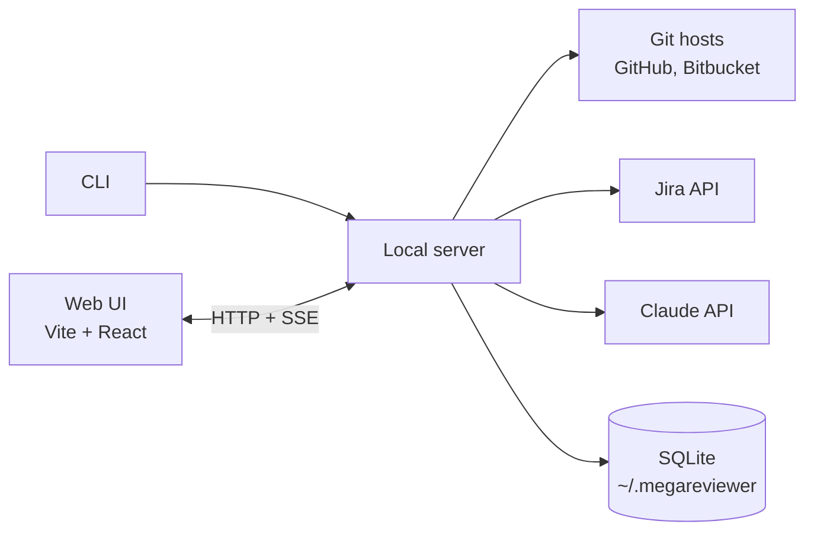

# Architecture

How megareviewer is built. [DESIGN.md](DESIGN.md) covers what it does and why.

## Shape: local-first, no server of ours

megareviewer is a CLI that serves a web UI on the user's machine:

```
npx megareviewer
```

It starts a local server on `127.0.0.1`, opens the browser, and does everything from there. Code, credentials and results never touch infrastructure we run.

Why:

- **Nothing to host or pay for.** Users bring their own Anthropic credentials.
- **Privacy is simple to explain.** "Your code never leaves your machine, except to the model provider" makes security reviews easy.
- **A local process can do what a browser page can't.** It can call Jira and Bitbucket (which block cross-origin browser requests), reuse the `gh` token, read the local git checkout, and later read agent transcripts on disk.

Costs we accept:

- **No shared state between reviewers.** The git host is the shared store: the review is published back to the PR.
- **Each reviewer pays for their own analysis.** A CI step that precomputes it is the later fix.
- **No webhooks,** so analysis starts when the PR is opened in the UI. Results stream so the intent summary shows up first.

## Git hosts

Supported: **GitHub** and **Bitbucket Cloud**.

The pipeline and UI never talk to a host directly. Each host is a connector behind one interface:

| Operation | GitHub | Bitbucket Cloud |
|---|---|---|
| Get PR (title, description, branch, head SHA) | `GET /repos/{o}/{r}/pulls/{n}` | `GET /2.0/repositories/{ws}/{repo}/pullrequests/{id}` |
| Get commits | `.../pulls/{n}/commits` | `.../pullrequests/{id}/commits` |
| Get diff (unified) | `.../compare/{base}...{head}` at the PR's SHAs, with diff media type, so a push while loading can't mismatch diff and head SHA | `.../diff/{head}..{dest}?topic=true` at the PR's commits: the same three-dot diff the PR's diff endpoint redirects to, pinned the same way |
| Get files at commits | One GraphQL query per 25 files (`object(expression: "sha:path")`); `.../contents/{path}?ref={sha}` for a file GraphQL truncates or won't give as text | `.../src/{sha}/{path}`, one request per file, 8 at a time |
| List PRs to review | Search API (`review-requested:@me`, `author:@me`) | PRs to review: per repo, the 50 most recently updated of the configured workspace. Own PRs: one workspace-wide call |
| Publish review | One PR review with inline comments and a verdict | Approve or request changes, plus one call per inline comment |

Both hosts return a unified diff, so hunk splitting and everything after it is shared.

Bitbucket specifics:

- **No cross-repo "waiting for my review" search.** The picker scans the 50 most recently updated repos of the configured workspace. A pasted PR URL always works.
- **Publishing isn't atomic.** Comments are posted one by one, so the server records each posted comment and skips it on retry, avoiding duplicates after a partial failure.
- **Inline comments anchor on the PR's current diff,** not on a commit. Publishing refuses when the PR has new commits since the analysis, so comments can't land on the wrong lines.

Flaky networks: on a lossy link, one dropped request used to fail the whole analysis, and a stalled one could hang for minutes. So:

- **Every read times out after 60 seconds** and fails as a network error.
- **Reads that fail on the network are retried** three times, after 1, 2 and 4 seconds. One wrapper around every host does this, so both hosts share the policy. Other failures, such as a rate limit or a missing PR, are answers and aren't retried.
- **Publishing is never retried and has no timeout.** A post that failed on the network may still have been posted, and retrying it would post it twice. The reviewer retries it, and the posted-comment records skip what's already there.

## Components



| Component | Role | Tech |
|---|---|---|
| CLI | Checks credentials, starts the server, opens the browser | Node 22.13+, TypeScript |
| Local server | Serves the UI and the API, runs the analysis pipeline, holds all credentials | Hono |
| Web UI | PR picker, review page, publishing | Vite, React, Shiki |
| Connectors | Git hosts, tickets, model calls | Octokit, Bitbucket REST, Jira REST, `@anthropic-ai/sdk` |
| Code analysis | Parse changed files for mechanical proofs and call-graph hints | `web-tree-sitter` |
| Store | Cached analyses and review state | SQLite via built-in `node:sqlite`, plain SQL migrations |

It ships as one npm package. The server is bundled into a single file with no runtime dependencies, and the UI is prebuilt and served as static files. A tiny launcher runs first and checks the Node version, so Node older than 22.13, the first with `node:sqlite` unflagged, gets a clear message instead of a failed import of `node:sqlite`.

## Why TypeScript everywhere

- **The UI is TypeScript anyway.** Using it for the server too means one language, one toolchain, and one set of Zod schemas shared by the model calls, the server and the UI.
- **The libraries we need are first-class in TypeScript.** Octokit, the Anthropic SDK with Zod helpers, and tree-sitter's WASM build.
- **Easy install.** `npx` works on almost every developer machine with nothing extra to install.

Trade-offs we accept, and how we limit them:

| Trade-off | Mitigation |
|---|---|
| npm supply-chain risk in a tool that holds credentials | The server is bundled at publish time, so users install one package with no dependencies and no third-party install scripts. No native modules (hence `node:sqlite`). Few dependencies (see [ENGINEERING.md](ENGINEERING.md)). |
| Users need Node | Bun can compile the same code into a single binary if that becomes a blocker. |
| Weaker for heavy analysis later | The HTTP API between UI and server is the seam: the server can be rewritten in Go without touching the UI. |

Alternatives considered:

- **Go server + TypeScript UI:** a single binary and a smaller attack surface, but two toolchains and a schema generated for both. We'd switch if security-sensitive buyers or install friction become the blocker.
- **Rust:** no official Claude SDK, and slower iteration that doesn't pay off for mostly-network work.
- **Python:** the hardest to install on users' machines.

## Releases

Versions are published to npm from CI: pushing a `v*` tag runs every check, builds the package, and publishes it with npm provenance. Users can verify that a version was built from this repository at a given commit, which matters for a tool that holds their credentials. Publishing from a laptop was the alternative; it's simpler, but nothing ties the published files to the source. megareviewer is MIT-licensed.

## Credentials

| Service | Source | Required |
|---|---|---|
| GitHub | `GITHUB_TOKEN`, else `GH_TOKEN`, else `gh auth token` | For GitHub PRs |
| Bitbucket Cloud | `BITBUCKET_EMAIL` + `BITBUCKET_API_TOKEN` (scoped Atlassian API token), else `BITBUCKET_USERNAME` + `BITBUCKET_APP_PASSWORD`; `BITBUCKET_WORKSPACE` for the picker | For Bitbucket PRs |
| Anthropic | SDK default resolution: `ANTHROPIC_API_KEY`, else an `ant auth login` profile | For `--ai`, which fails at startup without them |
| Jira | `JIRA_BASE_URL`, `JIRA_EMAIL`, `JIRA_API_TOKEN` | No. Without it, ticket keys are shown but not fetched |

Bitbucket app passwords are accepted because existing setups for other tools often have them, and both kinds are the same Basic auth to the adapter. Atlassian removed app passwords in July 2026, so `doctor` points to an API token when one is rejected; rejecting them outright at startup was the alternative.

At least one git host must be configured. Credentials stay in the server process and are never sent to the browser.

## Analysis pipeline

Input is a PR URL from either host. Output is one analysis, cached by `(host, repo, PR, head SHA, pipeline version)`, so reopening a PR is instant and a new push triggers a fresh analysis. The pipeline version says whether the model ran, so starting with `--ai` analyzes again.

The model passes run only with `--ai`. Without it, the analysis is complete after prep, and the four model stages show as skipped.

### 1. Collect

- PR title, description, branch name, commits, and the diff, from the host connector.
- Base and head contents of each changed file, for parsing and context.
- Jira tickets: keys matching `[A-Z][A-Z0-9]+-\d+` in the description, commit messages and branch name, fetched from Jira.

### 2. Deterministic prep (no model)

- Split the diff into hunks with stable IDs. Every later stage refers to hunks by ID.
- Mark hunks as **mechanical with proof** when a check proves it:
  - generated or vendored files (lockfiles, `linguist-generated` in `.gitattributes`, known build output);
  - whitespace-only changes;
  - pure renames (rename headers in the diff with no content change);
  - moved code (removed and added blocks match after normalization);
  - formatting-only changes (tree-sitter syntax trees are identical before and after).
- Split each hunk without a proof into **parts**, one per definition it changes. A hunk is whatever git put between two unchanged stretches, so one can hold three routes, and the tour could place it only once: on delphi-code #2, three routes added in one hunk made one flow of 32 of the 48 hunks. The cut is at the outermost definitions that start or end inside the hunk, so a class around a block of methods cuts at its methods. Deleted lines go with the definition around them in the base file, and an unchanged line shared by a base and a head definition makes them one, so a renamed method stays one part. Lines outside any changed definition (imports, decorators, comments, unchanged stretches) join the next part. Tests split too. A proved hunk is never split, since its proof is about the whole hunk. Risk, proofs, decisions and comments stay per hunk; hints, the tour and reviewed marks are per part.
- Build call-graph hints with tree-sitter: which changed symbols are defined, and which changed code calls or uses them. A use links to a definition only in its own file or in a file its imports reach, never across languages or from code into tests, and a type annotation isn't a use. Matching names across the whole PR was the first version: on a real PR it linked Python and TypeScript files that shared a class name, pointed production code at test fakes, and joined most of the PR into one tour step. A missing link hides no code, so the hints err toward fewer.
- Link changed files by their imports, by the same rules, for the overview: an import that reaches another changed file is a link, even where no hint does, such as an app importing the module that registers its routes.

- Classify every remaining hunk as *contract* or *logic* with rules: dependency manifests, schemas and migrations, CI and infrastructure, repository config, auth and security paths, risky calls in added lines, and removed or skipped tests. A rule can only raise a hunk to *contract*; one no rule matches is *logic*.
- Build the tour from the call-graph hints, as flows. A flow starts at an entry point a user or caller reaches (an HTTP route, a page, a command), found by framework markers on added lines, and reads the changed code it runs, callers before callees. Code an earlier flow read is linked from the next flow instead of shown again. Types, imports, tests and docs join the flow they belong with; what no flow runs goes into supporting steps: API schema, docs, tests, and other changes by area. Flows that reach contract hunks come first. The tour has no step cap: merging unrelated code to meet one would hide the story. Grouping the files the call graph connects was the first version: its steps were whatever happened to connect, titled by a chain of symbols, and on a real PR one step held 33 of 48 hunks. Code that registers an entry, like a router the routes are declared on or an app adding that router, is read first in the first flow it registers.
- Join back the parts the tour read together: consecutive parts of one hunk in the same step become one part again, and a hunk read in one step is whole again. Splitting without joining gave 115 parts on delphi-code #2, one file in 29 pieces, too fine to read; with joining, 8 of its 48 hunks stay split, into 32 parts, and each of its three routes is a flow of its own. The model's passes see whole hunks: its input maps hints back to hunks, and each hunk its tour lists reads as all of its parts.

The model can't override a mechanical proof. It only classifies the hunks that remain, and a hunk a rule marks *contract* stays *contract* whatever the model says. When the model's tour fails validation twice, the call-graph tour replaces it.

### 3. Model passes

Only with `--ai`. All passes use **Claude Haiku 5.5** (`claude-haiku-5-5`) with structured outputs (Zod schemas) and streaming. They share one cached prompt prefix holding the PR context, so the PR is paid for in full once and read from cache by the later passes. Effort is set per pass. Changing the output format or the top-level effort between requests would invalidate that cache, so every pass sends the same output schema (a union of the four outputs, tagged by pass) and sets its effort in a system message after the PR context.

| Pass | Output | Effort | Runs |
|---|---|---|---|
| Intent | Stated intent (description, tickets), intent inferred from the code, and mismatches between them | medium | First, streamed to the UI |
| Risk | Each remaining hunk marked *logic* or *contract*, with a one-line reason | low | In parallel with Decisions |
| Decisions | Decisions the code makes, each with a category, why it matters, and the hunk IDs it rests on | high | In parallel with Risk |
| Tour | Hunks ordered into concept steps, starting from the entry point, using the call-graph hints | medium | Last, needs Risk and Decisions |

Intent and tour are kept short, because the reviewer reads them before any code. Each intent summary is one sentence, with at most 5 behavior changes. The tour has at most 7 steps, one per concept. Tests, generated files and docs join the step of the code they belong to instead of getting their own. A 12-step tour with a step each for tests, generated types and docs was the first version, and reviewers found it noisy.

The server validates every response: every referenced hunk ID must exist, and the tour must cover every non-mechanical hunk exactly once. On failure it retries the pass once, then shows the error.

PR content is untrusted. A description or code comment can contain text aimed at the model, so:

- The model has no tools. The worst a prompt injection can do is distort the analysis.
- Model output is rendered as text, never as HTML.
- Mechanical proofs come from deterministic code, not the model.

**Size limits.** Mechanical hunks are sent as path plus stats, not content. If the PR still doesn't fit in the context window, the analysis fails with a clear message. It never silently truncates.

**Model and cost.** Haiku 5.5 is the cheapest model, at $0.10 per million input tokens and $0.50 per million output tokens for prompts up to 100K tokens, five times that above. A medium PR costs a few cents. This is an estimate, to be measured on real PRs. Each reviewer pays for their own analysis, so cost per review decides whether people run it at all. Opus 5.5 was the first choice: stronger analysis, but on the order of $1 per medium PR. The evals measure what the cheaper model costs in quality. Haiku has no server-side refusal fallback, so a refused pass fails with the model's reason instead of being answered by another model.

## UI

**PR picker.** Lists PRs waiting for the user's review and their own open PRs from every configured host, or accepts a pasted PR URL.

**Review page.** It opens on the code. The header holds the PR and its intent in one line: the model's summary with `--ai`, or the description's first line without it. A red chip names a mismatch between what was asked and what the code does, and goes to the code it rests on; "Details" opens the full intent in a dialog. The reviewer picks one of two layouts with a switch (`v`), kept per browser:

- **Map**, the default: every hunk in one scroll, step after step in tour order, then the proved-mechanical changes. A rail beside it has a bar per hunk or part, sized by its length, colored by risk and marked for each decision and contract rule on it; the hunks in view are outlined, reviewed ones dimmed, and a click scrolls there. The first call in a step to a changed hunk has a chip under its line that opens the called hunk in place, indented, so the reviewer reads down the call stack without leaving the page. A later call to that hunk in the same step underlines the symbol instead, with a peek of the called code on hover or focus; a symbol that reaches several hunks is one chip listing them. Under a hunk's header, its callers are listed by file, tests counted. A chip on every call was the first version: on delphi-code #2, 29 of 54 chips repeated a call shown earlier in the same step, and one hunk listed six of its 17 callers by symbol. A part of a split hunk is a card, a bar and a reviewed mark of its own: its header names what it changes, which part it is and the steps the rest of its hunk is in, and a row above and below its lines goes to the hunk's neighboring parts. The header's count stays in hunks: a split hunk is reviewed once all its parts are.
- **Overview:** the changed files as a layered diagram. Files nothing in the PR calls are on top, each file one row below its lowest caller, with its entry (routes, a page, a command) named on it. Edges are imports, calls and type uses between files; color is the file's highest risk class and width its lines changed. Tests and test helpers are badges on the files they reach, generated files are faded, and files no edge touches sit in a strip under the diagram. A click opens the file's first hunk in the map, and Esc there comes back. Above 40 files, files group by directory, and a group opens in place. Rows by depth, ordered by their neighbors' positions, are enough at that size without a layout library.

The overview replaced a call tree: the changed hunks as a tree of symbols from the entry points. On delphi-code #2 it had 42 rows for 29 hunks, 13 of them "above" references to a hunk placed higher, three test files among its seven roots, and 19 hunks under "Not on a call path". Its rows were symbols, so it never showed that the PR runs from the routes through the services to the host classes and the keychain. Reviewers didn't use it. A tree of the tour's flows instead of symbols is the alternative kept for later.

In the map, each decision is a card under the first hunk it rests on, with approve, reject and comment there, and its other hunks link to it. Mechanical hunks are collapsed with their proof ("moved, verified identical"), and the user can expand them. A jump palette (`⌘K`) searches decisions, mismatches, contract changes, symbols, steps and files; in the overview, it focuses the item's file.

The page opens on the code because the intro in front of it, an intent panel and two sidebars, was what reviewers skipped. Two alternatives were rejected:

- A path of questions, one per concern, which put the intent and a question before every piece of code.
- One tour step at a time beside sidebars for the tour and the decisions. It split the reader's attention across three panels. It was the first version.

**Publish.** Sends the review to the PR's host with a verdict (approve or request changes). Rejected decisions and comments become inline comments on their hunks, and comments the reviewer wrote on hunk lines go on those lines. Without decisions, the reviewer picks the verdict. The user confirms before anything is posted.

Comments on hunk lines are drafts in the browser's local storage until they're sent with the publish request, which checks that each is on a line the diff shows. A `hunk_comments` table with its own routes was the plan; the drafts belong to one reviewer in one browser, like reviewed marks, and the posted-comment records already make publishing safe to retry.

## Storage

SQLite at `~/.megareviewer/db.sqlite`:

| Table | Holds |
|---|---|
| `analyses` | host, repo, PR number, head SHA, pipeline version, status, result JSON |
| `decision_reviews` | analysis, decision ID, status (pending / approved / rejected), comment |
| `published_comments` | analysis, comment key (a decision or the summary), host comment ID, published time |
| `publications` | analysis, review URL, published time |
| `file_contents` | host, repo, commit SHA, path, content (or none, when the file isn't at that commit), fetched time |

The pipeline version changes whenever prompts or schemas change, which invalidates cached analyses.

`file_contents` keeps every file fetched from a host. A file at a commit never changes, so an analysis that failed partway, or another analysis of the same commits, doesn't fetch it again. Rows older than 30 days are dropped when megareviewer starts. A file over 1 MB isn't kept, because the analysis doesn't use it.

## Local server security

- Binds to `127.0.0.1` only.
- The CLI creates a random session token and opens the UI with it. Every API request must carry the token, and the server checks the `Host` header. This stops other web pages and DNS rebinding from reaching the API.

## First slice

In scope: the CLI, GitHub and Bitbucket Cloud connectors, PR picker, all four model passes, the review page, decision approvals stored locally, and publishing to the host.

Later, in rough order:

1. Read the local git checkout when one exists (full repo context, no API rate limits, other git hosts).
2. Carry decision statuses over when a PR gets new commits.
3. Agent transcripts (e.g. Claude Code sessions) as an intent source.
4. Ask the code (principle 7).
5. A CI step (GitHub Action, Bitbucket Pipelines) that precomputes the analysis and attaches it to the PR.
6. Desktop app via Tauri.
