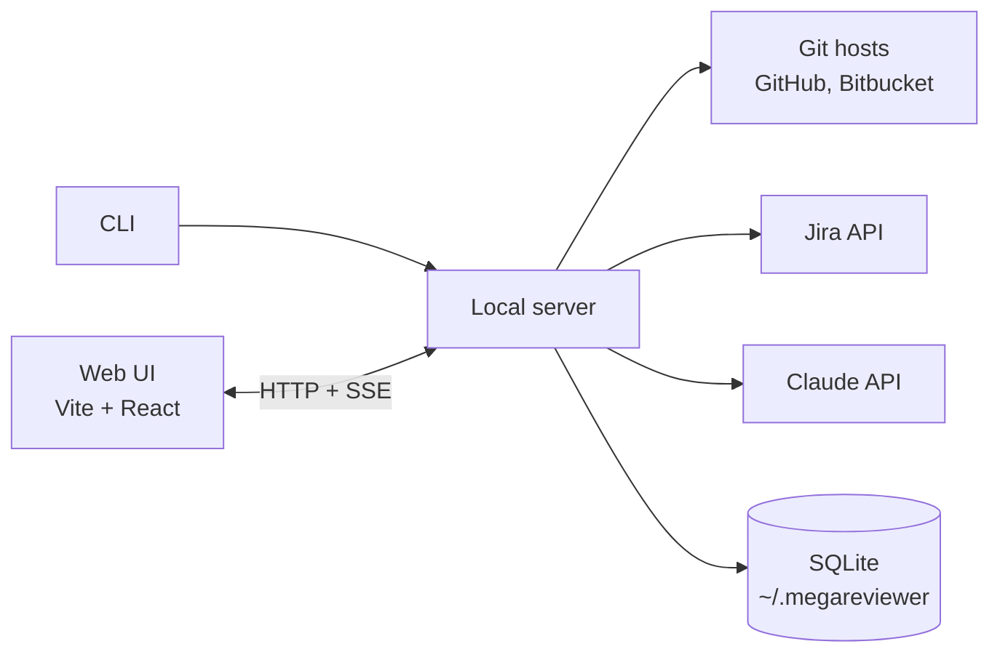

# Architecture

How megareviewer is built. [DESIGN.md](DESIGN.md) covers what it does and why.

## Shape: local-first, no server of ours

megareviewer is a CLI that serves a web UI on the user's machine:

```
npx megareviewer
```

It starts a local server on `127.0.0.1`, opens the browser, and does everything from there. Code, credentials and results never touch infrastructure we run.

Why:

- **Nothing to host or pay for.** Users bring their own Anthropic credentials.
- **Privacy is simple to explain.** "Your code never leaves your machine, except to the model provider" makes security reviews easy.
- **A local process can do what a browser page can't.** It can call Jira and Bitbucket (which block cross-origin browser requests), reuse the `gh` token, read the local git checkout, and later read agent transcripts on disk. The checkout is read when there is one (see [Local checkout](#local-checkout)) and never changed.

Costs we accept:

- **No shared state between reviewers.** The git host is the shared store: the review is published back to the PR.
- **Each reviewer pays for their own analysis.** A CI step that precomputes it is the later fix.
- **No webhooks,** so analysis starts when the PR is opened in the UI. Results stream so the intent summary shows up first.

## Git hosts

Supported: **GitHub** and **Bitbucket Cloud**.

The pipeline and UI never talk to a host directly. Each host is a connector behind one interface:

| Operation | GitHub | Bitbucket Cloud |
|---|---|---|
| Get PR (title, description, branch, head SHA) | `GET /repos/{o}/{r}/pulls/{n}` | `GET /2.0/repositories/{ws}/{repo}/pullrequests/{id}` |
| Get commits | `.../pulls/{n}/commits` | `.../pullrequests/{id}/commits` |
| Get diff (unified) | `.../compare/{base}...{head}` at the PR's SHAs, with diff media type, so a push while loading can't mismatch diff and head SHA | `.../diff/{head}..{dest}?topic=true` at the PR's commits: the same three-dot diff the PR's diff endpoint redirects to, pinned the same way |
| Get files at commits | One GraphQL query per 25 files (`object(expression: "sha:path")`); `.../contents/{path}?ref={sha}` for a file GraphQL truncates or won't give as text | `.../src/{sha}/{path}`, one request per file, 8 at a time |
| List PRs to review | Search API (`review-requested:@me`, `author:@me`) | PRs to review: per repo, the 50 most recently updated of the configured workspace. Own PRs: one workspace-wide call |
| Publish review | One PR review with inline comments and a verdict | Approve or request changes, plus one call per inline comment |

Both hosts return a unified diff, so hunk splitting and everything after it is shared.

Bitbucket specifics:

- **No cross-repo "waiting for my review" search.** The picker scans the 50 most recently updated repos of the configured workspace. A pasted PR URL always works.
- **Publishing isn't atomic.** Comments are posted one by one, so the server records each posted comment and skips it on retry, avoiding duplicates after a partial failure.
- **Inline comments anchor on the PR's current diff,** not on a commit. Publishing refuses when the PR has new commits since the analysis, so comments can't land on the wrong lines.

Flaky networks: on a lossy link, one dropped request used to fail the whole analysis, and a stalled one could hang for minutes. So:

- **Every read times out after 60 seconds** and fails as a network error.
- **Reads that fail on the network are retried** three times, after 1, 2 and 4 seconds. One wrapper around every host does this, so both hosts share the policy. Other failures, such as a rate limit or a missing PR, are answers and aren't retried.
- **Publishing is never retried and has no timeout.** A post that failed on the network may still have been posted, and retrying it would post it twice. The reviewer retries it, and the posted-comment records skip what's already there.

## Local checkout

The checkout is the directory given with `--checkout`, or else the one megareviewer runs in. It's read when it has the PR's head commit, whatever its remotes say: the commit pins every file's content, so a fork's checkout, or one cloned before its owner was renamed, reads the same. Requiring a remote that names the PR's repository was the plan, and refused delphi-code's own checkout, whose remote still names its owner's old account. The remotes only decide what the page says when the commit is missing: with one that names the repository, that a `git fetch` would bring it; without, that no checkout was found. `doctor` names the checkout and the repositories its remotes name.

Reading runs `git` without a shell and without a new dependency: `cat-file -e` for the commit, `ls-tree` for the files at it, and `cat-file --batch` for many files in one process, after `--batch-check` skips those over 1 MB. Nothing it runs fetches, checks out or writes, so the reviewer's working tree stays as it is. A failure to read is a warning on the analysis, never a failed analysis.

It's used for one thing so far: the unchanged callers of what the PR changes (see prep).

## Components



| Component | Role | Tech |
|---|---|---|
| CLI | Checks credentials, starts the server, opens the browser | Node 22.13+, TypeScript |
| Local server | Serves the UI and the API, runs the analysis pipeline, holds all credentials | Hono |
| Web UI | PR picker, review page, publishing | Vite, React, Shiki |
| Connectors | Git hosts, tickets, model calls, the local checkout | Octokit, Bitbucket REST, Jira REST, `@anthropic-ai/sdk`, the `git` command |
| Code analysis | Parse changed files for mechanical proofs and call-graph hints | `web-tree-sitter` |
| Store | Cached analyses and review state | SQLite via built-in `node:sqlite`, plain SQL migrations |

It ships as one npm package. The server is bundled into a single file with no runtime dependencies, and the UI is prebuilt and served as static files. A tiny launcher runs first and checks the Node version, so Node older than 22.13, the first with `node:sqlite` unflagged, gets a clear message instead of a failed import of `node:sqlite`.

## Why TypeScript everywhere

- **The UI is TypeScript anyway.** Using it for the server too means one language, one toolchain, and one set of Zod schemas shared by the model calls, the server and the UI.
- **The libraries we need are first-class in TypeScript.** Octokit, the Anthropic SDK with Zod helpers, and tree-sitter's WASM build.
- **Easy install.** `npx` works on almost every developer machine with nothing extra to install.

Trade-offs we accept, and how we limit them:

| Trade-off | Mitigation |
|---|---|
| npm supply-chain risk in a tool that holds credentials | The server is bundled at publish time, so users install one package with no dependencies and no third-party install scripts. No native modules (hence `node:sqlite`). Few dependencies (see [ENGINEERING.md](ENGINEERING.md)). |
| Users need Node | Bun can compile the same code into a single binary if that becomes a blocker. |
| Weaker for heavy analysis later | The HTTP API between UI and server is the seam: the server can be rewritten in Go without touching the UI. |

Alternatives considered:

- **Go server + TypeScript UI:** a single binary and a smaller attack surface, but two toolchains and a schema generated for both. We'd switch if security-sensitive buyers or install friction become the blocker.
- **Rust:** no official Claude SDK, and slower iteration that doesn't pay off for mostly-network work.
- **Python:** the hardest to install on users' machines.

## Releases

Versions are published to npm from CI: pushing a `v*` tag runs every check, builds the package, and publishes it with npm provenance. Users can verify that a version was built from this repository at a given commit, which matters for a tool that holds their credentials. Publishing from a laptop was the alternative; it's simpler, but nothing ties the published files to the source. megareviewer is MIT-licensed.

## Credentials

| Service | Source | Required |
|---|---|---|
| GitHub | `GITHUB_TOKEN`, else `GH_TOKEN`, else `gh auth token` | For GitHub PRs |
| Bitbucket Cloud | `BITBUCKET_EMAIL` + `BITBUCKET_API_TOKEN` (scoped Atlassian API token), else `BITBUCKET_USERNAME` + `BITBUCKET_APP_PASSWORD`; `BITBUCKET_WORKSPACE` for the picker | For Bitbucket PRs |
| Anthropic | SDK default resolution: `ANTHROPIC_API_KEY`, else an `ant auth login` profile | For `--ai`, which fails at startup without them |
| Jira | `JIRA_BASE_URL`, `JIRA_EMAIL`, `JIRA_API_TOKEN` | No. Without it, ticket keys are shown but not fetched |

Bitbucket app passwords are accepted because existing setups for other tools often have them, and both kinds are the same Basic auth to the adapter. Atlassian removed app passwords in July 2026, so `doctor` points to an API token when one is rejected; rejecting them outright at startup was the alternative.

At least one git host must be configured. Credentials stay in the server process and are never sent to the browser.

## Analysis pipeline

Input is a PR URL from either host. Output is one analysis, cached by `(host, repo, PR, head SHA, pipeline version)`, so reopening a PR is instant and a new push triggers a fresh analysis. The pipeline version says whether the model ran and whether a local checkout was read, so starting with `--ai`, or reopening a PR once the checkout has its head commit, analyzes again.

The model passes run only with `--ai`. Without it, the analysis is complete after prep, and the four model stages show as skipped.

### 1. Collect

- PR title, description, branch name, commits, and the diff, from the host connector.
- Base and head contents of each changed file, for parsing and context.
- Jira tickets: keys matching `[A-Z][A-Z0-9]+-\d+` in the description, commit messages and branch name, fetched from Jira.
- Whether the local checkout has the PR's head commit, decided before the analysis starts, since its pipeline version says so.

### 2. Deterministic prep (no model)

- Split the diff into hunks with stable IDs. Every later stage refers to hunks by ID.
- Mark hunks as **mechanical with proof** when a check proves it:
  - generated or vendored files (lockfiles, `linguist-generated` in `.gitattributes`, known build output);
  - whitespace-only changes;
  - pure renames (rename headers in the diff with no content change);
  - moved code (removed and added blocks match after normalization);
  - formatting-only changes (tree-sitter syntax trees are identical before and after).
- Split each hunk without a proof into **parts**, one per definition it changes. A hunk is whatever git put between two unchanged stretches, so one can hold three routes, and the tour could place it only once: on delphi-code #2, three routes added in one hunk made one flow of 32 of the 48 hunks. The cut is at the outermost definitions that start or end inside the hunk, so a class around a block of methods cuts at its methods. Deleted lines go with the definition around them in the base file, and an unchanged line shared by a base and a head definition makes them one, so a renamed method stays one part. Lines outside any changed definition (imports, decorators, comments, unchanged stretches) join the next part. Tests split too. A proved hunk is never split, since its proof is about the whole hunk. Proofs, decisions and comments stay per hunk, and so does risk, except that the page runs the rules on a split part's own lines (see Map); hints, the tour and reviewed marks are per part.
- Build call-graph hints with tree-sitter: which changed symbols are defined, and which changed code calls or uses them. A use links to a definition only in its own file or in a file its imports reach, never across languages or from code into tests, and a type annotation isn't a use. Matching names across the whole PR was the first version: on a real PR it linked Python and TypeScript files that shared a class name, pointed production code at test fakes, and joined most of the PR into one tour step. A missing link hides no code, so the hints err toward fewer.
- Link changed files by their imports, by the same rules, for the overview: an import that reaches another changed file is a link, even where no hint does, such as an app importing the module that registers its routes.
- Link requests to routes, across languages: a call that names an HTTP method and a literal path (a typed or generated client, `fetch` and the like, a test client in a test) links to the part that adds the route serving it. Methods match exactly and paths segment by segment, a placeholder in any syntax matching one segment. A base prefix the client adds isn't in the code, so a request also matches after dropping its leading segments, but only when that leaves one route. Hints stop at a language, so a full-stack PR was two islands: on delphi-code #2, nothing linked the page to the three routes it calls.

- With a checkout, find the **unchanged callers** of what the PR changes: code outside the PR that calls a definition the PR changes, or names it as a type, which is where a regression shows. A changed definition is one the base file has and whose own lines the PR adds or deletes, not counting nested definitions or blank lines, so a class that only gains methods isn't one. Callers are found by the hints' rules: through imports (or the package, in Go and Java), within a language family, never from code into tests, and not type uses of generated files. Only files in the PR's languages whose text names a changed definition are parsed, and languages whose imports aren't read are left out. At most 50 uses per definition are kept, code first, with the rest counted. Matching names across the repository was measured first: on delphi-code #2 it found 357 uses in 83 files, almost all other things named `state`, `to_json` or `main`. Following imports leaves 6: `create_app`'s three callers, the one of `clone_credentials`, whose order of credentials the PR changes, and the page that renders `CredentialsGuide`. One level only; callers of callers would need the same reading again.
- Classify every remaining hunk as *contract* or *logic* with rules: dependency manifests, schemas and migrations, CI and infrastructure, repository config, auth and security paths, credential handling in any path, risky calls in added lines, and removed or skipped tests. A rule can only raise a hunk to *contract*; one no rule matches is *logic*. Credential handling is read from the names a hunk changes: one that ends in a credential noun after a storage verb (`save_secret`, `forget_saved_token`), one about authorization (`_authorization_for`, `require_permission`), and a route declaration that changes a credential (`PUT …/token`). A noun has to end the name and a verb come with it, so `save_token_count` and `count_tokens` don't match, and a test's own name and a React state setter like `setToken` don't count. Paths alone were the first version: on delphi-code #2 they made the fake keychain and the credentials guide *contract* and left the methods that save and forget tokens, and the routes that change them, *logic*.
- Build the tour from the call-graph hints, as flows, with or without the model, so the page shows it once prep is done. A flow starts at an entry point a user or caller reaches (an HTTP route, a page, a command), found by framework markers on added lines, and reads the changed code it runs, callers before callees. Code that more than one flow runs is read once, in a shared section before them, and each of those flows passes through it: one section per connected piece of shared code, with the tests of that code, titled `Shared:` and where the flows enter it, and saying which steps use it. A section is a flow step without entries, so the model titles it but can't merge it away. Reading shared code in the first flow that reached it was the first version: on delphi-code #2 the GET flow read 37 of 73 parts, most of them the connection and keychain code that PUT and DELETE run too. With shared sections the largest step has 23 parts and GET 21, and every part is still placed once. Code an earlier flow read is linked from the next flow instead of shown again. Types, imports, tests and docs join the flow they belong with; what no flow runs goes into supporting steps: API schema, docs, tests, and other changes by area. Shared sections come first, then flows that reach contract hunks. The tour has no step cap: merging unrelated code to meet one would hide the story. Grouping the files the call graph connects was the first version: its steps were whatever happened to connect, titled by a chain of symbols, and on a real PR one step held 33 of 48 hunks. Code that registers an entry, like a router the routes are declared on or an app adding that router, is read first in the first flow it registers. A request never extends a flow: the flow passes through the route in an earlier step, says what it sends, and comes after the route's flow. A page flow that walked into the backend would read the whole PR. A test that requests a route joins that route's flow.
- Join back the parts the tour read together: consecutive parts of one hunk in the same step become one part again, and a hunk read in one step is whole again. Splitting without joining gave 115 parts on delphi-code #2, one file in 29 pieces, too fine to read; with joining, 8 of its 48 hunks stay split, into 32 parts, and each of its three routes is a flow of its own. The model's passes see whole hunks: its input maps hints back to hunks, and the tour pass names a part by its hunk and lines.

The model can't override a mechanical proof. It only classifies the hunks that remain, and a hunk a rule marks *contract* stays *contract* whatever the model says. The tour's steps are always the code's; the model only titles them, and when its titles fail validation twice, the steps keep the code's titles.

### 3. Model passes

Only with `--ai`. All passes use **Claude Haiku 5.5** (`claude-haiku-5-5`) with structured outputs (Zod schemas) and streaming. They share one cached prompt prefix holding the PR context, so the PR is paid for in full once and read from cache by the later passes. Effort is set per pass. Changing the output format or the top-level effort between requests would invalidate that cache, so every pass sends the same output schema (a union of the four outputs, tagged by pass) and sets its effort in a system message after the PR context.

| Pass | Output | Effort | Runs |
|---|---|---|---|
| Intent | Stated intent (description, tickets), intent inferred from the code, and mismatches between them | medium | First, streamed to the UI |
| Risk | Each remaining hunk marked *logic* or *contract*, with a one-line reason | low | In parallel with Decisions |
| Decisions | Decisions the code makes, each with a category, why it matters, and the hunk IDs it rests on | high | In parallel with Risk |
| Tour | A title and an explanation for each step of the code's tour, and merges of supporting steps into the steps they belong with, each with a reason | medium | Last, needs Risk and Decisions |

Intent is kept short, because the reviewer reads it before any code: each summary is one sentence, with at most 5 behavior changes.

The tour pass reads the code's tour after the PR context: each step's kind, its entries, its parts by hunk and lines, the code it passes through, and the code's title and explanation. It writes a title of at most 80 characters naming behavior ("Save a host's token", not `PUT /api/account-connections/{domain}/token`) and an explanation of at most 300 per step, and may merge a supporting step, such as docs, into the step it belongs with, giving a reason. It can't move or drop a part, so it can't miss a hunk, and the page shows the code's title under the model's, so the reader can check one against the other. The model wrote its own tour at first, at most 7 steps, because a 12-step tour with a step each for tests, generated types and docs was noisy. On delphi-code #2 that tour grouped by layer: the page, the routes, the services, the hosts and the keychain, with the three routes in one step. A tour the reader can check against the call graph is worth more than the model's grouping, and flows already put tests, generated types and docs with their code, so the cap went with it. The pass also got cheaper there, $0.011 instead of $0.016, because it writes titles instead of lists of hunks.

The server validates every response: every referenced hunk ID must exist, and every step of the tour must have exactly one title, with merges only of supporting steps, each once, into a step that isn't merged itself. On failure it retries the pass once with what was wrong, then shows the error; for the tour, the steps keep the code's titles instead.

PR content is untrusted. A description or code comment can contain text aimed at the model, so:

- The model has no tools. The worst a prompt injection can do is distort the analysis.
- Model output is rendered as text, never as HTML.
- Mechanical proofs come from deterministic code, not the model.

**Size limits.** Mechanical hunks are sent as path plus stats, not content. If the PR still doesn't fit in the context window, the analysis fails with a clear message. It never silently truncates.

**Model and cost.** Haiku 5.5 is the cheapest model, at $0.10 per million input tokens and $0.50 per million output tokens for prompts up to 100K tokens, five times that above. A medium PR costs a few cents. This is an estimate, to be measured on real PRs. Each reviewer pays for their own analysis, so cost per review decides whether people run it at all. Opus 5.5 was the first choice: stronger analysis, but on the order of $1 per medium PR. The evals measure what the cheaper model costs in quality. Haiku has no server-side refusal fallback, so a refused pass fails with the model's reason instead of being answered by another model.

## UI

**PR picker.** Lists PRs waiting for the user's review and their own open PRs from every configured host, or accepts a pasted PR URL.

**Review page.** It opens on the code. The header holds the PR and its intent in one line: the model's summary with `--ai`, or the description's first line without it, with its Markdown markers dropped as plain text. A red chip names a mismatch between what was asked and what the code does, and goes to the code it rests on; "Details" opens the full intent in a dialog, and says why nothing outside the PR is shown when no checkout was read. The reviewer picks one of two layouts with a switch (`v`), kept per browser:

- **Map**, the default: every hunk in one scroll, step after step in tour order, then the proved-mechanical changes. Within a step, a file's parts are one card, in the file's order, and the files come in the order the step reaches them. The card names the file once, with one Reviewed mark for its parts in that step and how many of them are contract. Each part is under a one-line divider with its lines, what it changes and, when it's contract, why; its risk is the color of a bar beside its lines. A divider doesn't show git's section heading, the line above the hunk that `@@` names: under the code before it, it read as one more line of the diff, and it often names a definition the hunk doesn't change. The divider links only to code the reader doesn't meet in the step: callers in other steps, and Related parts when the rest of its hunk is in another step. When the rules made a split hunk's risk, the page runs them on each part's own lines, so a part is contract for what it changes, and a part git put in a hunk beside credential code is logic, still shown in full; the model's risk is about the whole hunk and stays the hunk's. The hunk's risk on every part was the first version: on delphi-code #2, `account_connections` was red for `save_token` and `forget_saved_token`, which other parts of its hunk change. Between two parts the card counts the lines, and links to the file's parts other steps read there. In the rail, a file with several parts in a step is its name once, then a short row per part with its lines and risk. The first file cards kept each part's full header, a callers row, a Related parts row and a chip row under every first call, and most of those pointed at code on the same card. Call order within a step was the first version: a step that goes back and forth between two files showed each file as several cards, the path repeated on each, and on delphi-code #2 the 79 parts were 79 cards. File cards make them 37, one per file per step, and give up the callers-before-callees order inside a step, which the call chips still show. One card per file for the whole PR was rejected: hosts.py is in five steps there, and one card would mix five flows. A step the model titled shows the code's title under it, and why a supporting step was merged into it. A rail beside it has a bar per hunk or part, sized by its length, colored by risk and marked for each decision and contract rule on it; the hunks in view are outlined, reviewed ones dimmed, and a click scrolls there. Every step's heading stays in the rail, but only the step being read lists its bars. A step that passes through others names each step once, with how many parts, and lists the parts when opened. The first call in a step to a changed hunk is the symbol itself, underlined, and a click opens the called hunk under its line, indented, so the reviewer reads down the call stack without leaving the page. A call whose symbol isn't one word on its line, such as a request, and a symbol that reaches several hunks keep a chip under the line. A chip under every first call was the first version; on a file card it was a row of its own, usually opening a part a few lines down the same card. A later call to that hunk in the same step underlines the symbol instead, with a peek of the called code on hover or focus; a symbol that reaches several hunks is one chip listing them. A request's chip names its method and path and opens the route's part. Under a hunk's header, its callers are listed by file, tests counted, and a part that changes a definition used outside the PR says "Used unchanged in 2 places and 1 test", opening each use with its file, line and the lines around it. A chip on every call was the first version: on delphi-code #2, 29 of 54 chips repeated a call shown earlier in the same step, and one hunk listed six of its 17 callers by symbol. A part of a split hunk is a bar of its own, and a card of its own when it's its file's only part in the step: its header names what it changes, and one Related parts row opens which part it is, the steps the rest of its hunk is in, and links to the hunk's neighboring parts. Those were all on the card at first, as a header and a row above and below its lines, which on delphi-code #2 made small parts mostly navigation. The header's count stays in hunks: a split hunk is reviewed once all its parts are.
- **Overview:** the changed files as a layered diagram. Files nothing in the PR calls are on top, each file one row below its lowest caller, with its entry (routes, a page, a command) named on it. Edges are imports, calls, type uses and requests between files, a request drawn apart because it crosses into another process; color is the file's highest risk class and width its lines changed. Tests and test helpers are badges on the files they reach, generated files are faded, and files no edge touches sit in a strip under the diagram. Files outside the PR that use what it changes are faded nodes one row below the file they use, with a dashed edge up into it, grouped by directory above 10; a click opens the code they use. A click opens the file's first hunk in the map, and Esc there comes back. Above 40 files, files group by directory, and a group opens in place. Rows by depth, ordered by their neighbors' positions, are enough at that size without a layout library.

The overview replaced a call tree: the changed hunks as a tree of symbols from the entry points. On delphi-code #2 it had 42 rows for 29 hunks, 13 of them "above" references to a hunk placed higher, three test files among its seven roots, and 19 hunks under "Not on a call path". Its rows were symbols, so it never showed that the PR runs from the routes through the services to the host classes and the keychain. Reviewers didn't use it. A tree of the tour's flows instead of symbols is the alternative kept for later.

At 1024px wide or less the header's controls wrap, the map's rail is behind a Show Map button above the code, and only code blocks and the overview's canvas scroll sideways, never the page. A minimum page width of 1000px was the first version: in a narrow browser it put the header's controls, Publish among them, offscreen.

In the map, each decision is a card under the first hunk it rests on, with approve, reject and comment there, and its other hunks link to it. Mechanical hunks are collapsed with their proof ("moved, verified identical"), and the user can expand them. A jump palette (`⌘K`) searches decisions, mismatches, contract changes, definitions used unchanged outside the PR, routes (with the files that request them), symbols, steps and files; in the overview, it focuses the item's file.

The page opens on the code because the intro in front of it, an intent panel and two sidebars, was what reviewers skipped. Two alternatives were rejected:

- A path of questions, one per concern, which put the intent and a question before every piece of code.
- One tour step at a time beside sidebars for the tour and the decisions. It split the reader's attention across three panels. It was the first version.

**Publish.** Sends the review to the PR's host with a verdict (approve or request changes). Rejected decisions and comments become inline comments on their hunks, and comments the reviewer wrote on hunk lines go on those lines. Without decisions, the reviewer picks the verdict. The user confirms before anything is posted.

Comments on hunk lines are drafts in the browser's local storage until they're sent with the publish request, which checks that each is on a line the diff shows. A `hunk_comments` table with its own routes was the plan; the drafts belong to one reviewer in one browser, like reviewed marks, and the posted-comment records already make publishing safe to retry.

## Storage

SQLite at `~/.megareviewer/db.sqlite`:

| Table | Holds |
|---|---|
| `analyses` | host, repo, PR number, head SHA, pipeline version, status, result JSON |
| `decision_reviews` | analysis, decision ID, status (pending / approved / rejected), comment |
| `published_comments` | analysis, comment key (a decision or the summary), host comment ID, published time |
| `publications` | analysis, review URL, published time |
| `file_contents` | host, repo, commit SHA, path, content (or none, when the file isn't at that commit), fetched time |

The pipeline version changes whenever prompts or schemas change, which invalidates cached analyses.

`file_contents` keeps every file fetched from a host. A file at a commit never changes, so an analysis that failed partway, or another analysis of the same commits, doesn't fetch it again. Rows older than 30 days are dropped when megareviewer starts. A file over 1 MB isn't kept, because the analysis doesn't use it.

## Local server security

- Binds to `127.0.0.1` only.
- The CLI creates a random session token and opens the UI with it. Every API request must carry the token, and the server checks the `Host` header. This stops other web pages and DNS rebinding from reaching the API.

## First slice

In scope: the CLI, GitHub and Bitbucket Cloud connectors, PR picker, all four model passes, the review page, decision approvals stored locally, and publishing to the host.

Later, in rough order:

1. Read more of the local git checkout. It's read for unchanged callers already; left are the PR's own files instead of the host's API (no rate limits, other git hosts), unchanged functions on a call path between two changed hunks, and callers of callers.
2. Carry decision statuses over when a PR gets new commits.
3. Agent transcripts (e.g. Claude Code sessions) as an intent source.
4. Ask the code (principle 7).
5. A CI step (GitHub Action, Bitbucket Pipelines) that precomputes the analysis and attaches it to the PR.
6. Desktop app via Tauri.
