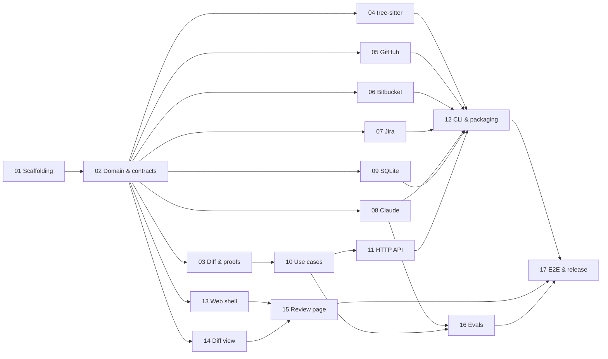

# Implementation plan: first slice

This plan builds the first slice described in [ARCHITECTURE.md](../../ARCHITECTURE.md#first-slice). It is split into stages, each in its own document, so different agents can pick them up in parallel.

The product docs stay the source of truth for *what* and *why*: [MISSION.md](../../MISSION.md), [DESIGN.md](../../DESIGN.md), [ARCHITECTURE.md](../../ARCHITECTURE.md), [ENGINEERING.md](../../ENGINEERING.md). Stage docs say *how*.

## Stages

| # | Stage | Depends on | Owns |
|---|---|---|---|
| 01 | [Scaffolding and tooling](01-scaffolding.md) | — | Root configs, CI, folder skeleton, `src/domain/shared/` |
| 02 | [Domain model, ports and contracts](02-domain-and-contracts.md) | 01 | `src/domain/review/`, `src/domain/diff/types.ts`, `src/domain/shared/hash.ts`, `src/application/ports/`, `src/application/testing/`, `contracts/` |
| 03 | [Diff parsing and mechanical proofs](03-diff-parsing-and-proofs.md) | 02 | `src/domain/diff/` (except S04's files) |
| 04 | [tree-sitter: formatting proofs and call-graph hints](04-tree-sitter.md) | 02 | `src/adapters/treesitter/`, `src/domain/diff/formatting.ts`, `src/domain/diff/call-graph.ts` |
| 05 | [GitHub adapter](05-github-adapter.md) | 02 | `src/adapters/github/` |
| 06 | [Bitbucket Cloud adapter](06-bitbucket-adapter.md) | 02 | `src/adapters/bitbucket/` |
| 07 | [Jira adapter](07-jira-adapter.md) | 02 | `src/adapters/jira/` |
| 08 | [Claude adapter: model passes](08-claude-adapter.md) | 02 | `src/adapters/claude/` |
| 09 | [SQLite store](09-sqlite-store.md) | 02 | `src/adapters/sqlite/` |
| 10 | [Use cases and pipeline](10-use-cases.md) | 02, 03 | `src/application/use-cases/`, `src/application/events/`, `src/domain/review/publication.ts` |
| 11 | [HTTP API](11-http-api.md) | 10 | `src/adapters/http/` |
| 12 | [CLI, composition root and packaging](12-cli-and-packaging.md) | 04–09, 11 | `src/cli/`, `scripts/`, `package.json` bin/files/build |
| 13 | [Web shell, API client and PR picker](13-web-shell.md) | 02 | `web/` (except S14 and S15 folders) |
| 14 | [Diff view component](14-diff-view.md) | 02 | `web/src/diff/` |
| 15 | [Review page and publishing](15-review-page.md) | 13, 14 | `web/src/pages/review/` |
| 16 | [Evals](16-evals.md) | 08, 10 | `evals/` |
| 17 | [End-to-end tests, dogfooding and release](17-e2e-and-release.md) | 12, 15, 16 | `e2e/`, `README.md`, release config |

### Waves

| Wave | Stages | Parallel agents |
|---|---|---|
| 1 | 01 | 1 |
| 2 | 02 | 1 |
| 3 | 03, 04, 05, 06, 07, 08, 09, 13, 14 | up to 9 |
| 4 | 10 (needs 03), 15 (needs 13, 14) | 2 |
| 5 | 11, 16 | 2 |
| 6 | 12 | 1 |
| 7 | 17 | 1 |

Stage 02 is the bottleneck on purpose: it fixes every type, port and API contract so wave 3 can run without agents waiting on each other. Keep it small and finish it fast.

## Second slice: review without the model

The first slice needs the model for almost everything on the review page: intent, risk classes, decisions and the tour. The second slice makes the model optional. With it off, the review page is built from deterministic code only, so the page is good enough to review with before any model call, and the model passes later improve what the page already shows instead of producing it.

The layout stays the guided tour. Without the model:

- **Risk** comes from rules that can only mark a hunk *contract*, never hide one.
- **The tour** follows the call graph from the entry point, with each test next to the code it tests.
- **Visual weight follows risk.** Contract hunks stand out with their reason shown inline, logic hunks look as they do now, and mechanical hunks shrink to one dimmed line with their proof.

| # | Stage | Depends on | Owns |
|---|---|---|---|
| 18 | [Rule-based risk](18-rule-based-risk.md) | — | `src/domain/review/risk-rules.ts` |
| 19 | [Tour from the call graph](19-code-tour.md) | 18 | `src/domain/review/code-tour.ts` |
| 20 | [Model passes optional](20-model-optional.md) | 18, 19 | `src/application/use-cases/run-pipeline.ts`, `src/cli/` |
| 21 | [Risk-weighted review page](21-risk-weighted-ui.md) | 18 | `web/src/diff/`, `web/src/pages/review/TourNav.tsx`, `MainArea.tsx` |
| 22 | [Navigation and review progress](22-navigation.md) | 19, 21 | `web/src/pages/review/` except stage 21's files |
| 23 | [Comments on hunks](23-hunk-comments.md) | 20 | `src/domain/review/publication.ts`, `web/src/pages/review/PublishDialog.tsx` |

Once stage 18 is done, stages 19 and 21 run in parallel; 21 works on the dev fixtures until 20 lands. Each of 18, 19 and 20 changes a stage 02 contract; that change goes in its own PR as described below.

## Third slice: code-first review page

The review page still opens on an intent panel and two sidebars, and shows one tour step at a time. This slice opens it on the code and moves the explaining into navigation: a risk map beside one scroll of code, or a call tree, chosen by a toggle. Its design is on the [Review page redesign](https://claude.ai/artifact/YQfPAHQvsmm59w47wNyceE) canvas.

| # | Stage | Depends on | Owns |
|---|---|---|---|
| 24 | [Code-first review page](24-code-first-review.md) | 22, 23 | `web/src/pages/review/`, `web/src/diff/`, `src/domain/diff/call-graph.ts` |

It's one stage because both layouts share the hunk cards, decisions and shortcuts it moves. The `CallGraphHint` change goes in its own PR first.

## Fourth slice: navigation by flows

Without the model, the tour's steps are whatever the call graph happens to connect, so their titles say nothing and one step can hold most of the PR. This slice makes each step a flow: an entry point (a route, a page, a command) and the changed code it runs. Later stages replace the call tree with an overview of how the changed files connect, and show a call chip only where it helps.

| # | Stage | Depends on | Owns |
|---|---|---|---|
| 25 | [Tour by flows](25-flows.md) | 24 | `src/domain/review/code-tour.ts`, `entry-points.ts`, `src/domain/diff/call-graph.ts`, step headings in `web/src/pages/review/` |

## How to pick up a stage

1. Check the stage doc's **Status** line. Only start a stage that says *Not started* and whose dependencies say *Done*.
2. Set **Status** to `In progress (branch stage/NN-slug)` in a first commit.
3. Work on branch `stage/NN-slug` from the latest `main`.
4. Read the stage doc's **Read first** list. [CLAUDE.md](../../CLAUDE.md) already loads the product docs.
5. Change only paths your stage **Owns**. The exceptions are `package.json` and `pnpm-lock.yaml` when you add a dependency (say why in the PR, per ENGINEERING.md §8). If you need a change elsewhere, see the next section.
6. Open a PR to `main`. You may split a stage into several PRs; each must pass CI.
7. When the last PR merges, set **Status** to `Done (PR links)` and fill **Notes for later stages** with anything that differs from this doc.

## Changing something you don't own

- **Contracts from stage 02** (domain types, ports, `contracts/`, fakes, contract test suites) are shared by everyone. Don't change them silently inside your stage. Open a separate small PR that changes only the contract and its fakes, describe the change and who's affected in the PR, and add a line to stage 02's **Change log**.
- **Anything else:** leave a note in your stage doc's **Notes for later stages** and, if it blocks you, stop and ask the user.
- **If a stage doc is wrong** (an API doesn't behave as described, a type doesn't fit), follow what's right and record the deviation in **Notes for later stages**. Docs describe intent; reality wins.

## Definition of done (every stage)

- `pnpm check` passes locally and in CI: typecheck, lint and format, dependency rules, tests, coverage thresholds.
- Every item in the stage's **Definition of done** is checked.
- The stage changed only paths it owns, plus contract PRs made as described above.
- New decisions that change DESIGN.md or ARCHITECTURE.md are written there in the same PR (ENGINEERING.md §10).
- The PR description states the intent, links the stage doc, and lists decisions made along the way.

## Credentials agents may not have

Some stages need real accounts to record fixtures or run live checks (GitHub, Bitbucket, Jira, Anthropic). If you don't have them:

- Build synthetic fixtures from the official API docs and mark them `synthetic` in the fixture file name.
- Leave the recorder script in place.
- Add an **Open issue** to the stage doc saying which fixtures still need recording.

Never commit tokens, and strip `Authorization` headers and personal data from recorded fixtures.
